# orgmcp — target architecture and migration plan

Status: **design (phase R0)**. Input to the refactor of the whole system. Nothing in `src/` or `tests/` changes in this phase.
Binding rules: `docs/refactor-principles.md` (decided by the project manager with the user; restated in section 1 as checkable rules).
Facts below were verified against the code at commit `01a6277` (main) by reading every module in `src/orgmcp/` and the tests;
`file:function` references are to that commit.

**Reading guide.** 1 goals and rules · 2 package map · 3 interfaces · 4 dependency graph · 5 mapping table (every
class, `Org` method and function → target) · 6 composition root · 7 test layout · 8 enforcement config · 9 migration plan
(steps, parallel groups) · 10 risks. Section 9 is what engineers pick steps from.

---

## 1. Goals and principles

**Goal (user, verbatim):** "refactor the whole system respecting TDD and SOLID principles. All classes should implement and
depend on interfaces" with "extreme organization, well separated responsibilities and extremely high cohesion and extremely
low coupling." **Pure refactor**: no feature, prompt, file-format, MCP tool, CLI or event-schema change.

### 1.1 What is wrong today (the problems the design removes)

| Problem | Evidence (commit `01a6277`) |
|---|---|
| God class | `core.Org`: 98 `def`s (97 without `__init__`) that mix addressing, mailbox I/O, trace stamping, budget, policy, hiring, file guard, run bookkeeping, prompt rendering. 65 of them are called from outside `core.py` (189 module-method uses, measured by AST over the receivers `org`, `self.org`, `binding.get()`, ...). |
| Concrete dependency everywhere | 12 of 19 modules import the concrete `Org` (`blueprint cli cli_obs dashboard_data health observe progress review scheduler server services upgrade`); `dashboard_data.LenientOrg(Org)` subclasses it to change caching. |
| Dependency cycle | one strongly connected component of 7 modules: `core health progress review scheduler services telemetry`. Without late imports there is no cycle; it exists because of 5 function-level imports: `core -> services`, `telemetry -> core`, `telemetry -> scheduler`, `progress -> scheduler`, `scheduler -> progress` (20 module pairs in total are linked only by late imports). |
| Private cross-module imports | 14 names imported by 6 modules: `health._aware/_stamp/_msg_time/_parse_time/_duration`, `core._visible`, `progress._human_items`. They are missing shared vocabulary. |
| Implicit file-format contracts | the run-log format (`# senders:`, `# exit N after Ns`, `# killed after`) is written by `scheduler` and parsed by `health._run_outcomes`, `observe._log_facts`, `dashboard_data._read_tail`; the `running.json`/`nudges.json`/`strays.json` ledgers are written by one module and read by three. |
| Global state | `telemetry._writers/_proc/_tl`, `core._PARSED`, `observe._META_CACHE`, `scheduler._children`; tests reset or monkeypatch them. |
| Tests couple to layout | ~80 `monkeypatch.setattr(<module>, <name>, ...)` calls on module attributes (`core.utcnow`, `core.atomic_write`, `core.Message.load`, `observe.scheduler_state`, `sched_mod.KIRO_AGENTS_DIR`, ...) and private-name access (`bpm._resolve` x29, `sched._check_waiting` x15, `sched._reap` x11, ...). |

### 1.2 The binding rules as checkable rules

Every rule has a *check* that runs in the default `pytest` run (details in section 8). "Package" = a directory
`src/orgmcp/<name>/`.

| # | Rule | Check |
|---|---|---|
| R1 | **Package by feature.** Each feature/entry package has `api.py` (the only public surface: `typing.Protocol` interfaces, data types, exceptions) and `__init__.py` re-exporting exactly `api.__all__`. | `test_architecture.py::test_init_reexports_exactly_api` |
| R2 | **Privacy.** Implementation modules are named `_*.py`. Nobody imports another package's `_` module; only `orgmcp.app` may (to construct classes). A package's own `tests/` may import its own `_` modules. | import-linter contracts `private-modules-<pkg>` (one per package, generated) |
| R3 | **Kernel is a leaf.** `orgmcp.kernel` imports nothing else from `orgmcp`. | import-linter `kernel-independent` |
| R4 | **Layers and DAG.** `app` -> entry points -> features (levels L11..L1) -> `kernel`; an upper level may import only lower levels; entry points do not import each other. This also proves the feature graph acyclic. | import-linter `layers` |
| R5 | **No feature imports the `Org` facade** (`orgmcp.core`, `orgmcp.app.facade`) or any legacy shim module. | import-linter `no-facade-import` |
| R6 | **D of SOLID.** Every class with behaviour subclasses at least one `Protocol` it implements (`class FsMailbox(MailboxReader, MailboxWriter)`), receives every collaborator through its constructor typed by a Protocol, constructs no collaborator from another package, and no module outside `app` has a module-level instance. Exempt: pure data (dataclasses/NamedTuples/enums with no collaborators), exceptions, Textual widgets/screens, `typing.Protocol` classes, and the `app` package. | `test_architecture.py::test_every_class_implements_a_protocol`, `::test_no_module_level_singletons` |
| R7 | **I of SOLID.** A Protocol has at most 8 public methods; consumers type each dependency with the narrowest Protocol they use (read vs mutate are separate). | `::test_protocols_are_small` (max 8) |
| R8 | **L of SOLID.** Every Protocol in an `api.py` has a contract suite, parametrized over every implementation including the in-memory fake. | `::test_every_protocol_has_a_contract_suite` (file `tests/test_contract_<snake_name>.py` exists and references each implementation registered in `<pkg>/testing.py::IMPLEMENTATIONS`) |
| R9 | **Single writer per file.** Each file or directory of an organization has exactly one owning package (section 2.3). | `::test_single_writer` (the owner table below is machine-readable; any other package mentioning the literal path fragment in a write context fails) |
| R10 | **Types.** `mypy==2.4.0 --strict` on every refactored package; no `Any` in `api.py` modules. | `::test_mypy_strict` |
| R11 | **TDD.** RED -> GREEN -> REFACTOR; one extraction = one commit; the suite is green after every step. | step done-checks (section 9) |
| R12 | **Behaviour freeze.** Byte-identical prompts, `ORG.md`, message files, kiro profiles, plan blocks, CLI output, MCP tool signatures/docstrings, event schema. | golden suite (safety-net track, referred to as GOLDEN below) must stay green; never regenerated in a refactor commit |
| R13 | **S of SOLID.** The one-sentence responsibility of a package (section 2.2) contains no "and". A class that needs one is split. | `::test_responsibilities_have_no_and` reads the sentences from `ARCHITECTURE.md` section 2.2 |

### 1.3 Decisions that interpret the principles (so nobody has to guess)

1. **Names of entry points.** `cli`, `scheduler`, `dashboard` keep their names; the MCP server package is `mcp_server`
   (`orgmcp.mcp` would be confused with the third-party `mcp`). The legacy module `server.py` becomes a shim.
2. **In-place conversion of legacy modules.** A module `health.py` and a package `health/` cannot coexist. During the
   strangler phase each legacy module is converted *in place* to a package of the same name whose `__init__.py` exports
   `api` plus the legacy names (`LEGACY_EXPORTS`), implemented by a private `_legacy.py` that shrinks to nothing. The
   architecture test allows `LEGACY_EXPORTS` only until step E3 (section 9) and then asserts it is empty; permanent
   exceptions are listed in 6.4/6.5 (`orgmcp.core`, which README documents, and `orgmcp.progress.progress`, which README documents; `orgmcp.server` is a
   decision for the manager, 10.3).
3. **`Message` stays a mutable dataclass** in the kernel. `Org.deliver(msg)` completes `msg.id/created/trace` in place and
   tests rely on that (`tests/dash_fixtures.py:262`, `tests/test_observe.py:617`). Freezing it is a post-refactor change.
4. **Fakes live next to the interface** in `<pkg>/testing.py` (in-memory implementation + builders). Production code never
   imports `testing.py` (contract `no-testing-in-production`).
5. **Process-scope vs org-scope objects.** The caches and writer pools that are module globals today
   (`telemetry._writers`, `core._PARSED`, `observe._META_CACHE`, `scheduler._children`, the thread-local trace tap) become
   *process resources* created once by `app.wiring.ProcessResources` and shared by every org runtime in the process (2.4, 6.3).
   This keeps one event file per process and day, and the 50 000-entry parse caches.
6. **Two clocks for the scheduler.** Today `Scheduler(clock=...)` only drives stall/review/heartbeat cadence while run
   timing uses `time.time()` (`scheduler.py:_start/_reap`). The new scheduler takes `run_clock` and `cadence_clock`
   (both `Clock`); the legacy `Scheduler(clock=f)` maps `f` to `cadence_clock` only, preserving behaviour.

---

## 2. Package map

### 2.1 Layout of every package

```
src/orgmcp/<pkg>/
  __init__.py      # from .api import *  (+ __all__ = api.__all__)
  api.py           # Protocols, data types, exceptions, pure public functions. Nothing else is public.
  _<impl>.py       # implementations (FsXxx, XxxPolicy, ...), private helpers; only app.wiring imports them
  testing.py       # in-memory fakes, builders, IMPLEMENTATIONS (list of factories the contract suites iterate over)
  tests/           # colocated tests: test_contract_<protocol>.py, test_<impl>.py, golden/characterization tests moved here
```

`kernel/` follows the same layout (its `api.py` re-exports the vocabulary modules `_address _errors _message _frontmatter
_text _timeutil _paths _ports`; its file adapters are in `_system.py`).

### 2.2 The package map

42 packages: `kernel`, 36 feature packages, 4 entry points, `app`. "Allowed dependencies" is the complete list of
packages a package may import (always through their `api`); it is the source of the import-linter `layers` contract. `L<n>` is the
level in the dependency DAG (4.1).

| # | Package | Kind | One-sentence responsibility | Owns on disk (single writer) | Reads, does not own | Allowed dependencies |
|---|---|---|---|---|---|---|
| 1 | `kernel` | kernel | Defines the smallest shared vocabulary: addresses, messages, errors, time, text, primitive ports. | nothing of its own; its file adapters write `<any>.tmp-*` temp files and `.runtime/<ledger>.json` on behalf of the owners listed in 2.3 | - | none |
| 2 | `agents` (L1) | feature | Is the on-disk registry of agents: existence, charters, memory. | `<addr>/AGENT.md`, the agent directory skeleton (`inbox/ inflight/ read/ sent/ work/ runs/`, empty `MEMORY.md` at creation), `.retired/` | `<addr>/MEMORY.md` | kernel |
| 3 | `eventlog` (L1) | feature | Reads events from the on-disk event log, whose format it defines. | - | `.runtime/events/**` | kernel |
| 4 | `locator` (L1) | feature | Finds the organization root a process should work on. | - | `$ORG_ROOT`, working directory (read through `Environment`), `ORG.md` presence | kernel |
| 5 | `processes` (L1) | feature | Wraps the operating system's process table behind ports. | - | process table (`ps`, signals) | kernel |
| 6 | `runs` (L1) | feature | Keeps the durable record of agent runs (logs, in-flight registry). | `<addr>/runs/*.log`, `.runtime/running.json` | - | kernel |
| 7 | `settings` (L1) | feature | Owns ORG.md: its settings block, its rules text. | `ORG.md` (only writer: `FsOrgSettings`) | - | kernel |
| 8 | `skill` (L1) | feature | Installs the assistant skill file into a kiro skills directory. | `~/.kiro/skills/orgmcp/SKILL.md` | packaged `SKILL.md` | kernel |
| 9 | `snapshots` (L1) | feature | Snapshots the organization directory in git. | `.git/`, `.gitignore` | - | kernel |
| 10 | `templates` (L1) | feature | Renders the fixed prose the runtime writes into messages, ORG.md, charters. | - | - | kernel |
| 11 | `access` (L2) | feature | Knows what each agent was granted: workspace, inputs, tools, model. | - | `<addr>/AGENT.md` (through `agents`) | kernel, agents, settings |
| 12 | `bootstrap` (L2) | feature | Brings a new organization directory into existence. | the initial skeleton: `ORG.md` (through `settings`), root boxes, `.runtime/`, `.gitignore` and `.git` (through `snapshots`) | - | kernel, settings, snapshots, templates |
| 13 | `mail` (L2) | feature | Persists messages in per-agent mailboxes (inbox, inflight, read, sent). | `<addr>/{inbox,inflight,read,sent}/*.md` (root: `<root>/{inbox,...}`) | - | kernel, agents |
| 14 | `telemetry` (L2) | feature | Appends what the runtime does to the event log as structured events. | `.runtime/events/<day>/<proc>-<pid>-<ms>.jsonl` (one writer per file: the emitting process); deletes expired day directories | `ORG.md` (the `events` switch, through `settings`) | kernel, eventlog, settings, snapshots |
| 15 | `upgrade` (L2) | feature | Brings an organization's ORG.md rules up to the current template. | - (rewrites `ORG.md` through `settings`) | - | kernel, settings, snapshots, templates |
| 16 | `kiro` (L3) | feature | Adapts the organization to the kiro-cli agent runtime (profiles, path confinement, run command). | `~/.kiro/agents/orgmcp-<slug>-<hash>[-tools][-x<hash>].json` | - | kernel, agents, settings, access |
| 17 | `orgfiles` (L3) | feature | Guards every file an agent reads or writes inside the organization. | agent-authored files: `<addr>/MEMORY.md` (after creation), `<addr>/work/**`, any other path the guard allows an agent; routes charter rewrites to `agents` | any file inside the org root | kernel, agents, settings, access |
| 18 | `strays` (L3) | feature | Tracks org files that an agent's built-in write left in its workspace until the agent has been told. | `.runtime/strays.json` | agent workspaces (stat only) | kernel, agents, access |
| 19 | `traces` (L3) | feature | Decides which request trace a message belongs to. | - | mailboxes (through `mail`) | kernel, mail |
| 20 | `delivery` (L4) | feature | Delivers a message through the one complete-then-store pipeline. | - (stores through `mail`) | - | kernel, mail, traces |
| 21 | `budget` (L5) | feature | Accounts for run budget: held, handed down, taken back. | - (budget is derived; reclaim is a message) | mailboxes, run logs (through `mail`, `runs`) | kernel, agents, runs, settings, mail, delivery |
| 22 | `dispatch` (L6) | feature | Applies the protocol rules to every message an agent or the human sends. | - (acts through `delivery`) | artifact files (stat and word count) | kernel, agents, settings, templates, access, mail, delivery, budget |
| 23 | `eligibility` (L6) | feature | Tracks whether an agent may run (paused, failing, pending, idle). | `<addr>/.paused`, `.runtime/failures.json` | mailboxes (through `mail`) | kernel, agents, mail, budget |
| 24 | `hierarchy` (L6) | feature | Applies the rules that change the agent tree's membership. | - (acts through `agents`, `delivery`) | - | kernel, agents, settings, templates, access, mail, delivery, budget |
| 25 | `health` (L7) | feature | Measures the health of agents, branches, from the files. | - | - | kernel, agents, runs, settings, mail, budget, eligibility |
| 26 | `services` (L7) | feature | Manages standing services: contract, playbook, request, feedback. | `<owner>/services/<name>/{SERVICE.md,PLAYBOOK.md,history/*}`, `<owner>/services/.retired/**` | - | kernel, agents, settings, mail, delivery, dispatch |
| 27 | `stalls` (L7) | feature | Climbs the escalation ladder for tasks whose assignee has gone quiet. | `.runtime/nudges.json` | - | kernel, agents, runs, settings, templates, mail, delivery, eligibility |
| 28 | `attention` (L8) | feature | Determines what remains to be done, by whom. | - | - | kernel, agents, mail, budget, eligibility, stalls |
| 29 | `blueprint` (L8) | feature | Turns a blueprint into an organization via a validated plan. | workspace directories it creates for a plan (`WorkspaceProvisioner`) | `roles/*.md` (packaged), user blueprint files | kernel, agents, settings, snapshots, kiro, dispatch, hierarchy, services |
| 30 | `overview` (L8) | feature | Renders the organization tree with one state line per agent. | - | - | kernel, agents, mail, budget, eligibility, services |
| 31 | `reflection` (L8) | feature | Derives the history of service requests, with statistics, from the files. | - | - | kernel, agents, runs, settings, mail, services |
| 32 | `review` (L8) | feature | Turns flagged health into notes for the responsible managers on a schedule. | `.runtime/reviews.json` | - | kernel, agents, runs, settings, templates, mail, delivery, budget, eligibility, health |
| 33 | `daemon` (L9) | feature | Manages the organization's scheduler process (start, stop, status). | `.runtime/scheduler.pid`, `.runtime/scheduler.exit`, `.runtime/scheduler.log` | process table (through `processes`) | kernel, processes, snapshots, mail, attention |
| 34 | `prompts` (L9) | feature | Builds the texts an agent is shown (whoami, state summary, run prompt). | - (consumes the one-time stray notice through `strays`) | - | kernel, agents, settings, access, mail, strays, budget, eligibility, services, reflection |
| 35 | `observability` (L10) | feature | Answers what the runtime did (now, trace, metrics, events, check) from the files alone. | - | all of the above, read-only | kernel, agents, eventlog, processes, runs, settings, mail, budget, eligibility, attention, daemon |
| 36 | `progress` (L10) | feature | Reports on the tasks the human gave, optionally waiting for a change. | - | - | kernel, agents, runs, mail, budget, eligibility, attention, reflection, daemon |
| 37 | `dashdata` (L11) | feature | Builds UI-free, cached snapshots of the organization for display. | - | - | kernel, agents, eventlog, runs, settings, access, mail, budget, eligibility, health, services, attention, reflection, daemon, observability, progress |
| 38 | `scheduler` (L10) | entry | Runs the heartbeat loop that executes agent runs. | - (all writes go through feature interfaces) | - | kernel, agents, processes, runs, settings, snapshots, templates, access, mail, telemetry, kiro, strays, delivery, budget, eligibility, stalls, attention, review, daemon, prompts |
| 39 | `mcp_server` (L11) | entry | Serves the organization's tools over MCP for one identity. | - | - | kernel, agents, locator, settings, access, bootstrap, mail, telemetry, orgfiles, traces, budget, dispatch, hierarchy, health, services, attention, blueprint, overview, reflection, daemon, prompts, observability, progress |
| 40 | `cli` (L12) | entry | Parses command lines, invokes features. | - | - | kernel, agents, locator, settings, skill, snapshots, bootstrap, mail, telemetry, upgrade, kiro, dispatch, eligibility, hierarchy, health, services, blueprint, overview, reflection, review, daemon, observability, progress, dashdata |
| 41 | `dashboard` (L12) | entry | Renders the terminal dashboard as a Textual user interface. | - | - | kernel, dashdata |
| 42 | `app` | app | Is the composition root: assembles every object graph. | - | - | everything (the only importer of `_` modules) |

### 2.3 On-disk ownership (single writer per file)

Machine-readable: `tests/architecture/ownership.py` holds exactly this table; `test_single_writer` fails when a package
other than the owner contains the path literal in a write call (`write_text`, `atomic write`, `open(..., "w"/"a")`,
`os.replace`, `shutil.move`, `mkdir`, `unlink`).

| Path (relative to the org root unless `~`) | Owner (only writer) | Others may |
|---|---|---|
| `ORG.md` | `settings` (`FsOrgSettings`); `bootstrap` and `upgrade` write through `OrgDocumentStore` | read through `OrgSettings` |
| `.git/`, `.gitignore` | `snapshots` (`GitOrgSnapshotter`, `FsIgnoreList`); `telemetry` and `daemon` ask `IgnoreList.ensure` | - |
| `<addr>/{inbox,inflight,read,sent}/*.md`, root's own boxes | `mail` (`FsMailbox` creates, `FsBatchStore` moves) | read through `MailboxReader`, `MessageIndex` |
| `<addr>/AGENT.md`, agent directory skeleton, `.retired/**` | `agents` (`FsAgentRegistry`): `create`, `rewrite_charter`, `archive` | read through `CharterReader`, `RetiredArchive` |
| `<addr>/MEMORY.md` (after creation), `<addr>/work/**` | `orgfiles` (the agent's `write` tool) | read through `CharterReader.memory`, `OrgFileReader` |
| `<addr>/runs/*.log` | `runs` (`FsRunLogWriter.create/open_sink/append_note`) | read through `RunLogReader` |
| `<addr>/.paused` | `eligibility` (`FsPauseStore`) | read through `PauseStore.paused` |
| `<owner>/services/**` | `services` (`FsServiceStore`) | read through `ServiceCatalog` |
| `.runtime/failures.json` | `eligibility` (`LedgerFailureCounter`) | - |
| `.runtime/running.json` | `runs` (`FsRunRegistry`); written by the scheduler through `RunRegistry` | read through `RunRegistry.all` |
| `.runtime/nudges.json` | `stalls` (`LedgerNudgeLedger`) | read through `NudgeLedger.entries` (`attention`) |
| `.runtime/strays.json` | `strays` (`LedgerStrayRegistry`) | - |
| `.runtime/reviews.json` | `review` (`LedgerHealthReviewer`) | - |
| `.runtime/scheduler.pid` | `daemon` (`PidFileSchedulerLock`, written by the scheduler process) | read through `SchedulerStatus` |
| `.runtime/scheduler.exit`, `.runtime/scheduler.log` | `daemon` (`FileExitMarker`, `DetachedSchedulerControl`) | read through `ExitMarker.read`, `SchedulerStatus.exit_reason` |
| `.runtime/events/<day>/*.jsonl` | `telemetry` (`FsEventSink` of the emitting process; `FsEventRetention` deletes expired days) | read through `EventReader` |
| workspace directories created for a plan | `blueprint` (`FsWorkspaceProvisioner`) | - |
| `~/.kiro/agents/orgmcp-*.json` | `kiro` (`FsProfileStore`) | - |
| `~/.kiro/skills/orgmcp/SKILL.md` | `skill` (`FsSkillStore`) | - |

**Creator exceptions** (directories and empty files, never content), listed in `ownership.py` so the test knows them: `agents` creates the agent
skeleton (`inbox/ inflight/ read/ sent/ work/ runs/`, empty `MEMORY.md`) at `create`, and `bootstrap` creates the root's four boxes and `.runtime/` at `init`; after
creation the owner in the table is the only writer of content.

Ledger names (`kernel.LedgerStore`) are a closed registry: `failures` -> `eligibility`, `running` -> `runs`,
`nudges` -> `stalls`, `strays` -> `strays`, `reviews` -> `review`. `test_single_writer` also asserts each ledger name literal
appears in exactly one package.

### 2.4 Process-scope resources (module globals today)

| Today | Becomes | Created by |
|---|---|---|
| `telemetry._writers`, `_proc`, `_lock`, `_dropped` | `EventWriterPool` + `ProcessLabel` instance inside `telemetry` | `ProcessResources.event_pool`, `.process_label` |
| `telemetry._tl` (thread-local trace collector) | `ThreadLocalTraceScope` (is both `TraceTap` and `TraceScope`) | `ProcessResources.trace_scope` |
| `core._PARSED` (50 000-entry LRU of parsed messages) | `CachingMessageParser` instance | `ProcessResources.message_parser` |
| `observe._META_CACHE` (50 000 entries) | `StampCachedMetaReader` inside `mail` (`FsMessageIndex`) | `ProcessResources.meta_cache` |
| `scheduler._children` (zombie reaping of schedulers this process started) | `ChildRegistry` inside `daemon` | `ProcessResources.children` |

`ProcessResources.reset()` replaces the autouse `telemetry.reset()` fixture. An `OrgRuntime` (6.2) is created per
organization root and refers to the process resources; two `Org(root)` objects in one process share them, exactly as the
module globals do now.


---

## 3. Interfaces

Conventions: every block is the future `<pkg>/api.py` (imports abbreviated). `Protocol` = interface; **ISP split**: read/query and
mutating roles are separate Protocols. "Impl" lists the implementations that will exist: **real** (filesystem/OS), **fake**
(in-memory, in `<pkg>/testing.py`, passes the same contract suite), or decorators. Signatures keep today's parameter names and
defaults so the facade delegates one-to-one. All Protocols are `@runtime_checkable`. **Fake policy.** I/O Protocols (the 42 listed in 4.5) have a real implementation and an in-memory fake in `testing.py` that pass one contract suite.
Role interfaces over derived logic (policies, queries, renderers) have one real implementation; their unit tests run it against fakes of the I/O Protocols it
depends on, and `testing.py` adds a trivial stub (`RecordingDelivery`, `FixedBudget`, `FakeSchedulerStatus`, ...) where a consumer's test wants to dictate the answer.
Common imports for all blocks:

```python
from __future__ import annotations
from datetime import datetime
from pathlib import Path
from typing import Callable, Collection, ContextManager, Iterator, Mapping, NamedTuple, Protocol, Sequence
from dataclasses import dataclass
from orgmcp.kernel import JsonObject, Message, OrgError
```

### 3.1 `kernel`

Data and pure vocabulary (not Protocols): `ROOT="root"`, `RUNTIME="runtime"`, `BOXES`, `RUNTIME_NAMES`, `RESERVED`, `NAME_RE`,
`MESSAGE_TYPES`, `RESULT_STATUSES`, `RENDER_BODY_CHARS`, `JsonObject = dict[str, object]`, `Provider[T] = Callable[[], T]`;
`class OrgError(ValueError)`; address helpers `norm parent depth child_addr`; `split_frontmatter join_frontmatter flow_text`;
`word_count clip clip_line single`; time helpers `aware parse_time stamp_of msg_time fmt_duration fmt_dur`; `inside visible`;
`latest_results`; `@dataclass class Message` (fields as today; `meta() to_text() render(limit) cut_body(limit, where)` and the
new pure `Message.parse(text, path=None)`; **no file I/O**); `@dataclass(frozen=True) class OrgPaths(root)` with pure path
arithmetic `agent_dir(addr) box(addr, box) runtime_dir() ledger_file(name) events_dir() retired_dir() rel(path)` (value
object, exempt from R6).

```python
class Clock(Protocol):
    def now(self) -> datetime: """Aware UTC wall-clock time."""
    def time(self) -> float: """Epoch seconds."""
    def monotonic(self) -> float: """Monotonic seconds for waits and TTLs."""
    def sleep(self, seconds: float) -> None: """Block."""

class IdGenerator(Protocol):
    def message_id(self, sender: str) -> str:
        """'<UTC %Y%m%dT%H%M%S%f>-<sender, / as .>-<4 hex>'; lexicographic order is creation order."""

class EventSink(Protocol):
    def emit(self, kind: str, /, *, actor: str | None = None, run: str | None = None, trace: str | None = None,
             proc: str | None = None, **fields: object) -> None:
        """Append one event to the org's event log. Never raises."""

class TraceTap(Protocol):
    def note(self, trace: str | None) -> None: """Tell the running tool call which trace a delivered message carries."""

class AtomicWriter(Protocol):
    def write(self, path: Path, text: str) -> None: """Write via temp file + rename, creating parent directories."""

class LedgerStore(Protocol):
    def read(self, name: str) -> JsonObject: """`.runtime/<name>.json`; {} when missing or unparsable."""
    def write(self, name: str, data: JsonObject) -> None: """Atomically replace the ledger."""

class Environment(Protocol):
    def get(self, name: str) -> str | None: """An environment variable."""
    def cwd(self) -> Path: """Working directory."""
    def home(self) -> Path: """The user's home directory."""
    def variables(self) -> Mapping[str, str]: """A copy of the environment for child processes."""
```
Impl: `SystemClock`, `TimestampIdGenerator(Clock)`, `FsAtomicWriter`, `FsLedgerStore(OrgPaths, AtomicWriter)`, `OsEnvironment`;
fakes in `kernel/testing.py`: `FakeClock` (time moves only when told, +1 microsecond per `now()` like `obs_fixtures.Clock`),
`SequenceIdGenerator`, `ListEventSink`, `FailingAtomicWriter`, `MemoryLedgerStore`, `DictEnvironment`, `RecordingTraceTap`.

### 3.2 `templates`

```python
class DocumentTemplates(Protocol):
    def org_rules(self, mission: str | None) -> str: """The ORG.md body: mission + the rules text."""
    def charter_body(self, role: str, charter: str) -> str: """The AGENT.md body (exactly one H1)."""
    def task_body(self, goal: str, acceptance: str, inputs: Sequence[str]) -> str: """Body of a task message."""
    def result_body(self, summary: str, artifacts: Sequence[str], lessons: str = "") -> str: """Body of a result message."""

class Notices(Protocol):
    def budget(self, agent: str, unread: int) -> str: """Out-of-budget notice to the parent."""
    def budget_returned(self, agent: str, amount: int, retired_by: str, reason: str) -> str: """Refund note."""
    def failures(self, agent: str, count: int, log: str, to_human: bool = True) -> str: """'keeps failing' notice."""
    def nudge(self, task_id: str, title: str) -> str: """Stall reminder to the assignee."""
    def stalled(self, agent: str, task_id: str, title: str, told: Sequence[str]) -> str: """Stall escalation."""
    def review_item(self, addr: str, flag: str, reason: str, act: bool = True, branch: str | None = None) -> str: """One health item."""
    def review_manager(self, manager: str, items: Sequence[str]) -> str: """Health-review note to a manager."""
    def review_root(self, summary: str, items: Sequence[str], skipped: Mapping[str, str]) -> str: """Health-review note to root."""
```
Impl: `StaticDocumentTemplates`, `StaticNotices` (wrap the current pure functions; text moves verbatim). Fake: none needed (the
real implementations are pure); `testing.py` offers `RecordingNotices` for consumers' unit tests. Contract: output equals GOLDEN text.

### 3.3 `settings`

Data/pure: `DEFAULT_MODEL`, `DEFAULT_CONFIG`, `config_default_model(config) -> str`, `config_number(config, key, kind=float)`.

```python
class OrgSettings(Protocol):
    def config(self) -> JsonObject: """ORG.md frontmatter merged over DEFAULT_CONFIG."""
    def rules(self) -> str: """ORG.md body, stripped."""
    def default_model(self) -> str: """config default_model, else DEFAULT_MODEL (also for null)."""
    def number(self, key: str, kind: type = float) -> float: """A numeric setting; malformed or missing -> the default."""
    def message_cap(self) -> int: """max_message_chars; malformed or <= 0 -> the default."""

class OrgDocumentStore(Protocol):
    def exists(self) -> bool: """ORG.md exists."""
    def read_raw(self) -> str: """The file exactly as written."""
    def write_raw(self, text: str) -> None: """Atomically replace the file."""

class EventSwitch(Protocol):
    def enabled(self) -> bool: """False when ORG.md is missing or events: false; re-read only when ORG.md changes (stat stamp)."""
```
Impl: `FsOrgSettings(OrgSettings, OrgDocumentStore)`, `CachingOrgSettings(OrgSettings)` (decorator, stamp cache; replaces
`LenientOrg.config`), `StampedEventSwitch(EventSwitch)`; fakes `MemoryOrgSettings`.

### 3.4 `locator`

```python
class OrgLocator(Protocol):
    def find_root(self, start: Path | None = None) -> Path:
        """$ORG_ROOT, else the nearest dir with ORG.md at or above start, else start/org; OrgError if none."""
```
Impl: `EnvOrgLocator(Environment)`; fake: `FixedOrgLocator`.

### 3.5 `snapshots`

```python
class OrgSnapshotter(Protocol):
    def init_repository(self) -> None: """git init (when git exists and none is there)."""
    def commit(self, message: str) -> None: """add -A + commit when the org is a repo; no-op otherwise; never raises."""

class IgnoreList(Protocol):
    def write_initial(self, lines: Sequence[str]) -> None: """Create .gitignore with these lines."""
    def ensure(self, lines: Sequence[str]) -> None: """Append the lines that are missing (whole-line match)."""
    def ensure_runtime_files(self) -> None: """running.json, scheduler.log, scheduler.exit, events/ (today's ignore_runtime_files)."""

class GitClient(Protocol):   # port to the outside world
    def available(self) -> bool: """git is on PATH."""
    def has_repository(self, root: Path) -> bool: """root/.git exists."""
    def init(self, root: Path) -> None: """git init -q."""
    def commit_all(self, root: Path, message: str) -> None: """add -A, commit -q as orgmcp <orgmcp@localhost>."""
```
Impl: `GitOrgSnapshotter(GitClient)`, `FsIgnoreList(OrgPaths, AtomicWriter)`, `SubprocessGit(GitClient)`; fakes `RecordingGit`, `MemoryIgnoreList`.

### 3.6 `eventlog`

Data/constants: `EVENTS_REL`, `SCHEMA_VERSION`, `LINE_MAX`, `ENVELOPE`, `PROCS`, `DAY_RE`; `@dataclass(frozen=True) EventFile(path, day, proc, pid, stem)`.

```python
class EventReader(Protocol):
    def files(self, since: datetime | None = None, until: datetime | None = None) -> list[EventFile]: """Day directories first, then files."""
    def read_file(self, file: EventFile) -> Iterator[tuple[datetime, JsonObject]]: """Tolerates a partial last line."""
    def timed(self, since: datetime | None = None, until: datetime | None = None) -> Iterator[tuple[datetime, JsonObject]]: """Merged by ts."""
    def events(self, since: datetime | None = None, until: datetime | None = None) -> Iterator[JsonObject]: """Merged stream."""
    def tail(self, file: EventFile, nbytes: int = 65536) -> list[JsonObject]: """Last complete events of a file."""
    def head(self, file: EventFile) -> JsonObject | None: """First event of a file."""

class EventFollower(Protocol):
    def poll(self, emit: bool = True, now: datetime | None = None) -> list[JsonObject]: """New complete lines of today's and yesterday's files."""

class EventFollowers(Protocol):
    def follow(self, match: Callable[[JsonObject], bool] | None = None, now: datetime | None = None) -> EventFollower: """Start tailing."""
```
Impl: `FsEventReader(OrgPaths)`, `FsEventFollowers(OrgPaths)`; fakes `MemoryEventLog` (also what `obs_fixtures` builds by hand).
The reader never imports the writer (spec: "the query layer must never import the emitting module").

### 3.7 `telemetry`

```python
class EventSinks(Protocol):
    def for_root(self, root: Path) -> EventSink: """A sink bound to one org root (cli needs it for `init`)."""
    def dropped(self) -> int: """Events this process could not write."""

class ProcessLabel(Protocol):
    def get(self) -> str: """scheduler, mcp or cli."""
    def set(self, name: str) -> None: """Name this process for the `proc` field and the file name (unknown -> cli)."""

class EventRetention(Protocol):
    def prune(self, keep_days: int, today: datetime | None = None) -> list[str]: """Delete day dirs older than keep_days (>= 1); never raises."""

class ArgumentSummarizer(Protocol):
    def summarize(self, arguments: Mapping[str, object]) -> JsonObject: """Ids, names, lengths; never bodies."""

class TraceScope(Protocol):
    def collect(self) -> ContextManager[list[str | None]]: """Collect traces delivered in this thread while the block runs."""
```
Impl: `FsEventSinks(EventSinks)` creating `FsEventSink(EventSink)` over the shared `EventWriterPool`; `MutableProcessLabel`; `FsEventRetention`;
`JsonArgumentSummarizer`; `ThreadLocalTraceScope(TraceScope, TraceTap)`. Fakes: kernel's `ListEventSink`, `MemoryProcessLabel`.
Emission contract suite (the three below must hold for the fake and the real sink): never raises; envelope fields; file per process and day.

### 3.8 `processes`

```python
@dataclass(frozen=True)
class ProcessInfo: state: str; started: str          # ps state, ps lstart (LC_ALL=C TZ=UTC)

class ProcessHandle(Protocol):
    @property
    def pid(self) -> int: ...
    @property
    def returncode(self) -> int | None: ...
    def poll(self) -> int | None: """Exit code or None while running."""
    def wait(self, timeout: float | None = None) -> int: """Block until exit."""
    def signal_group(self, sig: int) -> None: """Signal the process group; fall back to the process; ignore gone/denied."""

class ProcessSpawner(Protocol):
    def spawn(self, argv: Sequence[str], *, cwd: Path, env: Mapping[str, str], stdin: object | None, stdout: object | None) -> ProcessHandle:
        """Start in its own session (pgid == pid), stderr merged into stdout."""
    def spawn_detached(self, argv: Sequence[str], *, cwd: Path, env: Mapping[str, str], log: Path) -> ProcessHandle:
        """Detached scheduler: stdin devnull, output appended to log, own session."""

class ProcessInspector(Protocol):
    def info(self, pid: int) -> ProcessInfo | None: """None: no such process. Raises ProcessTableError if ps cannot run."""
    def command_line(self, pid: int) -> str | None: """`ps -o command=`."""
    def start_time(self, pid: int) -> str | None: """lstart or None."""
    def is_session_leader(self, pgid: int) -> bool | None: """pgid and sid equal pgid; None if undecidable."""
    def is_alive(self, pid: int) -> bool: """kill(pid, 0) semantics (EPERM = alive)."""
    def own_ids(self) -> tuple[int, int]: """(pid, pgid) of this process."""

class ProcessSignaller(Protocol):
    def kill_group(self, pgid: int, wait: float = 5.0) -> bool: """SIGKILL the group; True when its leader is gone."""
    def terminate(self, pid: int) -> None: """SIGTERM; raises ProcessGone / ProcessDenied."""

class OrphanJudge(Protocol):
    def judge(self, record: Mapping[str, object]) -> str: """'gone', 'foreign', 'ours' or 'doubt' (rules of today's judge_orphan)."""
```
Exceptions in `api`: `ProcessTableError` (ps cannot run), `ProcessGone`, `ProcessDenied`.
Impl: `PopenProcessSpawner`, `PopenHandle`, `PsProcessInspector`, `OsProcessSignaller`, `PsOrphanJudge(ProcessInspector)`.
Fakes: `FakeProcessTable` (one object implementing spawner, inspector, signaller; scripted exits) used by all scheduler/daemon unit tests.
Real-process contract tests (a real child in its own session) exist once, in `processes/tests/`.

### 3.9 `agents`

```python
class AgentDirectory(Protocol):
    def exists(self, addr: str) -> bool: """root is always true; otherwise valid name parts and <addr>/AGENT.md is a file."""
    def require(self, addr: str) -> str: """Normalized address or OrgError 'no such agent'."""
    def children(self, addr: str) -> list[str]: """Direct reports, sorted."""
    def agents(self) -> list[str]: """Every agent except root, parents before children."""
    def subtree(self, addr: str) -> list[str]: """addr and everything below."""

class CharterReader(Protocol):
    def charter(self, addr: str) -> tuple[dict[str, object], str]: """(frontmatter, stripped body); root has a fixed one."""
    def memory(self, addr: str) -> str: """MEMORY.md or ''."""

class AgentRegistry(Protocol):
    def create(self, addr: str, meta: Mapping[str, object], charter_text: str) -> None: """Directory skeleton, empty MEMORY.md, AGENT.md."""
    def rewrite_charter(self, addr: str, text: str) -> None: """Replace AGENT.md (callers did all authority checks)."""
    def archive(self, addr: str, stamp: str) -> str: """Move to .retired/<addr with . for />-<stamp>; returns that name."""

@dataclass(frozen=True)
class RetiredTree: name: str; top_level: bool; path: Path

class RetiredArchive(Protocol):
    def trees(self) -> list[RetiredTree]: """Every retired tree; top_level = it was a direct report of root."""
    def run_count(self) -> int: """Run logs inside retired trees (today's review.retired_runs)."""
    def unspent_budget(self, tree: RetiredTree) -> int: """received - sent - runs of every agent dir inside the tree."""
```
Impl: `FsAgentDirectory`, `FsCharterReader`, `FsAgentRegistry(AtomicWriter)`, `FsRetiredArchive`; fake `MemoryAgents`
(implements all four). `dashdata`'s wiring adds the decorators `CachingAgentDirectory` and `LenientCharterReader` (replace `LenientOrg.children/charter`).

### 3.10 `mail`

```python
@dataclass(frozen=True)
class MessageFile: path: Path; owner: str; box: str; meta: JsonObject | None; error: str | None; id: str; mtime: float

class MessageParser(Protocol):
    def parse(self, path: Path) -> Message: """Parse a message file; cached by (path, mtime_ns, size), 50 000 entries, LRU."""

class MailboxReader(Protocol):
    def messages(self, addr: str, *boxes: str) -> list[Message]: """Sorted by id."""
    def received(self, addr: str) -> list[Message]: """inbox + inflight + read."""
    def sent(self, addr: str) -> list[Message]: """sent/."""
    def find_received(self, addr: str, msg_id: str) -> Message | None: """By id among received."""
    def find_anywhere(self, addr: str, msg_id: str) -> Message | None: """By file name in the four boxes (no scan); None if absent or unparsable."""
    def unread(self, addr: str) -> int: """Waking messages in the inbox (wake: false are held; unreadable files count)."""
    def has_inflight(self, addr: str) -> bool: """A batch is in flight (= a run is going)."""

class MailboxWriter(Protocol):
    def store(self, msg: Message) -> None:
        """Sender's sent/ copy FIRST (skipped for the runtime), then the recipient's inbox/ copy; each atomic."""

class BatchStore(Protocol):
    def begin(self, addr: str) -> list[Message]: """inbox -> inflight; returns the whole inflight batch."""
    def end(self, addr: str, ok: bool) -> None: """inflight -> read (ok) or back to inbox; no-op for a vanished agent."""
    def recover(self) -> list[str]: """Return every inflight batch to its inbox, redeliver orphans; agents recovered."""
    def redeliver_orphans(self) -> list[str]: """Sent messages whose recipient has no copy are delivered; ids."""

class TaskQuery(Protocol):
    def open_tasks(self, addr: str) -> list[Message]: """Received tasks with no result sent."""
    def outstanding(self, addr: str) -> list[Message]: """Sent tasks with no result received."""
    def blocked_tasks(self, addr: str) -> list[Message]: """Received tasks whose latest result is blocked."""

class MailFingerprint(Protocol):
    def fingerprint(self, addr: str) -> tuple[frozenset[str], frozenset[str]]: """(received file names, sent file names): cheap cache key."""

class MessageIndex(Protocol):
    def scan(self) -> list[MessageFile]: """Every message file of root and the live agents, front matter parsed once (mtime cache)."""
```
Impl: `FsMailbox(MailboxReader, MailboxWriter, MailFingerprint)`, `FsBatchStore`, `DerivedTaskQuery(MailboxReader)`,
`FsMessageIndex`, `CachingMessageParser`; dashboard decorator `DirMtimeCachingMailbox(MailboxReader)` (replaces
`LenientOrg._box/messages/unread/running`, lenient: unparsable files are skipped and listed in `bad`). Fakes: `MemoryMailbox`
(implements Reader, Writer, BatchStore, Fingerprint, Index), `CountingMessageParser`.

### 3.11 `runs`

Pure: `run_id_of(addr, log) -> '<agent>@<stem>'`. Data: `RunWindow(start, end)`, `RunOutcomes(failed, runtime_only)` (frozensets of run start datetimes),
`RunLogFile(stem, path, start)`. The run-log text format (header `# run of`, `# senders:`, `# cwd`, `# cmd`, `# ---- prompt ----`, `# ---- output ----`, footer
`# exit N after Ns`, `# killed after`, `# failed to start`, `# interrupted by scheduler shutdown`) is defined once in `runs._format` and used by writer and reader.

```python
class RunLogSink(Protocol):
    @property
    def path(self) -> Path: ...
    def write(self, text: str) -> None: """Append."""
    def flush(self) -> None: ...
    def close(self) -> None: ...

class RunLogWriter(Protocol):
    def create(self, addr: str) -> Path: """Create <addr>/runs/<UTC stamp>.log (touch); its existence consumes one run of budget."""
    def open_sink(self, path: Path) -> RunLogSink: """Open for append."""
    def append_note(self, rel_path: str, text: str) -> None: """Append '# <text>' to an old log; silent on failure."""

class RunLogReader(Protocol):
    def count(self, addr: str) -> int: """Visible *.log files (= runs used)."""
    def files(self, addr: str) -> list[RunLogFile]: """Oldest first."""
    def windows(self, addr: str) -> list[RunWindow]: """(start = file name, end = mtime)."""
    def outcomes(self, addr: str) -> RunOutcomes: """Failed runs and runs whose whole batch came from the runtime (reads head/tail only)."""
    def last_end(self, addr: str) -> float: """Latest log mtime (epoch), 0.0 if none."""
    def facts(self, path: Path) -> JsonObject: """exit code, seconds, senders, killed/failed marks (today's observe._log_facts)."""
    def tail(self, path: Path, max_bytes: int, max_lines: int) -> tuple[str, bool]: """Text of the end of a log, and whether it was cut."""

class RunRegistry(Protocol):
    def all(self) -> dict[str, JsonObject]: """agent -> {pgid, lstart, started, scheduler, log}; malformed entries dropped."""
    def record(self, addr: str, record: JsonObject) -> None: ...
    def forget(self, *addrs: str) -> None: ...
    def replace(self, records: Mapping[str, JsonObject]) -> None: ...
```
Impl: `FsRunLogWriter(OrgPaths, Clock)`, `FileRunLogSink`, `FsRunLogReader(OrgPaths)`, `FsRunRegistry(LedgerStore)`; dashboard decorator `CachingRunLogReader` (mtime-cached `count`, replaces `LenientOrg.runs_used`); fakes `MemoryRuns`.

### 3.12 `eligibility`

```python
class PauseStore(Protocol):
    def paused(self, addr: str) -> str | None: """Reason, or None when not paused ('paused' if the flag file is empty)."""
    def pause(self, addr: str, reason: str, by: str | None = None) -> None: """Write .paused, emit agent.pause."""
    def resume(self, addr: str, reason: str = "", by: str | None = None) -> None: """Remove it; emit agent.resume only if it was paused."""

class FailureCounter(Protocol):
    def record(self, addr: str) -> int: """One more consecutive failure; returns the count."""
    def clear(self, addr: str) -> None: ...
    def repair(self) -> bool: """Drop malformed entries; True if the ledger changed."""

class AgentStates(Protocol):
    def state(self, addr: str) -> str: """'running', 'paused(<reason>)', 'pending' or 'idle'."""

class RunnableQuery(Protocol):
    def runnable(self, exclude: Collection[str] = ()) -> list[str]: """Agents with waking mail and budget, not paused (a budget pause with budget back counts), not excluded."""
    def startable(self, addr: str) -> bool: """Waking mail, budget > 0, paused for nothing or only for budget."""
```
Impl: `FsPauseStore(OrgLayout, EventSink)`, `LedgerFailureCounter(LedgerStore, LedgerShape)`, `DerivedAgentStates(MailboxReader, PauseStore)`,
`DerivedRunnableQuery(AgentDirectory, MailboxReader, PauseStore, BudgetQuery)`; dashboard decorator `CachingPauseStore(PauseStore, DirectoryProbe)`
(replaces `LenientOrg.paused`, built by `wire_eligibility.lenient`, which also rebuilds the states and the runnable query over the decorated flags); fakes
`MemoryPauseStore`, `MemoryFailureCounter`; `EligibilityWorld` is the harness of the `AgentStates` / `RunnableQuery` suites (budgets from
`budget.testing.FixedBudget`). `DirectoryProbe` (`mtime(addr, name) -> int`) and `LedgerShape` (`damaged(name) -> bool`) are eligibility's own narrow ports.
`LedgerStore.read` shows a ledger that holds JSON which is not an object as `{}`, so `FailureCounter.repair` asks `LedgerShape` whether the file is damaged
and keeps rewriting it (and the scheduler keeps saying so) as before. `RunnableQuery.runnable(exclude)` takes what the scheduler used to read from its own
state (`runs`, `_blocked`): whether an agent already runs is the caller's to say.

### 3.13 `strays`

```python
class StrayProbe(Protocol):
    def probe(self, addr: str) -> dict[str, float]: """mtimes of <workspace>/<address> and its MEMORY.md; {} without built-in write or workspace."""
    def found_since(self, before: Mapping[str, float], after: Mapping[str, float]) -> list[str]: """New paths, or a MEMORY.md written during the run."""

class StrayRegistry(Protocol):
    def record(self, addr: str, paths: Sequence[str]) -> None: """Remember up to 10 paths unless this agent was already told."""
    def take_notice(self, addr: str) -> str: """The one-time prompt notice; '' if none or already told; marks it told."""
```
Impl: `WorkspaceStrayProbe(AccessScopes, CharterReader)`, `LedgerStrayRegistry(LedgerStore, ToolNaming)`. The notice text names the write tool, so `strays` also depends on `access.ToolNaming`. Fakes `MemoryStrays`.

### 3.14 `traces`

```python
class TraceLookup(Protocol):
    def trace_of(self, addr: str, msg_id: str | None) -> str | None: """Trace stamped on a message in addr's own boxes."""
    def open_task_traces(self, addr: str) -> list[str | None]: """Traces of unfinished received tasks (none, or blocked)."""
    def context_trace(self, addr: str) -> tuple[str | None, str, list[str]]: """(trace, rule, candidates): rule 'open-task', 'batch' or 'ambiguous'."""

class TraceStamper(Protocol):
    def stamp(self, msg: Message) -> tuple[str, list[str]]: """Set msg.trace by the first matching rule: given, new, link, open-task, batch, ambiguous."""
```
Impl: `MailboxTraceLookup(MailboxReader, AgentDirectory)`, `RuleTraceStamper(TraceLookup)`; fake: none (pure over a `MemoryMailbox`).

### 3.15 `delivery`

```python
class MessageDelivery(Protocol):
    def deliver(self, msg: Message) -> Message:
        """Order (golden-tested): id, created, trace stamp (failure -> rule 'error'), store (sent copy then inbox copy), note_trace, emit msg.deliver."""
    def notify(self, to: str, title: str, body: str, wake: bool = True, trace: str | None = None) -> Message: """A note from the runtime."""
```
Impl: `PipelineMessageDelivery(MailboxWriter, TraceStamper, Clock, IdGenerator, EventSink, TraceTap)`; fake `RecordingDelivery` (collects messages; used by every policy test).

### 3.16 `access`

```python
class AccessScopes(Protocol):
    def workspace_of(self, addr: str) -> Path | None: """Resolved charter workspace, or None."""
    def inputs_of(self, addr: str) -> list[Path]: """Resolved charter inputs."""
    def readable_roots(self, addr: str) -> list[Path]: """Inputs + workspaces of the whole subtree."""
    def unconfined_read(self, meta: Mapping[str, object]) -> bool: """Legacy charter: no workspace and no `inputs` key."""

class AuthorityPolicy(Protocol):
    def check_authority(self, actor: str, tools: Sequence[str], workspace: str | None, inputs: Sequence[str] | None = None) -> None:
        """Authority only narrows down the tree; OrgError otherwise."""
    def check_inputs(self, inputs: object) -> list[str]: """Absolute paths outside the org directory."""

class ToolNaming(Protocol):
    def tool_names(self, addr: str) -> dict[str, str]: """read/write -> 'org_read'/'org_write' when the charter holds the built-in of that name."""

class ModelResolver(Protocol):
    def default_model(self) -> str: """Org default model."""
    def model_for(self, addr: str) -> str: """charter model > org default_model > DEFAULT_MODEL."""
```
Impl: `CharterAccessScopes`, `CharterAuthorityPolicy`, `CharterToolNaming`, `CharterModelResolver`; fake `StaticAccess`.

### 3.17 `orgfiles`

```python
class OrgFileStore(Protocol):   # port: the files below the org root as the guard sees them
    def resolve(self, path: Path) -> Path: """Absolute, symlinks resolved."""
    def kind(self, path: Path) -> FileKind: """'dir', 'file' or 'missing' (a Literal)."""
    def entries(self, path: Path) -> list[str]: """Directory entry names including hidden ones; [] if missing."""
    def read_text(self, path: Path, errors: str = "strict") -> str: """UTF-8; errors='replace' is how `read` shows a file."""
    def modified(self, path: Path) -> datetime: ...
    def write_text(self, path: Path, text: str) -> None: """Atomic."""

class OrgFileReader(Protocol):
    def resolve_read(self, path: str, actor: str | None = None) -> Path: """Inside the org, or (agents) workspace/inputs/team workspaces."""
    def read(self, path: str, actor: str | None = None) -> str: """Header line with words/lines/mtime, or a directory listing; 100 000 chars max."""

class OrgFileWriter(Protocol):
    def resolve_write(self, actor: str, path: str) -> Path: """Only inside the actor's directory; every protected-name rule."""
    def write(self, actor: str, path: str, content: str, append: bool = False) -> Path: ...
    def write_noted(self, actor: str, path: str, content: str, append: bool = False) -> tuple[Path, str]:
        """write + the note for a charter rewrite (kept/changed keys)."""
```
Impl: `FsOrgFileStore(OrgPaths, AtomicWriter)`, `GuardedOrgFileReader`, `GuardedOrgFileWriter` (collaborators: `AgentDirectory`, `CharterReader`, `AgentRegistry`, `AccessScopes`, `AuthorityPolicy`, `OrgSettings`, `OrgFileStore`; private `PathGuard`, `CharterMerger`
hold `_fold/_case_twin` and `charter_change_note`); fake `MemoryOrgFileStore` (symlink cases are FS-only tests).

### 3.18 `budget`

```python
class BudgetQuery(Protocol):
    def budget(self, addr: str) -> int | None: """received - sent - runs; None = unlimited (root)."""
    def delegable(self, addr: str) -> tuple[int, int, int]: """(budget, outstanding delegations, most that one more delegation can hand down)."""
    def grant_hint(self, addr: str) -> str: """What a report can do with its budget now ('' if it cannot hire)."""

class AllocationPolicy(Protocol):
    def check_allocation(self, actor: str, amount: int, new_delegation: bool) -> None: """Keep one run per outstanding delegation in reserve; OrgError otherwise."""
    def default_budget(self, actor: str) -> int: """min(default_budget, remaining - reserve); OrgError when < 1."""
    def budget_to_return(self, actor: str, task: Message, status: str) -> int: """Runs that travel up with a final result."""

class BudgetReclaimer(Protocol):
    def reclaim(self, actor: str, report: str, budget: int | None = None) -> Message: """Pull unspent budget back from an idle direct report."""
```
Impl: `DerivedBudgetQuery(MailboxReader, RunCounter, AgentDirectory, CharterReader, TaskQuery)`, `ReserveAllocationPolicy(BudgetQuery, TaskQuery,
MailboxReader, OrgSettings)`, `NoteBudgetReclaimer(MessageDelivery, BudgetQuery, TaskQuery, MailboxReader, AgentDirectory)`; fakes `FixedBudget`
(numbers a test sets; `MovingDelivery` moves them with the messages delivered through it) and `BudgetWorld`, the harness of the contract suites.
`RunCounter` (`count(addr) -> int`) is budget's own, narrower port for the one thing it needs of `RunLogReader` (any `RunLogReader` is one); the
dashboard's `LenientOrg` hands its per-refresh cache of the run count through it (`wire_budget.lenient`). The arithmetic and the words of
`delegable` / `grant_hint` are the pure functions of `budget/_hint.py`, shared by `DerivedBudgetQuery` and `FixedBudget`.

### 3.19 `hierarchy`

```python
class Retired(NamedTuple): addr: str; refunded: int; refunded_to: str | None

class Hiring(Protocol):
    def hire(self, actor: str, name: str, role: str, charter: str, *, model: str | None = None, tools: Sequence[str] | None = None,
             can_hire: bool = False, max_children: int = 5, workspace: str | None = None, inputs: Sequence[str] | None = None) -> str:
        """Create a direct report; returns its address. Emits agent.hire."""

class Retirement(Protocol):
    def retire(self, actor: str, name: str, reason: str) -> str: """retire_team(...).addr."""
    def retire_team(self, actor: str, name: str, reason: str) -> Retired: """Fail the team's open tasks upward, refund unspent budget to the parent, archive, emit agent.retire."""
```
Impl: `RuleHiring(AgentDirectory, CharterReader, AgentRegistry, AgentSlots, OrgSettings, DocumentTemplates, AccessScopes, AuthorityPolicy, ModelResolver,
Clock, EventSink)`, `RuleRetirement(AgentDirectory, AgentRegistry, TaskQuery, BudgetQuery, MessageDelivery, Notices, Clock, EventSink)`; `Retired` is defined in
`hierarchy/api.py` (the facade mixin and `orgmcp.core` re-export it). `AgentSlots` (`occupied(addr) -> bool`; `FsAgentSlots(OrgLayout)`) is hierarchy's own,
narrower port for the one thing `hire` needs that `AgentDirectory.exists` does not say: something is at the place of the agent (a directory without
`AGENT.md`, a stray file) and hiring there would collide ("`<addr>` already exists" as it always was). It is built by `wire_hierarchy`, not a runtime field.
Test support: `HierarchyWorld` over disk (`fs_world`) and over memory (`memory_world`) with a `FixedBudget`; no run logs are needed, so hierarchy does not depend
on `runs`.

### 3.20 `dispatch`

```python
class MessageSender(Protocol):
    def send(self, actor: str, to: str, body: str, *, type: str = "note", title: str = "", reply_to: str | None = None,
             status: str | None = None, budget: int = 0, revises: str | None = None, supersedes: str | None = None,
             service: str | None = None, contract: int | None = None, playbook: int | None = None,
             feedback: str | None = None, wake: bool = True, skip_route_check: bool = False) -> Message:
        """Validate (cap, route, budget, hops) then deliver. The facade maps skip_route_check to today's _skip_route_check."""

class TaskAssigner(Protocol):
    def delegate(self, actor: str, to: str, title: str, goal: str, acceptance: str, inputs: Sequence[str] | None = None,
                 budget: int | None = None, revises: str | None = None) -> Message: """Assign a task to a direct report."""

class TaskReporter(Protocol):
    def report(self, actor: str, task_id: str, status: str, summary: str, artifacts: Sequence[str] | None = None,
               lessons: str | None = None) -> Message: """Answer a task; returns the result message (budget travels with a final result)."""

class ReworkContext(Protocol):   # port, implemented by `services`
    def fields_for(self, actor: str, revises: str) -> Mapping[str, object]: """service/contract/playbook a rework inherits ({} for an ordinary task)."""
```
Impl: `RuleMessageSender`, `RuleTaskAssigner` (consumes a `MessageSender` and a `ReworkContext`), `RuleTaskReporter` (consumes a `MessageSender`); private collaborators (in `_protocols.py`, made by `wire_dispatch`, not runtime fields): `RoutePolicy` -> `ParentSiblingRoutePolicy`, `HopCounter` -> `InflightHopCounter`, `ArtifactNormalizer` -> `ArtifactAnnotator`, `LessonsCheck` -> `LessonsPolicy`.
Fakes: `RecordingSender`, `NoReworkContext`, `FixedReworkContext`. `ReworkContext` is provided by `wire_services` (`ServiceReworkContext`, step C-services); `wire_dispatch` has no provider of it (two providers of one port are refused), but its `RuleTaskAssigner` takes it from the runtime.

### 3.21 `services`

Data: `Contract`, `Playbook` (as today; `inputs` is a `list[JsonObject]`, `deliverable` a `JsonObject`), constants `INPUT_RE VERDICTS DESCRIPTION_MAX REASON_MAX FEEDBACK_MAX DELIVERABLE_KEYS FEEDBACK_HEADER`.

```python
class ServiceStore(Protocol):   # port: the files of one owner's services
    def names(self, owner: str) -> list[str]: """Directories with a SERVICE.md."""
    def read_contract(self, owner: str, name: str) -> tuple[JsonObject, str] | None: """(frontmatter, body) of SERVICE.md."""
    def read_playbook(self, owner: str, name: str) -> tuple[JsonObject, str] | None: ...
    def write_contract(self, owner: str, name: str, meta: JsonObject, body: str, archive_version: int | None) -> str: """Archive the old one as history/SERVICE.v<n>.md; returns the relative path."""
    def write_playbook(self, owner: str, name: str, version: int, meta: JsonObject, body: str, archive_version: int | None = None) -> str: """Archive the old one as history/PLAYBOOK.v<n>.md when archive_version is given; returns the relative path."""
    def retire(self, owner: str, name: str, stamp: str) -> str: """Move to services/.retired/<name>-<stamp>."""
    def playbook_history(self, owner: str, name: str) -> list[tuple[int, JsonObject]]: ...

class ServiceCatalog(Protocol):
    def service_names(self, addr: str) -> list[str]: """Non-retired services addr offers (root offers none)."""
    def read_contract(self, owner: str, name: str) -> Contract | None: ...
    def read_playbook(self, owner: str, name: str) -> Playbook: """Version 0 when none."""
    def owned_services(self, owner: str) -> list[Contract]: ...
    def requestable_services(self, actor: str) -> list[Contract]: """Services of actor's direct reports."""

class ServiceCommands(Protocol):
    def define_service(self, actor: str, owner: str, name: str, *, description: str | None = None, inputs: object = None,
                       acceptance: object = None, deliverable: Mapping[str, object] | None = None, budget: int | None = None,
                       playbook: str | None = None, locked: bool | None = None, notes: str | None = None,
                       add_acceptance: object = None, remove_acceptance: object = None) -> str: """Define or amend."""
    def retire_service(self, actor: str, owner: str, name: str, reason: str) -> str: ...
    def request(self, actor: str, service: str, inputs: Mapping[str, object] | None, *, title: str = "", note: str = "",
                extra_acceptance: Sequence[str] | None = None, budget: int | None = None, revises: str | None = None) -> Message: ...
    def revise_playbook(self, actor: str, service: str, content: str, reason: str) -> int: """New version."""
    def feedback(self, actor: str, task_id: str, verdict: str, note: str = "") -> Message: ...

class ServiceHints(Protocol):
    def report_hint(self, actor: str, task: Message, status: str) -> str: """Text the report tool appends for a final result on a service request."""
    def feedback_text(self, msg: Message) -> str: """The client's own words in a feedback note."""

class ContractNormalizer(Protocol):
    def parse_input_spec(self, spec: str) -> JsonObject: """'name*:description' -> input dict."""
    def inputs(self, value: object) -> list[JsonObject]: ...
    def deliverable(self, value: object) -> JsonObject: ...
```
Impl: `FsServiceStore`, `ContractServiceCatalog`, `RuleServiceCommands`, `ServiceReportHints`, `TextContractNormalizer`, `ServiceReworkContext(ReworkContext)`; fake `MemoryServiceStore`.
`RuleServiceCommands` only offers the five commands together; each rule is a part with its own private Protocol (in `_protocols.py`, made by `wire_services`, not runtime fields): `ContractDefinitions` -> `RuleContractDefiner`, `ServiceRetirement` -> `RuleServiceRetirement`, `PlaybookRevisions` -> `RulePlaybookReviser`, `ServiceRequests` -> `RuleServiceRequester`, `ClientFeedback` -> `RuleClientFeedback`. Their collaborators, also private: `ServicePlaces` -> `OrgServicePlaces` (where the files are; `Contract.path` and the relative paths in the texts come from it), `OwnerAddresses` -> `DirectReportOwners`, `PlaybookTexts` -> `CappedPlaybookTexts` (the cap is read from `OrgSettings.config()["playbook_max_words"]` exactly as the old `_word_cap` did: `OrgSettings.number` would read a bool as the default and an infinity as a crash), `PlaybookWriter` -> `EventedPlaybookWriter` (writes through the store and emits `service.revise`), `ContractAmendment` -> `ContractAmender`, `RequestBodies` -> `TextRequestBodies`. `ServiceStore.write_contract` / `write_playbook` write the file, `archive_version` names the old version to keep; the events (`service.define`, `service.revise`, `service.retire`) and the quiet notes (`MessageDelivery.notify(..., wake=False)`) are the commands'. Requests and feedback go through the runtime's `MessageSender`.
The part of the old `services.py` that is derived from the message files (cases, statistics, digest, `services_text`, `case_total`, the prompt sections) was the seam in `services/_legacy.py` until C-reflection; it is `reflection` now (3.22). `services._clip` is left as an alias of `kernel.clip_line` for `kernel/tests/test_text.py`, which compares the three copies; it goes with that test in E3. `services.api` also exports the pure `playbook_word_cap(config)` (C-reflection), so that the sections of the run prompt read the setting exactly as the commands do.

### 3.22 `reflection`

Data: `Case Verdict Stats` (as today; `Stats` subclasses the pure port `StatsReport`: `finished`, `avg_runs`, `line()`). Pure public functions in `api.py` (no collaborators): `summarize(items) -> Stats`, `stats_by_version(items) -> dict[int, Stats]`, `version_at(timeline, when) -> int`, `lessons_of(result) -> str`.

```python
class CaseHistory(Protocol):
    def cases(self, owner: str, service: str) -> list[Case]: """Requests + their rework chains, derived from messages and run logs."""
    def case_of(self, task: Message) -> Case | None: ...
    def playbook_timeline(self, owner: str, service: str) -> list[tuple[int, datetime]]: ...

class ReflectionDigest(Protocol):
    def reflection_digest(self, owner: str, service: str) -> str | None: """The cases with new evidence, max 6 cases / 3000 chars."""

class ServiceReports(Protocol):
    def services_text(self, actor: str) -> str: """The `services` tool/CLI output."""
    def case_total(self, task: Message) -> str: """'case total: N runs used of M handed down (contract: K per request)...'."""

class ServicePromptSections(Protocol):
    def prompt_sections(self, addr: str, batch: Sequence[Message]) -> str: """Playbook + reflect sections of an owner's run prompt ('' if it owns no service)."""
```
Impl: `DerivedCaseHistory`, `DigestBuilder`, `TextServiceReports`, `OwnerPromptSections`; runtime fields `case_history`, `reflection_digest`, `service_reports`, `service_prompt_sections`. `StatsReport` is `testing.PURE` and `NOT_A_FIELD`.

The collaborators among the rules are private ports of the package (`_ports.py`, consumer-owned and narrower than the providers': `ServiceStore` is read only through `PlaybookHistory`, `RunLogReader` only through `RunLogNames`, `OrgSettings` only through `ConfigSource`, `ServiceHints` only through `FeedbackWords`, `OrgLayout` through `ServicePaths`), made by `wire_reflection` and not runtime fields: `PlaybookTimelines` -> `StorePlaybookTimelines` (when each version was written), `RunCounter` -> `LogRunCounter` (the old `_count_runs`: the logs of a team whose name, cut at 21 characters, lies in a window; it reads `RunLogReader.files`, not `windows`, because the old rule compares names, also for logs whose name is no timestamp), `ServicePaths` -> `OrgServicePaths` (relative paths in the texts), `ServicesListing` -> `OwnedServicesListing` (the opening paragraph), `RejectedServices` -> `MailRejectedServices`, `PlaybookSection` -> `QuotedPlaybookSection`, `ReflectSection` -> `EvidenceReflectSection`. `DerivedCaseHistory` takes six collaborators and `OwnerPromptSections` seven (the catalog, the digest, the task query and the four parts it composes); no class of the package takes more.

The legacy functions (`reflection/_legacy.py`: `cases(org, owner, service)`, `reflection_digest`, `case_of`, `case_total`, `services_text`, `prompt_sections`, `playbook_timeline`, and the private `_case_line`, `_verdict_chain`) build the classes over the ports of the `Org` they are given *at the call* (`_assembly`), so that the dashboard's lenient `Org` keeps its cached, tolerant mailboxes, agents and config. The callers (`progress`, `dashboard_data`, `server`, `cli`, the run prompt of the prompts mixin) call them, or the runtime ports, directly. `services` answers to the old names (`services.cases`, ...) through a module `__getattr__` that looks them up in `reflection` at the first use (the tests, among them the golden suite, still say them; `services` sits below `reflection` and may not import it): it goes with the legacy names in E3.

### 3.23 `overview`

```python
class OrgTree(Protocol):
    def tree(self) -> str: """root line + one indented line per agent (role, state, budget, open, delegated, unread, services)."""
```
Impl: `TextOrgTree` (7 collaborators: `AgentDirectory`, `CharterReader`, `MailboxReader`, `TaskQuery`, `BudgetQuery`, `AgentStates` and `ServiceNames`, the one question - `service_names` - it asks of
`services.ServiceCatalog`, defined in the package's own `_ports.py`). Runtime field: `org_tree`. The tree prints no model: the line is `<name> [<role>] <state>  budget=.. open=.. delegated=.. unread=..`
(`status` is golden). `Org._agent_line` and `Org._indent` are the prompts' (5 maps them to `prompts`), not the tree's: they stay in `PromptsMixin` until C-prompts. The fakes are `testing.FixedStates`,
`testing.NamedServices` and `testing.FixedOrgTree` (the text a test of `cli` / `mcp_server` puts in); `testing.disk_world` / `memory_world` run the contract suite.

### 3.24 `prompts`

```python
class StateSummarizer(Protocol):
    def state_summary(self, addr: str, shown: Collection[str] | None = None) -> str: """The agent's situation; `shown` = task ids already printed in the batch."""
class Whoami(Protocol):
    def whoami(self, addr: str) -> str: """State summary + '## Charter'."""
class RunPromptBuilder(Protocol):
    def run_prompt(self, addr: str, batch: Sequence[Message]) -> str: """The complete prompt (byte-identical to today)."""
```
Impl: `TextStateSummarizer`, `TextWhoami`, `TextRunPromptBuilder`. Runtime fields `state_summarizer`, `agent_whoami` (not `whoami`: a verb of the facade) and `run_prompt_builder`.

The texts are composed of small roles (private ports in `_ports.py`, consumer-owned; `_assembly.py` is the one place that puts them together, called by `wire_prompts` and by `testing`; none is a runtime field, the facade makes the one a legacy private method asks for over the ports of the runtime): `TaskQuoter` -> `LiteralQuoter` (`_quote`), `AgentLines` -> `StatusAgentLine` (`_agent_line`), `FilesLines` -> `FilesGuide` (`_files_lines`, with the `org_read`/`org_write` wording and the shadowing lines), `UpstreamTasks` -> `SoleUpstreamTask` (`_upstream`), `ContextRenderer` -> `BatchRenderer` (`_render_in_context`: a result followed by the task it answers, verbatim, then the link to the task it serves in its three variants), `HeldTaskLines` -> `HeldTasks` and `DelegationLines` -> `OutstandingDelegations` (the open / blocked / outstanding blocks of the state summary, headings included), `MemoryText` -> `CappedMemory` (the memory and the notice over the cap), `Briefing` -> `PromptBriefing` (rules, charter and memory), `RunNotices` -> `RuntimeNotices` (the stray notice, taken once, and `ServicePromptSections` for a service owner), `ServiceNames` (the one question - `service_names` - it asks of `services.ServiceCatalog`); `indent` is a pure function (`_text.py`). `TextStateSummarizer` takes seven collaborators and `TextRunPromptBuilder` six; no class of the package takes more. The fakes are `testing.FixedStateSummary`, `FixedWhoami`, `FixedRunPrompt` (the text a test of `cli` / `mcp_server` / `scheduler` puts in) and one `Fixed*` per role, `FixedStates`, `NamedServices`, `FixedSections`, `ToldOnce`; `testing.disk_world` / `memory_world` run the contract suites. Two small differences from the old body, neither visible in a text: the rules are read together with the charter and the memory (before the messages are rendered, not after), and an unreadable ORG.md therefore fails before the stray notice is taken, not after.

### 3.25 `health`

Data: `AgentHealth BranchHealth OrgHealth`, `HEALTH_DEFAULTS`, `FLAGS`.

```python
class HealthReport(Protocol):  # what OrgHealth can do besides holding numbers (it subclasses it: no allow-list entry)
    @property
    def flagged(self) -> list[AgentHealth]: ...
    def to_dict(self) -> JsonObject: """JSON-able structure, datetimes as ISO strings, plus 'flagged' (the addresses)."""
class HealthThresholds(Protocol):
    def thresholds(self) -> dict[str, float]: """HEALTH_DEFAULTS merged with ORG.md health:, non-numbers fall back."""
class HealthAnalyzer(Protocol):
    def agent_health(self, addr: str, now: datetime | None = None, limits: Mapping[str, float] | None = None) -> AgentHealth: ...
    def org_health(self, root: str = "root", now: datetime | None = None) -> OrgHealth: ...
class HealthRenderer(Protocol):
    def render_text(self, health: OrgHealth) -> str: ...
```
Impl: `SettingsHealthThresholds`, `FileHealthAnalyzer`, `TextHealthRenderer`; private `MailClientRework` (`_client_rework`, `_holds_client_rework`), `CharterHireDates`
(`_since_hired`), `branch_totals` (the roll-up). They consume four ports the package owns (`_ports.py`, narrower than the providers'): `RunCount` (`RunLogReader.count`, or the
dashboard's cached count), `ConfigSource` (`OrgSettings.config`, or the dashboard's lenient `Org.config`), `ClientRework`, `HireDates`/`CharterStamp`. `HealthRenderer` and
`HealthReport` are pure (`testing.PURE`); the fakes are `testing.FixedHealthAnalyzer` (the health a test puts in, with the real guards and branch totals - for `review` and `dashdata`)
and the memory `HealthWorld`. Runtime fields: `health_thresholds`, `health_analyzer`, `health_renderer`. The legacy functions (`health/_legacy.py`) build the analyzer over the
ports of the `Org` they are given *at the call* (`_assembly.analyzer_of`), so that the dashboard's lenient `Org` keeps its tolerant mailboxes, config and run count.

### 3.26 `review`

Data: `Note`, `Review` (it subclasses `ReviewReport`, so it is no allow-list entry).

```python
class ReviewReport(Protocol):  # what a Review can show of itself (pure; Review subclasses it)
    def render(self, dry_run: bool = False) -> str: """What was (or, for a dry run, would be) sent to whom."""
class HealthReviewer(Protocol):
    def review(self, now: datetime | None = None, dry_run: bool = False) -> Review: ...
    def review_if_due(self, now: datetime) -> Review | None: """Due by review_every_runs or review_every_seconds; the first call starts the clock."""
    def total_runs(self) -> int: """Runs ever used, retired agents included."""
    def read_ledger(self) -> JsonObject | None: ...
```
Impl: `LedgerHealthReviewer`, composed (7 collaborators) of six small private role classes behind the package's own narrow ports (`_ports.py`): `ReviewPlanner`
(`HealthReviewPlanner`: who is told what, from the health report and the previous ledger; asks `HealthAnalyzer`, `Notices`, `ReserveCheck` and `RunTotal`),
`ReviewLedger` (`StoreReviewLedger`: `.runtime/reviews.json` over `kernel.LedgerStore`, read as a `LedgerRecord`), `RunTotal` (`ArchivedRunTotal`: run logs of the
agents + `RetiredArchive.run_count`), `ReviewCadence` (`LedgerReviewCadence`: due by `review_every_runs` / `review_every_seconds`, starts the clock, rebases a shrunk
counter), `ReserveCheck` (`BudgetReserveCheck`: paused / no budget / reserved for outstanding delegations) and `NoteOutbox` (`DeliveryNoteOutbox`: one non-quiet
`MessageDelivery.notify` per note). `ReviewReport` is pure (`testing.PURE`); the fakes are the memory `ReviewWorld` (the reviewer over `FixedHealthAnalyzer`,
`FixedBudget` and the in-memory mailboxes, runs, pause flags, settings and ledger; the same suite runs over disk) and `testing.ScriptedHealthReviewer` (the reviews a
test puts in and the calls made, for `scheduler` and `cli`). Runtime field: `health_reviewer`. The legacy functions (`review/_legacy.py`) ask
`org.runtime.health_reviewer` at the call.

### 3.27 `stalls`

```python
class StallLadder(Protocol):
    def check(self) -> list[str]: """One pass of the ladder (remind, tell assigner, then ancestors); returns operator lines."""
class NudgeLedger(Protocol):
    def entries(self) -> dict[str, dict[str, float]]: """task id -> {step, at}; legacy 'nudged'/'escalated' accepted; malformed dropped."""
    def chain(self, addr: str, task: Message) -> list[str]: """Who hears about a stalled task: assignee, assigner, ancestors up to root."""
```
Impl: `EscalationStallLadder(Clock)`, `LedgerNudgeLedger`; the `_task_view` memo keyed by `MailFingerprint` lives in the ladder instance.

### 3.28 `attention`

Data: `@dataclass(frozen=True) Waiting(text, options, settled=True)`.

```python
class WaitingOnUser(Protocol):
    def analyze(self, *, running: Collection[str] | None = None, blocked: Collection[str] = (), can_start: bool = True) -> Waiting | None:
        """Is every open root task unable to progress without the user? Read-only."""
class HumanQueue(Protocol):
    def items(self) -> list[tuple[str, str]]: """(message id, one-line reason) of root's unread items that wait for a decision."""
    def lines(self) -> list[str]: """'Needs you: ...' lines."""
class OpenWork(Protocol):
    def nothing_to_do(self) -> bool: """Root has no open task and no agent could start."""
```
Impl: `RootTaskWaitingOnUser(TaskQuery, AgentDirectory, MailboxReader, PauseStore, BudgetQuery, RunnableQuery, NudgeLedger)`, `InboxHumanQueue(MailboxReader)`,
`RunnableOpenWork(TaskQuery, RunnableQuery)`; private `_text` (`section`, `summary`, `short`: the line of a message, copied from `progress` whose own
copies stay until C-progress). `OpenWork` does not look at runs in flight (a fresh scheduler has none); `WaitingOnUser`'s default `running` is the agents
with a batch in flight. `testing.py`: `AttentionWorld` (the real budgets and runnable query over disk and over memory; `eligibility.testing.runnable_over`
builds the query over a consumer's own ports), `FixedWaiting`, `ListHumanQueue`, `FixedOpenWork`. The legacy functions (`scheduler.waiting_on_user`,
`nothing_to_do`, `progress._human_items`) build the objects over the ports of the runtime in force (`wire_attention.*_of`), since tests and the dashboard's
lenient `Org` replace parts of `org.runtime`.

### 3.29 `daemon`

Data: `SchedulerState(state, pid, since, detail)` NamedTuple; constants `EXIT_FILE`, `FINISHED`.

```python
class SchedulerStatus(Protocol):
    def state(self) -> SchedulerState: """stopped, running (verified to be this org's), unverified."""
    def describe(self) -> str: """'scheduler: running (pid, since)' / 'stopped (reason)' / 'unknown ...'."""
    def exit_reason(self) -> str: """Why the last scheduler exited by itself, while still true; else ''."""
class SchedulerControl(Protocol):
    def start(self, max_runs: int | None = None, until_done: bool = False) -> int: """Launch detached; returns pid."""
    def stop(self, wait: float = 15.0) -> str: """SIGTERM the verified scheduler."""
class SchedulerLock(Protocol):
    def acquire(self) -> None: """Refuse if another live scheduler holds the pidfile; write ours."""
    def release(self) -> None: ...
class ExitMarker(Protocol):
    def write(self, reason: str) -> None: ...
    def clear(self) -> None: ...
    def read(self) -> str: ...
class SchedulerCommand(Protocol):
    def argv(self, max_runs: int | None, until_done: bool) -> list[str]: """`<venv orgmcp> --root <org> run [--max-runs N] [--until-done]`."""
```
Impl: `PidFileSchedulerStatus(OrgLayout, ProcessInspector, SchedulerRecognizer, Children, ExitMarker, TaskQuery, WaitingOnUser)`, `DetachedSchedulerControl(SchedulerLauncher, SchedulerStopper)`,
`PidFileSchedulerLock(OrgLayout, ProcessInspector)`, `FileExitMarker(OrgLayout, AtomicWriter)`, `VenvSchedulerCommand(OrgLayout, executable)`.
`SchedulerControl` is composed of consumer-owned private ports (`_ports.py`, not in the api): `DetachedLauncher(SchedulerStatus, LaunchSite, LaunchEnvironment, SchedulerCommand,
ProcessSpawner, Children, StartupWatch)` is `start`; `SignalSchedulerStopper(SchedulerStatus, ProcessSignaller, ProcessInspector, Children, Clock)` is `stop`. `RuntimeLaunchSite(OrgLayout,
IgnoreList, ExitMarker, Clock)` readies `.runtime`, keeps the runtime files out of the snapshots (`IgnoreList.ensure_runtime_files`), forgets the last exit reason and writes the
`# --- scheduler started <time>: <argv>` line of the log; `ScrubbedLaunchEnvironment(OrgLayout, Environment)` is the environment bound to the org without `ORG_AGENT` /
`ORG_REQUIRE_AGENT`; `PidFileStartupWatch(OrgLayout, ExitMarker, Clock)` waits up to ten seconds (every 0.05) for the scheduler to write its pid. `SchedulerIdentity`
(`SchedulerRecognizer`, `_identity.py`) is `_looks_like_scheduler_of` with `--root X` / `--root=X`, symlinked and `~` roots and the old `orgmcp --root X run` command lines;
`ChildRegistry` (`Children`, `_children.py`) is `ProcessResources.children`, which only reaps and is never reset. Pure private helpers: `_describe.describe_state` (the line of
`describe`, shared with the fake), `_refusals.check_startable` / `check_stoppable` and the texts `NO_SCHEDULER`, `SINCE_FORMAT` (shared with the fake), `_files` (the three file names).
`SchedulerLock` is for the scheduler process: it writes `ProcessInspector.own_ids()[0]`, and a pidfile that names no usable pid (not a number, or 1 or less) is stale.
`testing.py`: `FakeSchedulerStatus` (state, exit reason, open tasks and what `attention` says are attributes; answers like the real one), `FakeSchedulerControl` (refuses like
the real one, records `starts` / `stops` / `signalled`), `FixedSchedulerCommand` (exactly the argv it was given), `FakeSchedulerCommand` (the flags of the real one, another program),
`RecordingSchedulerCommand(inner)`, `MemoryExitMarker`, `MemorySchedulerLock`, `FixedTasks`, `ScriptedSchedulerSpawner` (plays the scheduler that writes its pid / leaves an exit
reason as it starts), and the worlds the contract suites iterate over: each over files and a `FakeProcessTable` (`pidfile_*`), over the machine's processes (`real_*`: only
processes the world started are touched, and `close` kills those) and over the fake (`memory_*`). `wire_daemon` provides the five ports (`exit_marker`, `scheduler_command`,
`scheduler_lock`, `scheduler_status`, `scheduler_control`) and, for the legacy functions (`scheduler.scheduler_state` / `describe_scheduler` / `start_scheduler` /
`stop_scheduler` / `scheduler_command`, `Scheduler.acquire` / `release` and the exit marker of `serve`), builds them over the ports of the runtime in force (`status_of`,
`control_of`, `command_at`), since tests and the dashboard's lenient `Org` replace parts of `org.runtime`. The "waiting on you" refusal of `start()` stays in the MCP tool (`mcp_server`).

### 3.30 `progress`

```python
class ProgressReporter(Protocol):
    def progress(self, task_id: str | None = None, now: datetime | None = None, *, wait_seconds: int = 0) -> str: ...
    def describe_progress(self, task_id: str | None = None, wait_seconds: int = 0) -> str: """progress + scheduler line."""
    def work_in_flight(self, task_id: str | None = None) -> bool: ...

class LegacyParts(Protocol):  # the seam of the legacy functions; goes with them (E3)
    def human_queue(self, runtime: object) -> HumanQueue: ...
    def case_history(self, runtime: object) -> CaseHistory: ...
    def service_reports(self, runtime: object) -> ServiceReports: ...
    def scheduler_status(self, runtime: object) -> SchedulerStatus: ...
    def waiting_on_user(self, runtime: object) -> WaitingOnUser: ...
```
Constant `WAIT_MAX=900`. `DerivedProgressReporter(view, snapshots, scheduler: SchedulerStatus, waiting: WaitingOnUser, tasks: TaskQuery)` is made of small role classes
(private interfaces in `_ports.py`, each with one implementation): `MailRootTasks(MailboxReader)` (the tasks root gave, their latest results, `listed`: open and blocked
always, finished ones for `RECENT` = 24 h), `AgentTaskTeams(AgentDirectory)`, `MailTaskStates(MailboxReader, PauseStore, TaskQuery)` (the state words and who is busy),
`LogRunCounts(MailboxReader, RunLogReader)` (the run-window rule: logs from the task's creation to its final result or the next task to the same assignee; budget =
the task's own plus the later grants), `FsTeamActivity(OrgLayout)` (names and mtimes, no parsing), `RunnableTeams(MailboxReader, RunnableQuery)`,
`CaseTaskLines(teams, states, runs, activity, CaseHistory, ServiceReports)` (the line: `[service <name> v<n>]`, artifacts, "no feedback yet", the case total of a rework chain),
`RootTaskReport(roots, lines, HumanQueue, Clock)`, `TeamSnapshots(roots, teams, states, liveness, HumanQueue, Clock)` + `moving(snapshot)` (does anything move: working/waiting, or
blocked/stalled while an agent below can run) and `PollingProgress(text, snapshots, Clock, poll)` (the wait: `Clock.sleep/monotonic`, `changes`, the stall seen twice, stop after two
idle looks, `WAIT_MAX`). The words of a message on a line are `attention`'s public helpers (`section`, `summary`, `short`, `SHORT`): `progress` keeps no copy.
Fakes (`testing`): `ProgressWorld` over files and over memory (`fs_world`, `memory_world`), `FixedProgressReporter`, `SpyProgressView`, `FixedSnapshots`, `FixedTeamActivity`,
`FixedCaseTotals`, `FixedLegacyParts`, `ScriptedClock`. `wire_progress` provides `ProgressReporter` and `LegacyParts` (`RuntimeParts`: the queue, the case history and the reports,
the scheduler status and the decision of the user, built over the ports of the runtime in force). The legacy functions (`progress(org, task_id, now, *, wait_seconds, poll, sleep,
clock)` - permanent -, `describe_progress`, `work_in_flight`, and the private `_human_items`, `_can_run`, `_state`, `_runs`, `_last_activity` that the dashboard, the scheduler and
`observe` still import) build the reporter at each call over `org.runtime` (`_assembly.reporter_of`: the package takes what it can from the ports and asks `LegacyParts` for
the rest, since it may not import the composition root), with the waits of their caller as the clock of the wait.

### 3.31 `observability`

Pure public: `percentile`, `parse_when`, `fmt_rel`, `normalize_refusal`, `is_error`, `format_event`.

```python
class EventQueries(Protocol):
    def events_view(self, since: str | datetime | None = None, until: str | datetime | None = None, agent: str | None = None, kind: str | None = None,
                    trace: str | None = None, errors: bool = False, limit: int | None = None, now: datetime | None = None) -> JsonObject: ...
    def events(self, since: str | datetime | None = None, until: str | datetime | None = None, agent: str | None = None, kind: str | None = None,
               trace: str | None = None, errors: bool = False, limit: int | None = None, now: datetime | None = None) -> list[JsonObject]: """The matching events, oldest first."""
    def follow(self, agent: str | None = None, kind: str | None = None, trace: str | None = None, errors: bool = False,
               poll: float = 0.5, max_polls: int | None = None) -> Iterator[JsonObject]: ...
class TraceQueries(Protocol):
    def trace(self, task_id: str, now: datetime | None = None) -> JsonObject: ...
class MetricQueries(Protocol):
    def metrics(self, since: str | datetime | None = "24h", by: str | None = None, now: datetime | None = None, agent: str | None = None) -> JsonObject: ...
class NowQueries(Protocol):
    def now_view(self, now: datetime | None = None) -> JsonObject: ...
class IntegrityChecks(Protocol):
    def check(self, now: datetime | None = None) -> JsonObject: """Six invariants (a)-(f): messages, budget, inflight, runs, seq, pidfile."""
class ObservabilityRenderer(Protocol):
    def render_events(self, view: JsonObject, max_lines: int | None = None) -> str: ...
    def render_trace(self, tr: JsonObject, max_lines: int | None = None) -> str: ...
    def render_metrics(self, m: JsonObject, limit: int = 50) -> str: ...
    def render_now(self, v: JsonObject, max_lines: int | None = None) -> str: ...
    def render_check(self, res: JsonObject) -> str: ...
class ObservabilityText(Protocol):
    def observe_text(self, view: str = "now", target: str | None = None, since: str = "24h", by: str | None = None,
                     errors_only: bool = False, limit: int = 50, now: datetime | None = None, max_lines: int | None = None) -> str: ...
```
Impl: `LogEventQueries`, `DerivedTraceQueries` (+ private `MessageTraceDeriver` = today's `Traces`, `RunCollector`), `DerivedMetricQueries`, `FileNowQueries`, `FileIntegrityChecks`, `TextObservabilityRenderer`, `ViewDispatcher(ObservabilityText)`.

**The first half (C-obs-1)**: `api.py` has `EventQueries`, `TraceQueries`, `MetricQueries` and the six pure functions (`since`/`until` are `str | datetime | None`:
what `parse_when` reads); `NowQueries`, `IntegrityChecks`, `ObservabilityRenderer`, `ObservabilityText` arrive with C-obs-2. Classes and what each is given:
`LogEventQueries(EventReader, EventFollowers, Clock)` (`follow` waits with `Clock.sleep`; `now` defaults to `Clock.now()`), `DerivedTraceQueries(MessageHistory,
TraceDerivers, EventReader, RunCollection, AgentDirectory, Clock)`, `DerivedMetricQueries(EventReader, RunCollection, MessageHistory, Clock)`. The ports they
are made of are owned by the package (`_ports.py`, not in the api): `MessageHistory` (`IndexedMessageHistory(MessageIndex)`: `build_messages` of the index's scan),
`TraceDeriver` / `TraceDerivers` (`MessageTraceDeriver(msgs, batches, RunLogReader)` is today's `Traces`; `LogTraceDerivers(RunLogReader)` makes one) and `RunCollection`
(`RunCollector(RunLogReader, RunRegistry, AgentDirectory, MailboxReader, EventReader)`: `collect` = `collect_runs`, `team_runs` = the run loop of `trace`). Private
modules: `_pure` (the six public functions), `_util` (`iso ms_between stats plain cap matcher`), `_messages` (`Msg msg_time build_messages`), `_history`, `_derive`,
`_runs` (`RunRec` is data; `run_dict` replaces `RunRec.to_dict`; `run_events`; `_make_run`), `_events`, `_trace` (`run_window in_window calls_summary user_wait`; the
window is the rule `progress` counts runs by, pinned by `app/tests/test_observability_legacy`: the trace's runs per task equal `progress`'s), `_metrics` (`group_key`).
Decisions that keep the behaviour: `_ts` is `kernel.parse_time` (`test_time_equality` proves it equal to the old `_ts` for strings, None, datetimes and garbage);
the start of a run in `MessageTraceDeriver` is still read from the file name WITH its `.log` suffix (`stamp_of(path.name)`, 21 characters of it: a stem shorter than a
timestamp has none), not from `RunLogFile.start`; `MessageTraceDeriver` is not unified with `traces.RuleTraceStamper` (`test_trace_parity` pins where they agree - new,
link, open-task, batch, ambiguous/unknown - and the two places they differ on purpose); `parse_when(text)` without `now` counts from the wall clock, the views from
their `Clock`; `observe.utcnow` is gone, the default time of every view is `org.runtime.clock`. `testing.py`: `FixedEventQueries`, `FixedTraceQueries`,
`FixedMetricQueries` (answer what they were told, remember what they were asked) and `ObservabilityWorld` over event files, messages, run logs and agents on disk and in
memory (`disk_world`, `memory_world`: the contract suites iterate over them). `wire_observability` provides the three queries to a builder and, for the functions of
`observe.py` that remain, builds them over the runtime in force (`event_queries_of`, `trace_queries_of`, `metric_queries_of`, `message_history_of`, `trace_derivers_of`,
`run_collection_of`); the runtime has no field for them until C-obs-2 (`test_runtime_fields` takes all of 3.31 as that step).
**The boundary for C-obs-2**: `observe.py` still holds `now` (`_scheduler_files _scheduler_info _tail_events _head_event now_view`, with `scheduler_state` and `judge_orphan`
read from `orgmcp.scheduler` and the front matter of the inflight messages read from `org.runtime.resources.meta_cache`: `MessageIndex` has no single-file method, add one
with `now`), `check` (`_check ... check`, `_live_run`), the text (`render_events render_trace render_metrics render_now render_check _cap`) and `observe_text`;
its top documents the list. The names the second half takes from the first (`Traces`, `build_messages`, `scan_messages`, `format_event`, `is_error`, `iter_events`,
`_running_ledger`, `_run_logs`, `_iso`, `_cap`, `_clip`, `_ts`) are the package's or small adapters over the runtime.

### 3.32 `blueprint`

Data: `Issue` (implements `IssueText.render`, a pure view of its data), `Role`, `Agent` (`raw` is a `JsonObject`), `Summary` (second half), `BlueprintError(OrgError)`; pure `errors(issues)`.

```python
class RoleLibrary(Protocol):
    def role_names(self) -> list[str]: ...
    def get_role(self, name: str) -> Role | None: ...
class BlueprintLoader(Protocol):
    def load(self, source: object) -> JsonObject: """Path, dict or YAML/JSON text; acceptance given as bullet text becomes a list."""
    def load_text(self, text: str) -> JsonObject: """Text only; never reads a file."""
class BlueprintValidator(Protocol):
    def validate(self, bp: Mapping[str, object], *, org_exists: bool = False, allowed_roots: Sequence[str | Path] | None = None) -> list[Issue]: """`org_exists`: the organization's settings apply and its names are taken; otherwise the defaults."""
class PlanRenderer(Protocol):
    def render_plan(self, bp: Mapping[str, object], issues: Sequence[Issue] | None = None, *, allowed_roots: Sequence[object] | None = None) -> str: """Details."""
    def plan_for_user(self, bp: Mapping[str, object], issues: Sequence[Issue] | None = None, *, allowed_roots: Sequence[object] | None = None) -> str: """PLAN FOR YOU block."""
    def propose_text(self, bp: Mapping[str, object], *, target: str = "", allowed_roots: Sequence[object] | None = None) -> str: ...
    def propose(self, source: object, *, allowed_roots: Sequence[object] | None = None) -> str: ...
class PlanIdentity(Protocol):
    def plan_id(self, bp: Mapping[str, object]) -> str: """12 hex of the normalized blueprint (independent of the organization)."""
class BlueprintApplier(Protocol):
    def apply(self, bp: Mapping[str, object], *, allowed_roots: Sequence[object] | None = None) -> Summary: """Hire parents first, define services, give the first task; roll back on failure."""
class BlueprintExamples(Protocol):
    def example(self, kind: str = "research", base: Path | str = ".", service: bool = False) -> str: ...
class WorkspaceProvisioner(Protocol):   # port
    def ensure(self, path: Path) -> list[Path]: """mkdir -p; returns the directories created."""
    def remove_if_empty(self, path: Path) -> bool: ...
```
`org: Org | None` of today's signatures becomes the injected `AgentDirectory`/`OrgPaths` (plan time without an org = a `NoOrg` null object injected by wiring).
Impl: `PackagedRoleLibrary`, `YamlBlueprintLoader`, `RuleBlueprintValidator`, `TextPlanRenderer`, `HashPlanIdentity`, `HiringBlueprintApplier`, `TemplateBlueprintExamples`, `FsWorkspaceProvisioner`.
First half (C-blueprint-1): `PackagedRoleLibrary` (given `orgmcp/roles` by `wire_blueprint.roles_dir()`: risk 8, `test_wire_blueprint` pins it to the value of `main` for a checkout and any wheel layout), `YamlBlueprintLoader(TextFiles)` (+ `FsTextFiles`), `RuleBlueprintValidator` (7 collaborators, all private Protocols of `_protocols.py`: `AgentResolution` -> `AgentResolver`, `PathChecking` -> `RootedPathChecker`, `BudgetPlanning` -> `BudgetPlanner`, `AccessReport` -> `PolicyAccessReport`, `ServiceRules` -> `ServiceBlueprintRules`, `WorkspaceRoots` -> `EnvironmentWorkspaceRoots`, `OrgContexts` -> `PresentOrAbsentOrg`); the organization a blueprint is planned against is an `OrgContext` (`RuntimeOrgContext` from the ports of the runtime, `NoOrgContext` = plan time before it exists, `HostOrgContext` = what a legacy `Org` object says). `BudgetPlanner` is in the first half because the validator needs the estimate. Fakes (`testing.py`): `MemoryRoleLibrary`, `MemoryTextFiles`, `StaticOrgContext`, `ScriptedConfinementPolicy`. `wire_blueprint` provides `RoleLibrary`, `BlueprintLoader` and `BlueprintValidator` to a builder (runtime fields since C-blueprint-2, which fills `fields_blueprint` for all eight ports: `test_runtime_fields` counts 3.32 as one step).
Second half (C-blueprint-2): the plan side is `TextPlanRenderer(PlanRenderer)` (5 collaborators: `BlueprintLoader`, `PlanBasis`, `PlanDetailing`, `UserPlanning`, `PlanIdentity`) over `TextPlanDetails` (`render_plan`: basis, `BudgetPlanning`, `AccessReport`, `PlaybookWriting`, `PlanWords`) and `TextUserPlan` (`plan_for_user`: basis, `BudgetPlanning`, `AccessWording` = `PlainAccessWords`, `PlanWords`); `ValidatedPlanBasis(PlanBasis)` = "the problems and the agents of the blueprint for the organization it is planned against" (`org_exists` is `OrgContext.root() is not None`, so the `org: Org | None` of the old signatures is the injected `OrgContext`); `ServiceWords(PlanWords)` = the sentences about services both plans share (inputs, delivery, first request, reflection; over `ContractNormalizer`); `HashPlanIdentity(PlanIdentity)`; `CharterWriter(Charters)` and `StepsPlaybookWriter(PlaybookWriting)` (`default_playbook`, over `BudgetPlanning`). The application is `HiringBlueprintApplier(BlueprintApplier)` (7 collaborators: basis, `BudgetPlanning`, `TeamBuilding`, `ServiceDefining`, `FirstTasking`, `BuildUndoing`, `OrgSnapshotter`) over `CharterTeamBuilder` (`Hiring`, `Charters`, `WorkspaceProvisioner`), `PlaybookServiceDefiner` (`ServiceCommands`, `ContractNormalizer`, `PlaybookWriting`, `BudgetPlanning`), `FirstTaskGiver` (`TaskAssigner`, `ServiceCommands`) and `RetiringRollback` (`AgentDirectory`, `Retirement`, `WorkspaceProvisioner`); the record the rollback works from is the data `Built` (`created`, `made_dirs`, `defined`, filled step by step, so a failure leaves it as far as it got). `FsWorkspaceProvisioner(WorkspaceProvisioner)` (a directory that exists is not made again; `remove_if_empty` is False on any `OSError`). `TemplateBlueprintExamples(BlueprintExamples)` over `_example_texts.py` (the template strings, verbatim). `Summary` is in `api` behind `SummaryText` (`text()`), like `Issue`/`IssueText`; `EXAMPLE_KINDS` (research, documents, code, analysis) is public data. Fakes (`testing.py`): `MemoryWorkspaceProvisioner`, `RecordingHiring/Retirement/TaskAssigner/ServiceCommands/Snapshots` (with `CallLog`), and the failure injectors `FlakyHiring`, `FlakyTaskAssigner`, `FlakyServiceCommands` that wrap any port (they replace the tests that patched `Org.hire/delegate/define_service`). `_assembly.plan_parts(...)` and `_assembly.applier_over(...)` say how the plan side and the applier are put together (the legacy assembly, `wire_blueprint` and the harnesses of `testing` all call them).
The legacy second half is adapters too: `plan_id`, `render_plan`, `plan_for_user`, `propose_text`, `propose`, `default_playbook`, `_agent_access` ask `assembly_of(org).plan`; `apply(org, bp)` is `_assembly.applier_of(org).apply(...)`, built from the ports its `Org` has *now* (`org.runtime`: `hiring`, `retirement`, `agents`, `service_commands`, `task_assigner`, `snapshotter`), so an `Org` whose runtime was opened with other ports applies through them. The flat `blueprint_examples.py` keeps `KINDS` and `example`; `fields_blueprint` (through `wire_blueprint.install_legacy_parts`) installs the templates into it when `orgmcp.app` is loaded.
The legacy functions (`validate`, `get_role`, `_resolve`, ...) are adapters in `blueprint/_legacy.py` over `_assembly.assembly_of(org)`, which builds the classes from the *legacy parts* that `fields_blueprint` installs when `orgmcp.app` is loaded (`wire_blueprint.legacy_parts()`: the process environment, a confinement policy that is whatever `scheduler.file_confinement` is at the time of the call - the patch point `test_round_f_read` replaces -, the contract normalizer, the roles directory), because a legacy function with no `Org` (plan time) has no runtime to take them from. `_legacy.py` held, verbatim, the second half until C-blueprint-2 moved it. `blueprint/_access.py` shares its name with the legacy function `_access`: `__init__` loads the module before it binds the function, so the function wins whichever is imported first.

### 3.33 `bootstrap`, `upgrade`, `skill`

```python
class OrgInitializer(Protocol):      # bootstrap
    def init(self, root: Path, mission: str | None = None, config: Mapping[str, object] | None = None) -> None:
        """ORG.md, the four root boxes, .runtime/, .gitignore, git init, first commit 'init organization'; OrgError if ORG.md exists."""

@dataclass
class Upgrade: changed: bool; added: int; removed: int; diff: list[str]; written: bool   # with text()
class RulesUpgrader(Protocol):       # upgrade
    def upgrade_rules(self, dry_run: bool = False) -> Upgrade: """Rewrite only the ORG.md body (frontmatter byte for byte, mission kept)."""

class SkillSource(Protocol):         # skill (port)
    def read(self) -> str: """The packaged SKILL.md (wheel `_skill/` or checkout `skills/orgmcp/`); OrgError if missing."""
class SkillStore(Protocol):          # skill (port)
    def target(self, dest: Path | None) -> Path: """<dest>/orgmcp/SKILL.md (~ expanded, resolved; None: ~/.kiro/skills); the installer names it in its messages."""
    def read_existing(self, dest: Path | None) -> str | None: """None when absent; OrgError when the target exists and is not a file."""
    def write(self, dest: Path | None, text: str) -> str: """Returns the target path."""
class SkillInstaller(Protocol):
    def install_skill(self, dest: str | Path | None = None, force: bool = False) -> str: ...
```
Impl: `FsOrgInitializer(OrgDocumentStore, DocumentTemplates, OrgSnapshotter, IgnoreList, AtomicWriter)`, `TemplateRulesUpgrader`, `PackagedSkillSource`, `FsSkillStore`, `CopySkillInstaller`; fakes `MemorySkillStore`.

### 3.34 `kiro`

Data: `RunCommand(argv, cwd, env)` (frozen), `FILE_TOOLS`, `KIRO_AGENTS_DIR` default (resolved at call time, as today).

```python
class ConfinementPolicy(Protocol):
    def file_confinement(self, org_root: Path, tools: Sequence[str], workspace: Path | None, inputs: Sequence[Path]) -> tuple[list[str], dict[str, object]]:
        """(allowedTools, toolsSettings) confining kiro's built-in read/write by path (pure; verified against kiro-cli 2.29.1)."""
class ProfileStore(Protocol):   # port: ~/.kiro/agents
    def read(self, name: str) -> dict[str, object] | None: ...
    def write(self, name: str, data: Mapping[str, object]) -> None: """Atomic."""
class ProfileProvisioner(Protocol):
    def profile_name(self, tools: Sequence[str]) -> str: """orgmcp-<slug>-<6 hex>[-<tools>]."""
    def ensure_profile(self, tools: Sequence[str], *, workspace: Path | None = None, inputs: Sequence[Path] | None = None, confine: bool = False) -> str:
        """Write the org's profile if missing or different; returns its name."""
class McpServerLocator(Protocol):
    def command(self) -> dict[str, object]: """{'command','args'} to start `orgmcp mcp`."""
class RunCommandBuilder(Protocol):
    def build(self, addr: str, prompt: str) -> RunCommand: """kiro-cli chat --no-interactive --agent <profile> --model <m>; prompt goes on stdin."""
```
Impl: `KiroConfinementPolicy`, `FsProfileStore`, `OrgProfileProvisioner`, `VenvMcpServerLocator`, `KiroRunCommandBuilder`; fakes `MemoryProfileStore`.
`blueprint.org_files_readable/access_facts` call `ConfinementPolicy` with a stand-in org dir (as today).

### 3.35 `dashdata`

Data: `AgentState AgentRow SchedulerView Snapshot MsgRow RunLog AgentDetail RequestRow ServiceRow HealthView Section EventLine`, `STATE_KINDS`, `GLYPHS`; pure `classify`, `clean_text`, `pause_text`, `doc_text`, and the event wording `describe/humanize/event_lines/who/clock`.

```python
class SnapshotQuery(Protocol):
    def snapshot(self) -> Snapshot: ...
class AgentDetailQuery(Protocol):
    def agent_detail(self, addr: str, snap: Snapshot | None = None, raw: bool = False) -> AgentDetail: ...
    def run_log(self, addr: str, live: bool) -> RunLog: ...
    def message_text(self, row: MsgRow) -> str: ...
class RequestQuery(Protocol):
    def requests(self, snap: Snapshot | None = None) -> list[RequestRow]: ...
    def trace_text(self, task_id: str) -> str: ...
    def request_line(self, task_id: str) -> str: ...
class ServiceQuery(Protocol):
    def services(self, snap: Snapshot | None = None) -> list[ServiceRow]: ...
    def service_detail(self, owner: str, name: str) -> list[Section]: ...
class HealthQuery(Protocol):
    def health(self, snap: Snapshot | None = None) -> HealthView: ...
    def run_check(self) -> tuple[datetime, str, bool]: ...
class EventFeed(Protocol):
    def poll(self, now: datetime | None = None) -> int: ...
    def error_count(self, now: datetime) -> int: ...
    def matching(self, text: str = "", errors: bool = False, agent: str | None = None, limit: int = 1000) -> list[JsonObject]: ...
class EventFeedFactory(Protocol):
    def create(self, keep: int = 5000, backfill: str = "2h", now: datetime | None = None) -> EventFeed: ...
class SnapshotRenderer(Protocol):
    def render_once(self, width: int = 110) -> str: """The plain-text snapshot of `orgmcp dash --once`."""
```
Impl: `CachedSnapshotQuery` etc. (one class per Protocol, sharing `DashCache`), `FeedBuffer(EventFeed)`, `TextSnapshotRenderer`. The lenient/caching decorators of `agents`, `mail`, `settings`, `runs` (mtime caches, `bad` listing) are
constructed by wiring for the dashboard only. `DashData.tick()/mtime()` become `DirMtimeProbe` (port `MtimeProbe.tick(); mtime(addr, name)`), internal to `dashdata`.

### 3.36 Entry points

Entry points publish a small `api.py` and define the **ports they consume** privately in `_ports.py` (consumer-owned, so entry
points never import each other). Their collaborators are Protocols too; `RunTable` is the scheduler's private mapping
agent -> in-flight `Run` record.

```python
# scheduler/api.py
class SchedulerLoop(Protocol):
    def serve(self, until_idle: bool = False, max_runs: int | None = None, until_done: bool = False) -> None: """Acquire, loop, release."""
    def run_once(self, max_runs: int | None = None) -> None: """cli `run --once`: acquire, one tick, wait for the runs, release."""
    def tick(self, max_runs: int | None = None) -> bool: """One pass; True if work remains."""
    def finished(self, max_runs: int | None = None) -> bool: """Nothing left for an until-done scheduler."""

# scheduler/_ports.py: one private class per Protocol, all built by wiring and injected into the loop
class RunStarter(Protocol):
    def launch(self, runs: RunTable, blocked: Collection[str], max_runs: int | None) -> int: """Start runs up to max_parallel; returns how many."""
class RunReaper(Protocol):
    def reap(self, runs: RunTable) -> None: """Collect finished, timed-out and retired runs; settle their batches."""
class OrphanSettler(Protocol):
    def settle(self, runs: RunTable, blocked: set[str]) -> None: """Kill or note runs of a dead scheduler (running.json)."""
class ExitPolicy(Protocol):
    def after_tick(self, stop: StopWhen, active: bool, standing: Standing) -> str | None: """Reason to exit (idle, finished, waiting on the user), or None."""
class PhaseGuard(Protocol):
    def guard(self, phase: str, fn: Callable[[], None]) -> None: """Run a best-effort phase; log once per distinct error."""

```
**D-sched-1 (the run lifecycle) as built.** `_ports.py` holds `RunStarter` (`launch(runs, blocked, max_runs) -> int`, `start(runs, addr)`) and `RunReaper` (`reap(runs)`,
`terminate_all(runs)`), and the roles they are made of, each a small Protocol: `RunAdmission` (`BudgetGate`), `RunPreparation` (`BatchPreparer`), `RunSpawning`
(`CommandSpawner`), `StartFailures`, `StartAnnouncing`, `RunInitiation` (`SingleRunStarter`); `RunWatching` (`ExitWatcher`), `RunSettling` (`RunSettlement`),
`RunTerminating` (`ShutdownTerminator`); `RunEvents` (`LifecycleEvents`), `RunRecords` (`RunTracker`), `RunFailures` + `FailureEscalation` (`CountingFailures`,
`PausingEscalation`), `StrayWatch` (`StrayCheck`); `Console` and `PhaseGuard` are what the loop gives them (its output and its best-effort guard). The runs started are
counted in a `RunCount` the loop and the preparation share (`max_runs` is compared with it), so `launch` needs no "remaining" argument and a failed start counts as
before. `_assembly.assemble(LifecyclePorts, run_clock, console, guard, count) -> Lifecycle(starter, reaper)` is the one place that puts them together (wiring and
`testing.lifecycle_world` call it); `app/wire_scheduler.lifecycle_of(runtime, ...)` makes it over a runtime. The boundary for D-sched-2: `HeartbeatLoop` takes a `Lifecycle`
(or the two ports) and a `cadence_clock`; it owns `RunTable`, `RunCount` and `blocked`; `Scheduler._launch/_start/_reap/release` are delegators until it replaces them.

**D-sched-2 (the loop) as built.** `api.py` publishes `SchedulerLoop` (`serve`, `run_once`, `tick`, `finished`); the legacy `Scheduler` subclasses it. `_ports.py` adds the
roles the loop is made of, each a small Protocol: `OrphanSettler` (`LedgerOrphanSettler`, with `RunNotes`: `LogRunNotes`), `TickPhase` (`run(standing, max_runs)`: one step of a pass;
`FailureLedgerRepair`, `ReapPhase`, `OrphanCheck`, `FundedResume`, `RunLaunch`, `StallCheck`, `ReviewCheck`, `HeartbeatUpkeep`, and `GuardedPhase(name, phase, guard)` for the
best-effort ones), `WorkLeft` (`QueriedWork`: `remains`, `finished`, `waiting` over `attention.OpenWork`, `eligibility.RunnableQuery` and `attention.WaitingOnUser`), `WaitGrace`
(`GraceWait`), `ExitPolicy` (`GraceExitPolicy`), `Pacing` (`PollPacing`), and the session: `Claim` (`ProcessClaim`: process label, `SchedulerLock`, `ExitMarker`, `IgnoreList`),
`SessionEvents` (`SessionAnnouncer` in `_events.py`), `InterruptedRuns` (`BatchRecovery`), `SchedulerSession` (`ClaimedSession`: `open` = claim, `scheduler.start`, orphans,
recover; `close` = terminate the runs, give up the claim, `scheduler.exit`). `PhaseGuard` is `LoggingPhaseGuard`. `HeartbeatLoop(session, phases, lifecycle, work, exits, pacing,
state)` owns a `LoopState` (the `RunTable`, the `blocked` set, the `RunCount`, `mode`, `max_runs`, `exit_reason`) and passes it to the phases as a `Standing` (the live runs and
blocked set, and whether `max_runs` allows another run); what the collaborators remember between two ticks (the guard's last errors, the heartbeat and prune times, the start of
the grace count, the memo of the stall ladder's task views) is a `LoopMemory` handed to them, so a loop made again over another runtime goes on where the old one was.
`_assembly.assemble_loop(LoopPorts, run_clock, cadence, console, state, memory)` is the one place that puts everything together (wiring and `testing.heartbeat_world` call it);
`app/wire_scheduler.loop_of(runtime, commands, console, cadence, state, memory, overrides)` makes it over a runtime (`overrides`: ports put in the place of the runtime's, as
`open_runtime` overrides do; `SchedulerLoop` is `NOT_A_FIELD`). Deviations from the sketch above: the upkeep is a `TickPhase`, not a port of its own, and counts the runnable
agents itself (lazily, when a heartbeat is due) instead of taking `runnable: int`; `ExitPolicy.after_tick` takes the modes and the standing because the policy is stateless and
the loop owns the runs; the tick order is the order of the list in `assemble_loop`. `finished()` asks `attention.OpenWork.nothing_to_do(running=, blocked=, can_start=)` (the port
gained those keyword arguments, defaulting to the old question) instead of keeping a copy of its rule. The two clocks: the loop times runs by the run clock (`SystemClock`) and
the stall ladder, the review, the heartbeat, the grace count and the guard by the cadence clock (`wire_stalls.ladder_on(ports, cadence)`).

```python
# mcp_server/api.py
class McpServerFactory(Protocol):
    def build(self, me: str) -> object: """The FastMCP server for `me` (root may start before an org exists)."""
class BindingResolver(Protocol):
    def resolve(self) -> tuple[object, str]: """(binding, identity) from ORG_AGENT / ORG_REQUIRE_AGENT / ORG_ROOT; fails closed."""

# mcp_server/_ports.py: every tool group is one class with one Protocol
class ToolGroup(Protocol):
    def register(self, mcp: object, me: str) -> None: """Register this group's tools (decided when the server starts)."""
# groups: MessagingTools (whoami inbox delegate report send reclaim), HiringTools (hire retire), FileTools (read/org_read, write/org_write),
# StatusTools (status health), ServiceTools (services define_service request feedback revise_playbook),
# RootSetupTools (create_org), SchedulerTools (start stop), BlueprintTools (blueprint_example propose_org apply_org),
# ProgressTools (progress), ObservabilityTools (observe). `ToolRecorder` wraps `mcp.tool` once (tool.call events).
class ToolRecorder(Protocol):
    def instrument(self, mcp: object, me: str) -> None: """Make every tool registered afterwards emit a tool.call event."""
class OrgBindingPort(Protocol):
    def peek(self) -> object | None: """The org runtime if the organization exists now."""
    def get(self) -> object: """The org runtime or OrgError(missing_message)."""
    def create(self, mission: str, default_model: str | None = None, path: str | None = None) -> object: """create_org."""

# cli/api.py
class CliApp(Protocol):
    def main(self, argv: Sequence[str] | None = None) -> None: """Parse, run the command, record cli.command, map OrgError to exit 1."""

# cli/_ports.py: Command = one class per sub-command, consumer-owned launcher ports for the other entry points
class Command(Protocol):
    def add_arguments(self, sub: object) -> None: """Register the sub-parser (names, flags and help text unchanged)."""
    def run(self, args: object) -> None: """Execute."""
class SchedulerRunner(Protocol):
    def run(self, root: Path, kiro_bin: str, once: bool, until_idle: bool, until_done: bool, max_runs: int | None) -> None: ...
class McpRunner(Protocol):
    def run(self) -> None: ...
class DashboardRunner(Protocol):
    def run(self, root: Path, interval: float) -> None: ...
class Terminal(Protocol):
    def is_interactive(self) -> bool: """stdin and stdout are TTYs (decides `dash` full screen vs `--once` text)."""

# dashboard/api.py
class DashboardLauncher(Protocol):
    def run_dashboard(self, root: Path, interval: float = 2.0) -> None: """Run the Textual app until quit."""
```

**D-cli (the command line) as built.** `api.py` publishes `CliApp` (`main`); `_ports.py` holds what the commands consume, each a small Protocol: `Command` (`add_arguments`, `run`),
`Output` (`say`, `write`, `warn`: the standard output and error, looked up at each call), `Terminal` (`is_interactive`, `stdout_is_tty`), `TextSource` (`@file` or literal text:
`AtFileText`), `OrgSession` (`named`, `open(args, mutating)`, `present`, `create`, `ports`: `AnnouncingOrgSession` over an `OrgLocator` and an `OrgOpener`, which says `org: <root>` on
the standard error before the organization is opened, for a mutating command only, also when the path is no organization), `CommandRecording` (`EventCommandRecorder`: `cli.command`),
the launchers `SchedulerRunner`, `McpRunner`, `DashboardRunner` (as in the sketch), `EventTails` / `EventTail` (the tail of the event files, started before the listing of `obs events --follow`)
and `JsonDump`. The 25 commands are classes of `_commands_org` (`init hire task send inbox resume`), `_commands_services` (`services define-service request feedback retire-service`),
`_commands_blueprint` (`plan apply`), `_commands_views` (`status health progress dash`), `_commands_ops` (`upgrade-rules install-skill review run mcp kiro-profile`) and `_commands_obs`
(`ObsCommand` with `NowCommand TraceCommand MetricsCommand EventsCommand`, and `CheckCommand`), each taking the features it uses as `Provider` thunks (`Provider[Hiring]`,
`Provider[OrgSnapshotter]`, ...): the organization is named by the arguments of the command line, so a command is built before any runtime exists and its thunks ask the organization
the session opened last. No command takes more than 7 collaborators. `ArgparseCliApp(commands, recorder, label, clock, out)` makes the parser (the commands add their sub-parsers in the
order of the old one: names, flags, help texts and defaults are byte-for-byte the old ones, `src/orgmcp/cli/tests/expected`), runs the chosen command and records it. The composition root
is `app/wire_cli.py` (`cli_app()`, `run_cli(argv)`; `fields_cli.py` declares `CliApp` as not a runtime field): `RuntimeOrgOpener` over `open_runtime`, `LoopSchedulerRunner`
(`wire_scheduler.loop_of` over the runtime; `run --once` is `SchedulerLoop.run_once`, `--kiro BIN` goes through `wire_kiro.run_command_builder`), `LazyMcpRunner`
(`wire_mcp_server.mcp_server_runner`), `LazyDashboardRunner` (`orgmcp.dashboard.run_dashboard`, imported when it runs), `RuntimeEventTails`, `PlainJson`, `PlanTime` (the plan side of
`blueprint` for the time before the organization exists) and the snapshot of `dash --once` from `wire_dashdata.dashboard_runtime`. Deviations from the sketch: `_open.py::OrgOpener` is
`_session.py::AnnouncingOrgSession` (it also serves the recorder: the root a `cli.command` event goes to), `_record.py::CommandRecorder` is `EventCommandRecorder`, `register_obs` is
`ObsCommand`, `Terminal` has the second question `cmd_now` asks (`stdout_is_tty`), and `main` is built by `app.wire_cli.run_cli` (not `app.wiring.run_cli`: `wiring.py` is the manager's).
`orgmcp.cli.main` (legacy, E3) asks it when it runs, so the package imports nothing of the application; `orgmcp/__init__.py` keeps `main` and still loads `orgmcp.core`, because
fresh interpreters that import only `orgmcp.kernel` or `orgmcp.telemetry` rely on the application having been loaded (`Message.load`, the process defaults of `telemetry`).
`orgmcp.cli_obs` is left as a shim with the one name `tests/test_observe.py` patches (`time`). `CliApp` is declared `PURE` in `testing.py` (an orchestrator over fakes of its ports).

`DashApp` and the Textual widgets (`TextPane NavTable AgentTree ContextFooter StatusBar TextScreen`) are framework subclasses
(exempt from R6) that depend only on the `dashdata` Protocols (`DashApp.__init__(self, data: DashboardQueries, ...)`, where
`DashboardQueries` is a structural intersection of the `dashdata` query Protocols it uses).

**D-dashboard as built.** `api.py` publishes `DashboardLauncher` only. The ports the dashboard consumes are its own, in `_ports.py`: `DashboardQueries` (the five `dashdata`
queries as one object, plus `feed`, the event log the state keeps), `QueriesOpener` (`open(root)`: the queries over an organization, `OrgError` when it is none) and
`ScreenRunner` (`run(queries, interval)`: take over the terminal). `ComposedQueries` (`_queries.py`, six collaborators: the five queries and the `DashboardState` they share; what
`DashData` was) implements `DashboardQueries`; `TextualDashboardLauncher` (`_launcher.py`) opens the queries first and only then hands them to the screen, so a directory that is not an
organization is refused before the terminal is switched; `TextualScreenRunner` makes the Textual app and runs it. `DashApp(queries, interval)` (`_app.py`) is the moved code of
`dashboard.py` with only its constructor changed; `_widgets.py`, `_render.py` and `_state.py` hold the rest of the module unchanged (typed for mypy strict). The stylesheet
`dashboard.tcss` lives in the package (`DashApp.CSS_PATH` is relative to `_app.py`; the wheel carries it). `app/wire_dashboard.py` makes the queries from the `dashdata` fields of a
`dashboard_runtime` (`queries_of`, over `RuntimeQueriesOpener` of the private `app/_dashboard_queries.py`) and the launcher (`dashboard_launcher`); it imports the dashboard package (which loads Textual) only inside those
functions, because every runtime loads every `wire_*` module; the dashboard has no runtime field (`NOT_A_FIELD`), but its part `fields_dashboard` must be one of the bases of `OrgRuntime`. Legacy until E3: `DashApp(root, interval, now)` and `run_dashboard(root, interval)` in `_legacy.py` (thin over the wiring, found
late because an entry point may not import `orgmcp.app`) and `dashboard_data.DashData` / `render_once`, which the command line (`dash --once`) and the older tests still use.
Screen goldens (`dashboard/tests/golden`, 34 plain-text screens) were taken from the flat module before it moved; the package draws the same text over both constructors.

### 3.37 Interface count and widths

Totals and the split into I/O Protocols and role interfaces are in 4.5 (counted by a script over the code blocks of this section). The widest Protocol has 8 methods (`Notices`); `MailboxReader`, `RunLogReader`, `ServiceStore` have 7; kernel ports have at most 4. Package-private Protocols (collaborators inside one package, e.g. `IntegrityCheck`, `RoutePolicy`, `ArtifactNormalizer`, `LineWriter`) live in `_protocols.py`, follow the same rules (R6, R7) and are not counted.

---

## 4. Dependency graph

### 4.1 Levels (the proof of acyclicity)

A package's level is `1 + max(level of its dependencies)` (kernel = level 0, implicit for all). Every edge in 4.3 goes from a
higher level to a strictly lower one, so the graph is a DAG; the import-linter `layers` contract (section 8.1) encodes exactly
this table and fails on any upward or sideways import, which is the *machine* proof and keeps the property from rotting.

| Level | Packages (depend only on lower levels) |
|---|---|
| L1 | `agents`, `eventlog`, `locator`, `processes`, `runs`, `settings`, `skill`, `snapshots`, `templates` |
| L2 | `access`, `bootstrap`, `mail`, `telemetry`, `upgrade` |
| L3 | `kiro`, `orgfiles`, `strays`, `traces` |
| L4 | `delivery` |
| L5 | `budget` |
| L6 | `dispatch`, `eligibility`, `hierarchy` |
| L7 | `health`, `services`, `stalls` |
| L8 | `attention`, `blueprint`, `overview`, `reflection`, `review` |
| L9 | `daemon`, `prompts` |
| L10 | `observability`, `progress` |
| L11 | `dashdata` |
| E | `scheduler`, `mcp_server`, `cli`, `dashboard` (mutually independent) |
| A | `app` (composition root and `Org` facade), legacy shim modules (`core.py`, ...) |

Notes: `eligibility` sits above `budget` because `RunnableQuery` needs budget; `attention` above `stalls` (it reads the nudge ledger);
`daemon` above `attention` (`describe()` explains a stopped scheduler by what the user must do); `dashdata` is the highest
feature because it aggregates health, progress, reflection and observability read models. `telemetry` (L2) is *not* a dependency of
any feature: features emit through the kernel `EventSink` port, so the event log can change without touching them.

### 4.2 Picture

Edges to the foundation services every higher package uses (`agents settings mail runs templates snapshots eligibility budget
access eventlog processes delivery traces`) are omitted for legibility (137 of 205 edges); they are all in 4.3. Arrows point from
the dependent to the dependency.

```mermaid
flowchart BT
  kernel[(kernel)]
  agents
  eventlog
  locator
  processes
  runs
  settings
  skill
  snapshots
  templates
  access
  bootstrap
  mail
  telemetry
  upgrade
  kiro
  orgfiles
  strays
  traces
  delivery
  budget
  dispatch
  eligibility
  hierarchy
  health
  services
  stalls
  attention
  blueprint
  overview
  reflection
  review
  daemon
  prompts
  observability
  progress
  scheduler
  dashdata
  mcp_server
  cli
  dashboard
  services --> dispatch
  reflection --> services
  overview --> services
  prompts --> strays
  prompts --> services
  prompts --> reflection
  review --> health
  attention --> stalls
  daemon --> attention
  progress --> reflection
  progress --> attention
  progress --> daemon
  observability --> daemon
  observability --> attention
  blueprint --> hierarchy
  blueprint --> services
  blueprint --> dispatch
  blueprint --> kiro
  dashdata --> daemon
  dashdata --> health
  dashdata --> progress
  dashdata --> reflection
  dashdata --> observability
  dashdata --> attention
  dashdata --> services
  scheduler --> strays
  scheduler --> kiro
  scheduler --> daemon
  scheduler --> stalls
  scheduler --> review
  scheduler --> attention
  scheduler --> prompts
  scheduler --> telemetry
  mcp_server --> locator
  mcp_server --> bootstrap
  mcp_server --> dispatch
  mcp_server --> hierarchy
  mcp_server --> services
  mcp_server --> reflection
  mcp_server --> orgfiles
  mcp_server --> overview
  mcp_server --> prompts
  mcp_server --> health
  mcp_server --> progress
  mcp_server --> observability
  mcp_server --> blueprint
  mcp_server --> daemon
  mcp_server --> attention
  mcp_server --> telemetry
  cli --> locator
  cli --> bootstrap
  cli --> hierarchy
  cli --> dispatch
  cli --> services
  cli --> reflection
  cli --> blueprint
  cli --> overview
  cli --> health
  cli --> progress
  cli --> upgrade
  cli --> skill
  cli --> review
  cli --> daemon
  cli --> telemetry
  cli --> observability
  cli --> kiro
  cli --> dashdata
  dashboard --> dashdata
```



### 4.3 Every edge and the interface it uses

| From | To | Interfaces used |
|---|---|---|
| `access` | `agents` | AgentDirectory, CharterReader |
| `access` | `settings` | OrgSettings |
| `bootstrap` | `settings` | OrgDocumentStore |
| `bootstrap` | `snapshots` | OrgSnapshotter, IgnoreList |
| `bootstrap` | `templates` | DocumentTemplates |
| `mail` | `agents` | AgentDirectory |
| `telemetry` | `eventlog` | EVENTS_REL, SCHEMA_VERSION, ENVELOPE (data) |
| `telemetry` | `settings` | EventSwitch |
| `telemetry` | `snapshots` | IgnoreList |
| `upgrade` | `settings` | OrgDocumentStore |
| `upgrade` | `snapshots` | OrgSnapshotter |
| `upgrade` | `templates` | DocumentTemplates |
| `kiro` | `agents` | CharterReader |
| `kiro` | `settings` | OrgSettings |
| `kiro` | `access` | AccessScopes, ModelResolver |
| `orgfiles` | `agents` | AgentDirectory, CharterReader, AgentRegistry |
| `orgfiles` | `settings` | OrgSettings |
| `orgfiles` | `access` | AccessScopes, AuthorityPolicy |
| `strays` | `agents` | CharterReader |
| `strays` | `access` | AccessScopes, ToolNaming |
| `traces` | `mail` | MailboxReader |
| `delivery` | `mail` | MailboxWriter |
| `delivery` | `traces` | TraceStamper |
| `budget` | `agents` | AgentDirectory, CharterReader |
| `budget` | `runs` | RunLogReader (as the narrower `RunCounter`) |
| `budget` | `settings` | OrgSettings |
| `budget` | `mail` | MailboxReader, TaskQuery |
| `budget` | `delivery` | MessageDelivery |
| `dispatch` | `agents` | AgentDirectory |
| `dispatch` | `settings` | OrgSettings |
| `dispatch` | `templates` | DocumentTemplates |
| `dispatch` | `access` | AccessScopes |
| `dispatch` | `mail` | MailboxReader, TaskQuery |
| `dispatch` | `delivery` | MessageDelivery |
| `dispatch` | `budget` | BudgetQuery, AllocationPolicy |
| `eligibility` | `agents` | AgentDirectory |
| `eligibility` | `mail` | MailboxReader |
| `eligibility` | `budget` | BudgetQuery |
| `hierarchy` | `agents` | AgentDirectory, CharterReader, AgentRegistry |
| `hierarchy` | `settings` | OrgSettings |
| `hierarchy` | `templates` | DocumentTemplates, Notices |
| `hierarchy` | `access` | AccessScopes, AuthorityPolicy, ModelResolver |
| `hierarchy` | `mail` | TaskQuery |
| `hierarchy` | `delivery` | MessageDelivery |
| `hierarchy` | `budget` | BudgetQuery |
| `health` | `agents` | AgentDirectory, CharterReader |
| `health` | `runs` | RunLogReader |
| `health` | `settings` | OrgSettings |
| `health` | `mail` | MailboxReader |
| `health` | `budget` | BudgetQuery |
| `health` | `eligibility` | PauseStore, AgentStates |
| `services` | `agents` | AgentDirectory, CharterReader |
| `services` | `settings` | OrgSettings |
| `services` | `mail` | MailboxReader |
| `services` | `delivery` | MessageDelivery |
| `services` | `dispatch` | MessageSender, ReworkContext |
| `stalls` | `agents` | AgentDirectory |
| `stalls` | `runs` | RunLogReader |
| `stalls` | `settings` | OrgSettings |
| `stalls` | `templates` | Notices |
| `stalls` | `mail` | TaskQuery, MailboxReader, MailFingerprint |
| `stalls` | `delivery` | MessageDelivery |
| `stalls` | `eligibility` | PauseStore |
| `attention` | `agents` | AgentDirectory |
| `attention` | `mail` | TaskQuery, MailboxReader |
| `attention` | `budget` | BudgetQuery |
| `attention` | `eligibility` | PauseStore, RunnableQuery |
| `attention` | `stalls` | NudgeLedger |
| `blueprint` | `agents` | AgentDirectory |
| `blueprint` | `settings` | OrgSettings |
| `blueprint` | `snapshots` | OrgSnapshotter |
| `blueprint` | `kiro` | ConfinementPolicy |
| `blueprint` | `dispatch` | TaskAssigner |
| `blueprint` | `hierarchy` | Hiring, Retirement |
| `blueprint` | `services` | ServiceCommands, ContractNormalizer |
| `overview` | `agents` | AgentDirectory, CharterReader |
| `overview` | `mail` | MailboxReader, TaskQuery |
| `overview` | `budget` | BudgetQuery |
| `overview` | `eligibility` | AgentStates |
| `overview` | `services` | ServiceCatalog |
| `reflection` | `agents` | AgentDirectory |
| `reflection` | `runs` | RunLogReader |
| `reflection` | `settings` | OrgSettings |
| `reflection` | `mail` | MailboxReader |
| `reflection` | `services` | ServiceCatalog |
| `review` | `agents` | AgentDirectory |
| `review` | `runs` | RunLogReader |
| `review` | `settings` | OrgSettings |
| `review` | `templates` | Notices |
| `review` | `mail` | TaskQuery |
| `review` | `delivery` | MessageDelivery |
| `review` | `budget` | BudgetQuery |
| `review` | `eligibility` | PauseStore |
| `review` | `health` | HealthAnalyzer |
| `daemon` | `processes` | ProcessInspector, ProcessSpawner, ProcessSignaller |
| `daemon` | `snapshots` | IgnoreList |
| `daemon` | `mail` | TaskQuery |
| `daemon` | `attention` | WaitingOnUser |
| `prompts` | `agents` | AgentDirectory, CharterReader |
| `prompts` | `settings` | OrgSettings |
| `prompts` | `access` | AccessScopes, ToolNaming |
| `prompts` | `mail` | MailboxReader, TaskQuery |
| `prompts` | `strays` | StrayRegistry |
| `prompts` | `budget` | BudgetQuery |
| `prompts` | `eligibility` | AgentStates |
| `prompts` | `services` | ServiceCatalog |
| `prompts` | `reflection` | ServicePromptSections |
| `observability` | `agents` | AgentDirectory, RetiredArchive |
| `observability` | `eventlog` | EventReader, EventFollowers |
| `observability` | `processes` | OrphanJudge |
| `observability` | `runs` | RunLogReader, RunRegistry |
| `observability` | `settings` | OrgSettings |
| `observability` | `mail` | MessageIndex, MailboxReader |
| `observability` | `budget` | BudgetQuery |
| `observability` | `eligibility` | PauseStore |
| `observability` | `attention` | HumanQueue |
| `observability` | `daemon` | SchedulerStatus, ExitMarker |
| `progress` | `agents` | AgentDirectory |
| `progress` | `runs` | RunLogReader |
| `progress` | `mail` | MailboxReader, TaskQuery |
| `progress` | `budget` | BudgetQuery (in `testing` only: the budget of its worlds) |
| `progress` | `eligibility` | PauseStore, RunnableQuery |
| `progress` | `attention` | WaitingOnUser, HumanQueue |
| `progress` | `reflection` | CaseHistory, ServiceReports |
| `progress` | `daemon` | SchedulerStatus |
| `dashdata` | `agents` | AgentDirectory, CharterReader |
| `dashdata` | `eventlog` | EventFollowers |
| `dashdata` | `runs` | RunLogReader |
| `dashdata` | `settings` | OrgSettings |
| `dashdata` | `access` | ModelResolver |
| `dashdata` | `mail` | MailboxReader, TaskQuery |
| `dashdata` | `budget` | BudgetQuery |
| `dashdata` | `eligibility` | PauseStore |
| `dashdata` | `health` | HealthAnalyzer |
| `dashdata` | `services` | ServiceCatalog |
| `dashdata` | `attention` | HumanQueue |
| `dashdata` | `reflection` | CaseHistory |
| `dashdata` | `daemon` | SchedulerStatus |
| `dashdata` | `observability` | TraceQueries, NowQueries, IntegrityChecks |
| `dashdata` | `progress` | ProgressReporter |
| `scheduler` | `agents` | AgentDirectory, CharterReader |
| `scheduler` | `processes` | ProcessSpawner, ProcessInspector, ProcessSignaller, OrphanJudge |
| `scheduler` | `runs` | RunLogWriter, RunRegistry |
| `scheduler` | `settings` | OrgSettings |
| `scheduler` | `snapshots` | OrgSnapshotter, IgnoreList |
| `scheduler` | `templates` | Notices |
| `scheduler` | `access` | ModelResolver |
| `scheduler` | `mail` | BatchStore, MailboxReader, TaskQuery |
| `scheduler` | `telemetry` | ProcessLabel, EventRetention |
| `scheduler` | `kiro` | RunCommandBuilder |
| `scheduler` | `strays` | StrayProbe, StrayRegistry |
| `scheduler` | `delivery` | MessageDelivery |
| `scheduler` | `budget` | BudgetQuery |
| `scheduler` | `eligibility` | PauseStore, FailureCounter, RunnableQuery |
| `scheduler` | `stalls` | StallLadder |
| `scheduler` | `attention` | WaitingOnUser, OpenWork, HumanQueue |
| `scheduler` | `review` | HealthReviewer |
| `scheduler` | `daemon` | SchedulerLock, ExitMarker |
| `scheduler` | `prompts` | RunPromptBuilder |
| `mcp_server` | `agents` | AgentDirectory |
| `mcp_server` | `locator` | OrgLocator |
| `mcp_server` | `settings` | OrgSettings |
| `mcp_server` | `access` | ToolNaming |
| `mcp_server` | `bootstrap` | OrgInitializer |
| `mcp_server` | `mail` | MailboxReader, BatchStore |
| `mcp_server` | `telemetry` | EventSinks, ProcessLabel, TraceScope, ArgumentSummarizer |
| `mcp_server` | `orgfiles` | OrgFileReader, OrgFileWriter |
| `mcp_server` | `traces` | TraceLookup |
| `mcp_server` | `budget` | BudgetQuery, BudgetReclaimer |
| `mcp_server` | `dispatch` | MessageSender, TaskAssigner, TaskReporter |
| `mcp_server` | `hierarchy` | Hiring, Retirement |
| `mcp_server` | `health` | HealthAnalyzer, HealthRenderer |
| `mcp_server` | `services` | ServiceCommands, ServiceHints |
| `mcp_server` | `attention` | WaitingOnUser, OpenWork |
| `mcp_server` | `blueprint` | BlueprintLoader, BlueprintValidator, PlanRenderer, BlueprintApplier, BlueprintExamples, PlanIdentity |
| `mcp_server` | `overview` | OrgTree |
| `mcp_server` | `reflection` | ServiceReports |
| `mcp_server` | `daemon` | SchedulerStatus, SchedulerControl |
| `mcp_server` | `prompts` | Whoami |
| `mcp_server` | `observability` | ObservabilityText |
| `mcp_server` | `progress` | ProgressReporter |
| `cli` | `agents` | AgentDirectory |
| `cli` | `locator` | OrgLocator |
| `cli` | `settings` | OrgSettings |
| `cli` | `skill` | SkillInstaller |
| `cli` | `snapshots` | OrgSnapshotter |
| `cli` | `bootstrap` | OrgInitializer |
| `cli` | `mail` | MailboxReader, BatchStore, TaskQuery |
| `cli` | `telemetry` | EventSinks, ProcessLabel |
| `cli` | `upgrade` | RulesUpgrader |
| `cli` | `kiro` | ProfileProvisioner, McpServerLocator |
| `cli` | `dispatch` | MessageSender, TaskAssigner |
| `cli` | `eligibility` | PauseStore, FailureCounter |
| `cli` | `hierarchy` | Hiring |
| `cli` | `health` | HealthAnalyzer, HealthRenderer |
| `cli` | `services` | ServiceCommands, ContractNormalizer, ServiceCatalog |
| `cli` | `blueprint` | BlueprintLoader, BlueprintValidator, PlanRenderer, BlueprintApplier |
| `cli` | `overview` | OrgTree |
| `cli` | `reflection` | ServiceReports |
| `cli` | `review` | HealthReviewer |
| `cli` | `daemon` | SchedulerStatus |
| `cli` | `observability` | ObservabilityText |
| `cli` | `progress` | ProgressReporter |
| `cli` | `dashdata` | SnapshotRenderer |
| `dashboard` | `dashdata` | SnapshotQuery, AgentDetailQuery, RequestQuery, ServiceQuery, HealthQuery, EventFeedFactory |

### 4.4 Coupling: today vs target

| Measure | Today (commit `01a6277`, measured) | Target (by construction, enforced) |
|---|---|---|
| Units | 19 modules | kernel + 36 features + 4 entry points (+ `app`) |
| Dependency edges between units | 71 (51 top-level + 20 late/function-level imports) | 205 between non-kernel packages (140 feature->feature, 65 entry->feature) + 40 to `kernel`; **all through `api`** |
| Cycles | 1 strongly connected component of 7 modules (`core health progress review scheduler services telemetry`) | 0 (11 feature levels + entry points + `app`, `layers` contract) |
| Units that depend on a concrete class | 12 import `core.Org` (98 `def`s); `dashboard_data.LenientOrg` subclasses it | 0; features and entry points depend on Protocols only (R5, R6) |
| `Org` surface used by consumers | 189 (module, method) uses over 65 distinct methods outside `core.py`; each of the 12 consumers sees all 98 and uses 16 on average | `Org` is imported by 0 features/entry points; only `app` (facade), the shim `orgmcp.core`, and not-yet-relocated tests |
| Interface width per dependency | 98 methods (everything) | 295 interface uses over 103 distinct Protocols; **mean 3.2 methods per use, max 8** |
| Private cross-module imports | 14 (`_aware _stamp _msg_time _parse_time _duration _visible _human_items`) | 0 (R2); their content is public kernel vocabulary |
| Module pairs linked only by late (function-level) imports | 20 (cycle-dodging or start-up laziness) | 0 in features and kernel; the CLI keeps lazy imports of entry-point adapters inside `app/` only |
| Module-level mutable state | `telemetry` (`_writers _proc _lock _dropped _warned` + thread-local `_tl`), `core._PARSED`, `observe._META_CACHE`, `scheduler._children` | 0 outside `app.wiring.ProcessResources` (R6 `no_module_level_singletons`) |
| Hidden file-format contracts | run-log text, 5 ledgers, event-log layout parsed in 3-4 places | one owner per format (2.3); readers use the owner's reader interface |

Honest reading of the numbers: the raw edge count rises (71 -> 205) because 19 coarse modules become 41 packages with
single responsibilities; the average out-degree of a feature is 3.9 (140 / 36). What falls is *what each edge exposes*: today a
consumer of `Org` can call 98 methods and uses roughly 16 % of that surface (189 uses / 12 consumers); in the target every dependency is the narrowest
Protocol the consumer uses (mean 3.2 methods), there is no cycle, no concrete type, no private import. Fan-in is concentrated
where it should be: `agents` (24), `settings` (21), `mail` (21), `budget` (13), `eligibility` (11).

### 4.5 Interface inventory

**149 Protocols**: 7 in `kernel`, 123 in the 36 features, 19 in the entry points (5 public + 14 private). Of the 149, 42 are
*I/O Protocols* (they touch the filesystem, the OS, git or time) with real and in-memory implementations: `Clock IdGenerator EventSink TraceTap AtomicWriter LedgerStore Environment`
(kernel), `OrgDocumentStore GitClient EventReader EventFollowers ProcessSpawner ProcessHandle ProcessInspector ProcessSignaller
OrphanJudge AgentRegistry RetiredArchive MessageParser MailboxWriter BatchStore MessageIndex RunLogWriter RunLogReader RunRegistry
PauseStore OrgFileStore ServiceStore ProfileStore SkillSource SkillStore WorkspaceProvisioner OrgLocator OrgSnapshotter IgnoreList
SchedulerLock ExitMarker SchedulerControl` plus the consumer-owned `SchedulerRunner McpRunner DashboardRunner Terminal`. The remaining 107 are
role interfaces over derived logic (policies, queries, renderers) whose "fake" is the real class run against fakes of the ports.

---

## 5. Mapping table: every current symbol -> target

Conventions: `pkg.Interface.method` = the Protocol and method that replaces it; `pkg/_module.py::Class` = the private implementation;
"deleted: duplicate of X" = the code disappears because X already does the same (the step that deletes it must prove equality with
a characterization test first; when the two are only *nearly* equal the row says "keep separate"). A private class that stays in the
same package is written `pkg._Class`. Verified complete by `tests/architecture/test_mapping_complete.py` (step M0), which parses this
section and compares it with an AST walk of the legacy modules: every module-level function, class, and `Org` method must appear
in the table of its module. Constants move with the code that uses them (listed where they matter).

### 5.1 `core.py` — module-level symbols

| Symbol | Target |
|---|---|
| `OrgError` | `kernel.OrgError` |
| `utcnow` | `kernel.Clock.now` (`SystemClock`); `orgmcp.core.utcnow` stays as a **patch point** adapter until step E1 (see 6.4) |
| `split_frontmatter`, `join_frontmatter`, `_YAML_LOADER` | `kernel/_frontmatter.py` (public functions of `kernel`) |
| `_message_cap` | `settings.OrgSettings.message_cap` (`FsOrgSettings`) |
| `_short`, `charter_change_note` | `orgfiles/_charter_merge.py::CharterMerger` (private; used only by `write_noted`); the YAML flow dump inside `_short` is `kernel.flow_text` (the import contract keeps PyYAML in the kernel and blueprint) |
| `config_default_model` | `settings.config_default_model` (pure, public) |
| `atomic_write` | `kernel.AtomicWriter.write` (`FsAtomicWriter`); `core.atomic_write` stays as a patch point until E1 |
| `_fold`, `_case_twin`, `_FOLDED_RUNTIME_NAMES`, `_EXACT_FILES` | `orgfiles/_guard.py::PathGuard` (private) |
| `word_count`, `_FENCE_LINE`, `_LINE_MARKER`, `_MARKUP_ONLY` | `kernel/_text.py::word_count` |
| `_opt_int` | `kernel/_message.py` (private to `Message.parse`) |
| `_inside` | `kernel.inside` (**deleted: duplicate of** `blueprint._within`) |
| `_visible` | `kernel.visible` (imported privately by `dashboard_data` today) |
| `latest_results` | `kernel.latest_results` |
| `Message` | `kernel.Message` (data; see 5.2); `Message.load` -> `mail.MessageParser.parse` (`CachingMessageParser`) |
| `Retired` | `hierarchy.Retired` |
| `Org` | `app/facade.py::Org` (delegating facade, 5.3) |
| `_PARSED`, `_PARSED_MAX` | `mail/_parser.py::CachingMessageParser` (process resource, 2.4) |
| `DEFAULT_CONFIG`, `DEFAULT_MODEL` | `settings` (public constants) |
| `ROOT RUNTIME BOXES RUNTIME_NAMES RESERVED NAME_RE MESSAGE_TYPES RESULT_STATUSES RENDER_BODY_CHARS` | `kernel` (public constants) |
| `LESSONS_MAX_CHARS` | `dispatch/_lessons.py::LessonsPolicy` |

### 5.2 `core.Message` methods

| Method | Target |
|---|---|
| `meta`, `to_text`, `cut_body`, `render` | `kernel.Message` (unchanged, pure) |
| `load` (classmethod, file I/O + cache) | `kernel.Message.parse(text, path)` (pure) + `mail.MessageParser.parse(path)` (I/O + cache); the legacy classmethod `Message.load` is attached to `kernel.Message` by the shim `orgmcp/core.py` (patch point `core.Message.load`) until E1 |

### 5.3 `core.Org` — all 98 `def`s

| Method(s) | Target |
|---|---|
| `__init__` | `app/facade.py::Org.__init__(root)`: builds an `OrgRuntime` via `wiring.open_runtime(root)`; raises `OrgError("not an organization (no ORG.md): <root>")` from `OrgDocumentStore.exists` |
| `init` (classmethod) | `bootstrap.OrgInitializer.init`, then `Org(root)` |
| `find_root` (staticmethod) | `locator.OrgLocator.find_root` |
| `config` (property) | `settings.OrgSettings.config` |
| `rules` | `settings.OrgSettings.rules` |
| `commit` | `snapshots.OrgSnapshotter.commit` |
| `norm`, `parent`, `depth`, `child_addr` | `kernel.norm / parent / depth / child_addr` (pure functions; the facade keeps the static/class-method spellings) |
| `dir` | `kernel.OrgPaths.agent_dir` (consumers no longer need a `Path`; stores get `OrgPaths`) |
| `exists`, `require`, `children`, `agents`, `subtree` | `agents.AgentDirectory` |
| `charter`, `memory` | `agents.CharterReader` |
| `default_model`, `model_for` | `access.ModelResolver` |
| `can_message` | `dispatch/_routes.py::ParentSiblingRoutePolicy.can_message` (private `RoutePolicy`; not used outside `core.py` today) |
| `messages`, `received`, `sent`, `find_received`, `unread` | `mail.MailboxReader` |
| `_wakes` | `mail/_mailbox.py::FsMailbox._wakes` (private helper) |
| `open_tasks`, `outstanding`, `_blocked_tasks` | `mail.TaskQuery.open_tasks / outstanding / blocked_tasks` |
| `new_id` | `kernel.IdGenerator.message_id` |
| `emit` | `kernel.EventSink.emit` |
| `trace_of`, `open_task_traces`, `context_trace` | `traces.TraceLookup` |
| `stamp_trace` | `traces.TraceStamper.stamp` |
| `deliver`, `notify` | `delivery.MessageDelivery.deliver / notify` |
| `runs_used` | `runs.RunLogReader.count` |
| `budget`, `delegable`, `grant_hint` | `budget.BudgetQuery` |
| `_check_allocation`, `_default_budget`, `_budget_to_return` | `budget.AllocationPolicy.check_allocation / default_budget / budget_to_return` |
| `reclaim` | `budget.BudgetReclaimer.reclaim` |
| `_next_hops` | `dispatch/_hops.py::InflightHopCounter.next_hops` (private `HopCounter`; reads inflight hops via `MailboxReader`; `RuleMessageSender` consumes it) |
| `send` | `dispatch.MessageSender.send` |
| `delegate` | `dispatch.TaskAssigner.delegate` (+ `ReworkContext.fields_for` replaces the late `import services`) |
| `report` | `dispatch.TaskReporter.report` |
| `_normalize_artifact` | `dispatch/_artifacts.py::ArtifactAnnotator` (private `ArtifactNormalizer`) |
| `_check_lessons` | `dispatch/_lessons.py::LessonsPolicy.check` |
| `service_names` | `services.ServiceCatalog.service_names` |
| `define_service`, `retire_service`, `request`, `revise_playbook`, `feedback` | `services.ServiceCommands` (removes the five late `from . import services`) |
| `hire` | `hierarchy.Hiring.hire` |
| `retire`, `retire_team` | `hierarchy.Retirement.retire / retire_team` |
| `_check_authority`, `_check_inputs` | `access.AuthorityPolicy.check_authority / check_inputs` |
| `workspace_of`, `inputs_of`, `readable_roots`, `unconfined_read` | `access.AccessScopes` |
| `tool_names` | `access.ToolNaming.tool_names` |
| `resolve_read`, `read` | `orgfiles.OrgFileReader` |
| `resolve_write`, `write`, `write_noted` | `orgfiles.OrgFileWriter` |
| `begin_run`, `end_run`, `recover`, `redeliver_orphans` | `mail.BatchStore.begin / end / recover / redeliver_orphans` |
| `running` | `mail.MailboxReader.has_inflight` |
| `start_run_log` | `runs.RunLogWriter.create` |
| `paused`, `pause`, `resume` | `eligibility.PauseStore` |
| `record_failure`, `clear_failures` | `eligibility.FailureCounter.record / clear` |
| `ledger`, `save_ledger` | `kernel.LedgerStore.read / write` (the facade keeps them; ledger names are owned per 2.3) |
| `state` | `eligibility.AgentStates.state` |
| `tree` | `overview.OrgTree.tree` |
| `_agent_line` | `prompts/_agent_line.py::StatusAgentLine.agent_line` (private) |
| `state_summary` | `prompts.StateSummarizer.state_summary` |
| `_indent` | `prompts/_text.py::indent` (private) |
| `_quote` | `prompts/_quote.py::LiteralQuoter.quote` (private) |
| `_render_in_context` | `prompts/_batch.py::BatchRenderer.render` (private) |
| `_upstream` | `prompts/_upstream.py::SoleUpstreamTask.upstream` (private) |
| `_files_lines` | `prompts/_files.py::FilesGuide.lines` (private) |
| `stray_notice` | `strays.StrayRegistry.take_notice` |
| `whoami` | `prompts.Whoami.whoami` |
| `run_prompt` | `prompts.RunPromptBuilder.run_prompt` |

### 5.4 `scheduler.py`

| Symbol | Target |
|---|---|
| `Runner` (type alias) | deleted: replaced by `kiro.RunCommandBuilder`; `app/_compat.py::LegacyRunnerAdapter` wraps a legacy `(org, addr, prompt)` callable (tests: `fake_agent`, custom runners) until E1 |
| `PROJECT_DIR` | `kiro/_mcp_locator.py` |
| `KIRO_AGENTS_DIR` | `kiro/_profiles.py::FsProfileStore` default directory, resolved at call time; `orgmcp.scheduler.KIRO_AGENTS_DIR` stays a patch point until E1 |
| `mcp_server_command` | `kiro.McpServerLocator.command` (`VenvMcpServerLocator`) |
| `_slug`, `kiro_profile_name` | `kiro.ProfileProvisioner.profile_name` (`OrgProfileProvisioner`; `_slug` private) |
| `FILE_TOOLS`, `file_confinement` | `kiro.ConfinementPolicy.file_confinement` (`KiroConfinementPolicy`) |
| `ensure_kiro_profile` | `kiro.ProfileProvisioner.ensure_profile` (+ `kiro.ProfileStore`) |
| `kiro_runner` | `kiro.RunCommandBuilder.build` (`KiroRunCommandBuilder`) |
| `Run` (dataclass) | `scheduler/_run.py::RunRecord` (data, private to the scheduler) |
| `_signal_group` | `processes.ProcessHandle.signal_group` |
| `_ps` | `processes.ProcessInspector.info` |
| `_start_time` | `processes.ProcessInspector.start_time` |
| `judge_orphan` | `processes.OrphanJudge.judge` (`PsOrphanJudge`) |
| `kill_group` | `processes.ProcessSignaller.kill_group` |
| `ignore_runtime_files` | `snapshots.IgnoreList.ensure_runtime_files` |
| `EXIT_FILE`, `FINISHED` | `daemon` (public constants) |
| `SchedulerState` | `daemon.SchedulerState` (data) |
| `scheduler_command` | `daemon.SchedulerCommand.argv` (`VenvSchedulerCommand`) |
| `_command_line` | `processes.ProcessInspector.command_line` |
| `_root_arguments`, `_same_dir`, `_looks_like_scheduler_of` | `daemon/_identity.py::SchedulerIdentity` (private) |
| `_children`, `_reap_children` | `daemon/_children.py::ChildRegistry` (process resource, 2.4) |
| `scheduler_state` | `daemon.SchedulerStatus.state` |
| `describe_scheduler` | `daemon.SchedulerStatus.describe` |
| `_exit_reason` | `daemon.SchedulerStatus.exit_reason` (reads `ExitMarker`, asks `mail.TaskQuery.outstanding("root")`) |
| `Waiting` | `attention.Waiting` (data) |
| `_chain` | `stalls.NudgeLedger.chain` (**deleted: duplicate of** `Scheduler._chain`, which only delegates to it) |
| `_startable` | `eligibility.RunnableQuery.startable` |
| `_names` | `attention/_waiting.py` (private helper) |
| `waiting_on_user` | `attention.WaitingOnUser.analyze` |
| `start_scheduler` | `daemon.SchedulerControl.start` |
| `stop_scheduler` | `daemon.SchedulerControl.stop` |
| `run_id_of` | `runs.run_id_of` (pure, public) |
| `_version` | `scheduler/_upkeep.py::package_version` (private; reads installed metadata) |
| `_nudge_entries` | `stalls.NudgeLedger.entries` (`LedgerNudgeLedger`) |
| `_stray_probe` | `strays.StrayProbe.probe` |
| `_strays_since` | `strays.StrayProbe.found_since` |
| `nothing_to_do` | `attention.OpenWork.nothing_to_do` |
| `Scheduler` | `scheduler.SchedulerLoop` + collaborators, per the method table in 5.5 |
| `_RunnerCommands`, `_EchoConsole`, `FunctionClock`, `_Loops` | `scheduler/_legacy.py`: the adapters of the legacy `Scheduler` to the loop (its runner -> `RunCommandBuilder`, its `echo` -> `Console`, its `clock` function -> the cadence `Clock`, `FunctionClock`, replacing `app/wire_stalls.CallableClock`), and `_Loops`, which makes the `HeartbeatLoop` by `app/wire_scheduler.loop_of` over the runtime `org.runtime` is now and again when tests replace it, with the state and the memory of the old loop (replacing `_Lifecycles`); `_SchedulerGuard` is deleted (the guard is `LoggingPhaseGuard`). They go with the class (E3) |
| `_patched`, `_wire` | the late lookups the legacy surface of `scheduler/_legacy.py` keeps until E3 (`_patched`: an attribute of the package `orgmcp.scheduler`, which tests replace; `_wire`: a module of `orgmcp.app`, which an entry point may not import) |

### 5.5 `scheduler.Scheduler` — method distribution (class is split)

| Method(s) | Target |
|---|---|
| `__init__` | composition in `app/wire_scheduler.loop_of` -> `_assembly.assemble_loop`; what the collaborators remember is `LoopMemory`; the legacy `Scheduler` keeps `org`, `runner`, `echo`, `clock` (and takes `ports=`, ports to put in place of the runtime's) |
| `runs`, `mode`, `max_runs`, `exit_reason`, `total_runs`, `_count`, `_blocked` | `scheduler/_run.py::LoopState` (`runs`, `blocked`, `count`, `mode`, `max_runs`, `exit_reason`), owned by `HeartbeatLoop`; on the legacy `Scheduler` they are properties over it |
| `_emit` | `kernel.EventSink.emit` on the scheduler's sink (`proc=scheduler`, `actor=runtime`), wrapped by `scheduler/_events.py::SchedulerEvents`; `scheduler.start` / `scheduler.exit` are `_events.py::SessionAnnouncer` |
| `acquire` | `HeartbeatLoop.acquire` -> `_session.py::ClaimedSession.open`: `ProcessClaim.take` (`ProcessLabel.set("scheduler")`, `SchedulerLock.acquire`, `ExitMarker.clear`, `IgnoreList.ensure_runtime_files`), `scheduler.start` event, `OrphanSettler.settle`, `BatchRecovery.recover` (`BatchStore.recover`) |
| `release` | `HeartbeatLoop.release` -> `ClaimedSession.close`: `RunReaper.terminate_all` (SIGTERM, wait 10 s, SIGKILL group, log note, `BatchStore.end(ok=False)`, `run.end` events), `ProcessClaim.give_up` (`SchedulerLock.release`), `scheduler.exit` event |
| `serve`, `tick`, `finished`, `run_once` | `scheduler/_loop.py::HeartbeatLoop.serve / tick / finished / run_once` (`SchedulerLoop`); `run_once` is the body of `cli.cmd_run --once`, which D-cli replaces by the call |
| `waiting_on_user`, `_check_waiting` | `HeartbeatLoop.waiting_on_user` -> `WorkLeft.waiting` (`_work.py::QueriedWork` -> `attention.WaitingOnUser.analyze(running=..., blocked=..., can_start=...)`); `_check_waiting` / `_waiting_since` -> `_exit.py::GraceWait.check` (memory: `GraceMemory`), used by `GraceExitPolicy` (`ExitPolicy`) |
| `_running_records`, `_record_run`, `_forget_run` | `runs.RunRegistry.all / record / forget` (via `scheduler/_tracker.py::RunTracker`, `RunRecords`) |
| `_ignore_running_ledger` | `snapshots.IgnoreList.ensure_runtime_files` |
| `_settle_orphans`, `_note_in_log` | `scheduler/_orphans.py::LedgerOrphanSettler` (`OrphanSettler`) using `OrphanJudge`, `ProcessSignaller`, `RunNotes` (`LogRunNotes` over `RunLogWriter.append_note`); the `OrphanCheck` phase runs it while an agent is blocked |
| `_upkeep_events` | `scheduler/_upkeep.py::HeartbeatUpkeep` (a `TickPhase`): `attention.HumanQueue.items` for `waiting_on_you`, `EventRetention.prune`; memory: `UpkeepMemory` |
| `_repair_failures_ledger` | `_phases.py::FailureLedgerRepair` (`eligibility.FailureCounter.repair`) |
| `_guard`, `_guard_value`, `_phase_errors`, `_error_emitted` | `scheduler/_guard.py::LoggingPhaseGuard` (`PhaseGuard`; memory: `GuardMemory`); `_phases.py::GuardedPhase` puts a phase behind it |
| `_resume_funded` | `_phases.py::FundedResume` using `AgentDirectory`, `PauseStore`, `BudgetQuery` |
| `_runnable` | `eligibility.RunnableQuery.runnable` (the loop asks it through `QueriedWork` and `HeartbeatUpkeep`; the legacy `Scheduler._runnable` stays a delegator until the tests that poke it move) |
| `_launch`, `_start`, `_emit_run_start` | D-sched-1, in `scheduler/_starter.py`: `AgentRunLauncher` (`RunStarter`; `_launch`) over `BudgetGate` (`_admission.py`, `RunAdmission`: unread, pauses, the budget pause and its notice) and `SingleRunStarter` (`RunInitiation`; `_start`) made of `BatchPreparer` (`BatchStore.begin`, `RunLogWriter.create/open_sink`, `RunPromptBuilder`, counts the run in `RunCount`), `CommandSpawner` (`RunCommandBuilder`, `ProcessSpawner`: log header, command, prompt on a temp-file stdin), `StartFailureHandler`, `StartAnnouncer` (`_emit_run_start` is `_events.py::LifecycleEvents.started`) and `StrayCheck.before` |
| `_emit_run_end`, `_reap`, `_check_strays`, `_failed` | D-sched-1, in `scheduler/_reaper.py`: `PollingRunReaper` (`RunReaper`; `_reap`) over `ExitWatcher` (poll, timeout by the run clock, retired agent; kills the group), `RunSettlement` (`BatchStore.end`, `OrgSnapshotter.commit`), `ShutdownTerminator` (the run half of `release`); `_emit_run_end` is `LifecycleEvents.ended`; `_check_strays` is `_strays.py::StrayCheck.after`; `_failed` is `_failures.py::CountingFailures` + `PausingEscalation` (`FailureCounter`, `PauseStore`, `MessageDelivery`, `Notices.failures`) |
| `total_runs` | `scheduler/_run.py::RunCount.total` (the loop reads it; the preparation of a run counts it, as the old `_start` did, before the prompt is written) |
| `_check_review` | `_phases.py::ReviewCheck` (a guarded phase) -> `review.HealthReviewer.review_if_due(cadence_clock.now())` |
| `_check_stalls`, `_task_view`, `_chain`, `_created`, `_last_run_end` | `_phases.py::StallCheck` (a guarded phase) -> `stalls.StallLadder.check` (`EscalationStallLadder`, timed by the cadence clock: `app/wire_stalls.ladder_on`; its task-view memo is `LoopMemory.stall_views`); `_task_view` -> `stalls.FingerprintTaskViews`; `_last_run_end` -> `RunLogReader.last_end` (the three poking tests were converted) |

### 5.6 `server.py`

| Symbol | Target |
|---|---|
| `INSTRUCTIONS`, `ROOT_INSTRUCTIONS`, `DS_STORE` | `mcp_server/_instructions.py` (verbatim text; golden) |
| `OrgBinding` | `mcp_server/_binding.py::OrgBinding` (`OrgBindingPort`); holds a runtime opener instead of `Org` |
| `_entries` | `mcp_server/_binding.py` (private helper) |
| `_tool_trace`, `_record_tool_call`, `_recorded`, `instrument_tools` | `mcp_server/_recorder.py::ToolCallRecorder` (`ToolRecorder`) using `EventSinks`, `TraceScope`, `ArgumentSummarizer`, `TraceLookup` |
| `root_instructions` | `mcp_server/_instructions.py::InstructionText.for_root` |
| `build_server` | `mcp_server.McpServerFactory.build`: the nested tool closures become tool groups (table below) |
| `register_service_tools`, `register_client_tools`, `register_owner_tools` | `mcp_server/_tools_services.py::ServiceTools` (role gating unchanged) |
| `setup_state` | `mcp_server/_instructions.py::InstructionText.setup_state` |
| `register_root_tools` | split: `RootSetupTools` (`create_org`), `SchedulerTools` (`start`, `stop`), `BlueprintTools` (`blueprint_example`, `propose_org`, `apply_org`), `ProgressTools` (`progress`), `ObservabilityTools` (`observe`) |
| `_example_base`, `_target_line` | `mcp_server/_tools_blueprint.py` (private helpers of `BlueprintTools`) |
| `resolve_binding` | `mcp_server.BindingResolver.resolve` (`EnvBindingResolver`, uses `Environment`, `OrgLocator`) |
| `serve` | `mcp_server/_serve.py::StdioMcpRunner` (`cli.McpRunner` adapter in wiring): `ProcessLabel.set("mcp")`, resolve, build, run |

Tool -> group (names, signatures and docstrings are golden-tested and must not change): `whoami inbox delegate report send reclaim` ->
`MessagingTools`; `hire retire` -> `HiringTools`; `read`/`org_read`, `write`/`org_write` -> `FileTools`; `status health` -> `StatusTools`;
`services define_service request feedback revise_playbook` -> `ServiceTools`; `create_org` -> `RootSetupTools`; `start stop` ->
`SchedulerTools`; `blueprint_example propose_org apply_org` -> `BlueprintTools`; `progress` -> `ProgressTools`; `observe` ->
`ObservabilityTools`.

### 5.7 `cli.py`, `cli_obs.py`, `__init__.py`, `__main__.py`

| Symbol | Target |
|---|---|
| `_text` | `cli/_args.py::read_text_or_file` |
| `_announce`, `_org` | `cli/_open.py::OrgOpener` (announces the org on stderr for mutating commands, opens the runtime) |
| `cmd_init` | `cli/_commands_org.py::InitCommand` (`OrgInitializer`) |
| `cmd_hire` | `HireCommand` (`Hiring`, `OrgSnapshotter`) |
| `cmd_task` | `TaskCommand` (`TaskAssigner`) |
| `cmd_send` | `SendCommand` (`MessageSender`) |
| `cmd_services`, `cmd_define_service`, `cmd_request`, `cmd_feedback`, `cmd_retire_service` | `cli/_commands_services.py`: `ServicesCommand`, `DefineServiceCommand`, `RequestCommand`, `FeedbackCommand`, `RetireServiceCommand` |
| `_bp_org`, `cmd_plan`, `cmd_apply` | `cli/_commands_blueprint.py`: `PlanCommand`, `ApplyCommand` |
| `cmd_status` | `StatusCommand` (`OrgTree`, `TaskQuery`, `SchedulerStatus`) |
| `cmd_health` | `HealthCommand` |
| `cmd_progress` | `ProgressCommand` |
| `cmd_upgrade_rules` | `UpgradeRulesCommand` |
| `cmd_install_skill` | `InstallSkillCommand` |
| `cmd_review` | `ReviewCommand` |
| `cmd_inbox` | `InboxCommand` (`BatchStore`, `MailboxReader`) |
| `cmd_resume` | `ResumeCommand` (`AgentDirectory`, `PauseStore`, `FailureCounter`) |
| `cmd_run` | `RunCommand` (`SchedulerRunner` port; the `--once` loop moves to `SchedulerLoop.run_once`) |
| `cmd_dash` | `DashCommand` (`SnapshotRenderer`, `DashboardRunner` port; TTY test via `Environment`/`Terminal` port) |
| `cmd_mcp` | `McpCommand` (`McpRunner` port) |
| `cmd_kiro_profile` | `KiroProfileCommand` (`ProfileProvisioner`, `McpServerLocator`) |
| `_record_command` | `cli/_record.py::CommandRecorder` (`EventSinks`) |
| `main` | `cli.CliApp.main` (`ArgparseCliApp`) |
| `cli_obs._org`, `_dump`, `cmd_now`, `cmd_trace`, `cmd_metrics`, `cmd_events`, `cmd_check`, `register_obs` | `cli/_commands_obs.py`: `NowCommand`, `TraceCommand`, `MetricsCommand`, `EventsCommand`, `CheckCommand` (`ObservabilityText`, `EventQueries`); `register_obs` is `ObservabilityCommands.add_arguments` |
| `orgmcp/__init__.py::main`, `__main__.py` | `orgmcp/__init__.py` keeps `main` (= `orgmcp.cli.main`, which runs `app.wire_cli.run_cli`; console script `orgmcp:main` unchanged) and loads `orgmcp.core` (3.36, D-cli) |

A TTY check (`sys.stdin.isatty() and sys.stdout.isatty()`) is the one terminal dependency: port `Terminal.is_interactive()` in `cli/_ports.py`.

### 5.8 `services.py`

| Symbol | Target |
|---|---|
| `Contract`, `Playbook` | `services` (data) |
| `service_dir`, `_rel` | `services/_store.py::FsServiceStore` (private) / `kernel.OrgPaths.rel` |
| `_int`, `_when` | `services/_parse.py` (private; `as_int`, `as_time` uses `kernel.parse_time`) |
| `read_contract`, `read_playbook`, `owned_services`, `requestable_services` | `services.ServiceCatalog` |
| `_owner_addr`, `_check_actor_owns`, `_playbook_text`, `_word_cap` | `services/_texts.py::DirectReportOwners`, `RulePlaybookReviser._owned`, `CappedPlaybookTexts` (private; `_word_cap` -> `_cap.playbook_word_cap(OrgSettings.config())`, same reading as before) |
| `_clip` | `kernel.clip_line` (**duplicate of** `observe._clip`, identical code; C-services keeps the name as an alias of `kernel.clip_line` for `kernel/tests/test_text.py`, deleted with that test in E3) |
| `_stamp_now` | deleted: `Clock.now().isoformat(timespec="microseconds")` |
| `_lines`, `parse_input_spec`, `_inputs`, `_deliverable` | `services.ContractNormalizer` (`TextContractNormalizer`; `_lines` private) |
| `define_service`, `retire_service`, `revise_playbook`, `request`, `feedback` | `services.ServiceCommands` |
| `_numbered`, `_amended_criteria`, `_fmt_deliverable`, `_contract_changes`, `_contract_diff` | `services/_amend.py::ContractAmender` (private) |
| `_write_playbook` | `services.ServiceStore.write_playbook` (+ the `service.revise` event: `services/_texts.py::EventedPlaybookWriter`) |
| `report_hint`, `feedback_text` | `services.ServiceHints` |
| `_request_body` | `services/_request.py::TextRequestBodies` (private) |
| `rework_fields` | `dispatch.ReworkContext.fields_for` implemented by `services/_rework.py::ServiceReworkContext` |
| `Case`, `Verdict`, `Stats` | `reflection` (data) |
| `playbook_timeline`, `cases`, `case_of` | `reflection.CaseHistory` |
| `version_at`, `lessons_of`, `summarize`, `stats_by_version` | `reflection` (pure public functions) |
| `_count_runs` | `reflection/_runs.py::LogRunCounter` (private; uses `RunLogReader.files`: the old rule compares the first 21 characters of the log names) |
| `reflection_digest`, `_verdict_chain`, `_case_line` | `reflection.ReflectionDigest` (`DigestBuilder`; helpers private) |
| `case_total`, `services_text`, `_service_block` | `reflection.ServiceReports` (`TextServiceReports`) |
| `prompt_sections`, `_quoted`, `_rejected_services`, `_playbook_section`, `_reflect_section` | `reflection.ServicePromptSections` (`OwnerPromptSections`, composing `OwnedServicesListing`, `MailRejectedServices`, `QuotedPlaybookSection` (`_quoted` private to it) and `EvidenceReflectSection`) |

### 5.9 `telemetry.py`

| Symbol | Target |
|---|---|
| `clip`, `single` | `kernel.clip`, `kernel.single` |
| `set_process`, `process` | `telemetry.ProcessLabel.set / get` |
| `dropped` | `telemetry.EventSinks.dropped` |
| `reset` | `ProcessResources.reset` (tests only) |
| `_drop`, `_Writer` | `telemetry/_sink.py::FsEventSink` and `_pool.py::_FileWriter` (private `LineWriter`) |
| `_falsy` | `settings/_switch.py` (private to `StampedEventSwitch`) |
| `traces_seen` | `telemetry.TraceScope.collect` |
| `note_trace` | `kernel.TraceTap.note` (`ThreadLocalTraceScope`) |
| `ensure_ignored` | `snapshots.IgnoreList.ensure_runtime_files` (called by `FsEventSink` on the first write of a fresh events dir) |
| `emit`, `_emit` | `kernel.EventSink.emit` (`FsEventSink`) |
| `_default`, `_encode`, `_shrink` | `telemetry/_encode.py` (private pure functions) |
| `summarize_args`, `_KEEP_STR`, `_KEEP_LIST` | `telemetry.ArgumentSummarizer.summarize` |
| `prune` | `telemetry.EventRetention.prune` |
| `SCHEMA_VERSION LINE_MAX EVENTS_REL DAY_RE ENVELOPE PROCS` | `eventlog` (format constants) |
| `RETRY_AFTER` | `telemetry/_sink.py` (stays with the sink that retries) |
| `TITLE_MAX` | `kernel` (`kernel/_text.py`: the one default title length) |
| `ERROR_MAX` | `telemetry/_legacy.py` (the longest error text of an event; re-exported as `telemetry.ERROR_MAX`) |

### 5.10 `observe.py`

| Symbol | Target |
|---|---|
| `fmt_dur` | `kernel.fmt_dur` |
| `fmt_rel`, `percentile`, `parse_when`, `normalize_refusal`, `is_error`, `format_event` | `observability` (pure public functions) |
| `_clip` | `kernel.clip_line` (**deleted: duplicate of** `services._clip`) |
| `_iso`, `_ms`, `_stats`, `_cap`, `_matcher`, `_group_key` | `observability/_util.py` (private) |
| `_plain` | `observability/_util.py` (**keep separate** from `health._plain`: it also converts tuples, sets, Paths and normalizes to UTC; merging would change JSON output) |
| `_ts` | `kernel.parse_time` (**deleted: subset duplicate**; step C-obs proves equality for str, None, datetime inputs) |
| `_day_dirs` | `eventlog/_reader.py` (private) |
| `event_files` | `eventlog.EventReader.files` |
| `_read_events` | `eventlog.EventReader.read_file` |
| `timed_events`, `iter_events` | `eventlog.EventReader.timed / events` |
| `events_view`, `events` | `observability.EventQueries.events_view / events` |
| `follow_events` | `observability.EventQueries.follow` |
| `Follower` | `eventlog/_follower.py::FsEventFollower` (`EventFollower`) |
| `render_events`, `render_trace`, `render_metrics`, `render_now`, `render_check` | `observability.ObservabilityRenderer` (`TextObservabilityRenderer`) |
| `FileRec` | `mail.MessageFile` (data) |
| `_read_meta`, `_META_CACHE`, `_META_MAX`, `scan_messages` | `mail.MessageIndex.scan` (`FsMessageIndex`; `StampCachedMetaReader` is the process-resource cache) |
| `Msg`, `_msg_time` (observe's), `build_messages` | `observability/_messages.py` (private; `_msg_time(mid, meta)` is *not* `kernel.msg_time(Message)`: keep separate) |
| `Traces` | `observability/_derive.py::MessageTraceDeriver` (private; mirrors the stamping rules in `traces.RuleTraceStamper`; a golden test pins the equivalence) |
| `_running_ledger` | `runs.RunRegistry.all` |
| `_log_facts` | `runs.RunLogReader.facts` |
| `RunRec`, `run_events`, `_queue_ms`, `_make_run`, `_run_logs`, `collect_runs` | `observability/_runs.py::RunCollector` (`RunRec` is data; `_run_logs` -> `RunLogReader.files`) |
| `_team`, `run_window`, `_in_window`, `_calls_summary`, `trace`, `_user_wait` | `observability.TraceQueries.trace` (`DerivedTraceQueries`, private helpers in `_trace.py`) |
| `metrics` | `observability.MetricQueries.metrics` |
| `_tail_events`, `_head_event` | `eventlog.EventReader.tail / head` |
| `_scheduler_files`, `_scheduler_info`, `now_view` | `observability.NowQueries.now_view` (`FileNowQueries`) |
| `_check`, `_live_run`, `_check_messages`, `_check_budget`, `_check_inflight`, `_check_runs`, `_check_seq`, `_check_pidfile`, `check` | `observability.IntegrityChecks.check` (`FileIntegrityChecks`, composed of six private `IntegrityCheck` classes `MessagesIntact`, `BudgetConserved`, `InflightAccounted`, `RunsAccounted`, `SeqGapless`, `PidfileSane`: OCP, a new check is a new class) |
| `_retired_trees` | `agents.RetiredArchive.trees` |
| `_sum_budget`, `_tree_unspent` | `agents.RetiredArchive.unspent_budget` (`FsRetiredArchive`, private helpers) |
| `observe_text` | `observability.ObservabilityText.observe_text` (`ViewDispatcher`) |
| `register_observe_tool` | `mcp_server/_tools_observe.py::ObservabilityTools` |

### 5.11 `progress.py`, `health.py`, `review.py`

| Symbol | Target |
|---|---|
| `progress.progress`, `describe_progress`, `work_in_flight` | `progress.ProgressReporter` (`DerivedProgressReporter`); `orgmcp.progress.progress(org, task_id=None)` stays as a permanent legacy export (documented in README): `progress/_legacy.py` over `_assembly.reporter_of`; the others go with the legacy layer (E3) |
| `_render`, `_listed`, `_last_finished`, `_task_line` | `progress/_render.py` (`RootTaskReport`), `_listing.py` (`MailRootTasks`, `listed`), `_lines.py` (`CaseTaskLines`) (private) |
| `_section`, `_summary`, `_short` (`SHORT`) | `attention.section`, `attention.summary`, `attention.short` (`SHORT`): public pure helpers, `progress` keeps no copy; `_section` stays a legacy alias for the dashboard until C-dashdata |
| `_artifacts` | `progress/_lines.py::artifacts_of` (private); `_artifacts` stays a legacy alias for the dashboard until C-dashdata |
| `_can_run`, `_alive` | `progress/_liveness.py` (`RunnableTeams`); `_can_run` stays a legacy adapter until E3 (private) |
| `_in_progress`, `_snapshot` | `progress/_snapshot.py` (`TeamSnapshots`, `moving`) (private) |
| `_changes`, the wait loop of `progress` | `progress/_wait.py` (`changes`, `PollingProgress`; `time.sleep`/`monotonic` -> `Clock`) (private) |
| `_rated` | `progress/_lines.py::rated` (uses `reflection.CaseHistory`) (private) |
| `_state` | `progress/_states.py` (`MailTaskStates`); `_state` stays a legacy adapter for the dashboard until C-dashdata (private) |
| `_runs` | `progress/_counts.py` (`LogRunCounts`); `_runs` stays a legacy adapter for the dashboard until C-dashdata (private; not `_runs.py`: the legacy name would be shadowed) |
| `_last_activity` | `progress/_activity.py` (`FsTeamActivity`); `_last_activity` stays a legacy adapter for the dashboard until C-dashdata (private) |
| `_human_items` | `attention.HumanQueue.items`; `_human_items` stays a legacy adapter (`LegacyParts.human_queue`) for `scheduler`, `observe` and the dashboard until D-sched-1, C-obs-1 and C-dashdata call the port |
| `_needs_human` | `attention.HumanQueue.lines` (the wrapper is gone) |
| `AgentHealth`, `BranchHealth`, `OrgHealth` | `health` (data) |
| `_number` | `settings.finite_number` (pure, public) |
| `thresholds` | `health.HealthThresholds.thresholds` |
| `config_number` | `settings.config_number` (pure, public) |
| `_client_rework`, `_holds_client_rework`, `_since_hired` | `health/_rework.py`, `_analyzer.py` (private) |
| `agent_health`, `org_health` | `health.HealthAnalyzer` |
| `render_text` | `health.HealthRenderer.render_text` |
| `_aware`, `_parse_time`, `_stamp`, `_msg_time`, `_duration` | `kernel.aware / parse_time / stamp_of / msg_time / fmt_duration` |
| `_run_windows`, `_run_outcomes` | `runs.RunLogReader.windows / outcomes` |
| `health._plain` | `health/_json.py` (keep separate; see `observe._plain`) |
| `review.read_ledger`, `retired_runs`, `total_runs`, `review_if_due`, `review` | `review.HealthReviewer.read_ledger`, `agents.RetiredArchive.run_count`, `HealthReviewer.total_runs / review_if_due / review` |
| `_cannot_afford`, `_pairs`, `_save` | `review/_reviewer.py` (private) |
| `Note`, `Review` | `review` (data) |

### 5.12 `blueprint.py`, `blueprint_examples.py`

| Symbol | Target |
|---|---|
| `BlueprintError`, `Issue`, `Role`, `Agent`, `Summary`, `errors` | `blueprint` (data/exception/pure function) |
| `role_names`, `get_role`, `ROLES_DIR` | `blueprint.RoleLibrary` (`PackagedRoleLibrary`; `roles/*.md` stay packaged data) |
| `load`, `load_text`, `_parse`, `_normalize` | `blueprint.BlueprintLoader` (`YamlBlueprintLoader`) |
| `_s`, `_list`, `_unknown`, `_needs`, `_deliverable`, `_criteria`, `_services`, `_is_request`, `_plain`, `_svc_deliverable`, `_svc_criteria`, `_cap`, `_has_plain_task` | `blueprint/_view.py` (private accessors over the normalized dict) |
| `service_budget`, `_svc_budgets`, `estimate`, `planned_total`, `budget_split` | `blueprint/_budgeting.py::BudgetPlanner` (private; moved in C-blueprint-1: the validator needs the estimate) |
| `_cfg` | `blueprint/_org.py::OrgContext.config` (`RuntimeOrgContext` reads `OrgSettings.config`; `NoOrgContext` gives the defaults) |
| `_walk`, `_within`, `_default_roots`, `_check_path`, `_input_entries`, `declared_inputs`, `_resolve`, `review_roots`, `_verifier_inputs` | `blueprint/_resolver.py::AgentResolver` (private; `_within` **deleted: duplicate of** `kernel.inside`; `_default_roots` uses `Environment`; tests that call `bpm._resolve` move to `blueprint/tests/`) |
| `edits_others_files`, `_is_code`, `_blob`, `_review_required`, `_has_ws_tools`, `_vague`, `_delivers_directly`, the regex constants | `blueprint/_rules.py` (private) |
| `_validate_services`, `_validate_request`, `validate` | `blueprint.BlueprintValidator.validate` (`RuleBlueprintValidator`) |
| `_charter` | `blueprint/_charters.py::CharterWriter` (private) |
| `default_playbook` | `blueprint/_playbooks.py::StepsPlaybookWriter` (private; it needs the budget split, the charter does not) |
| `org_files_readable`, `access_facts`, `_access` | `blueprint/_access.py::AccessReport` (private; asks `kiro.ConfinementPolicy` with the stand-in org dir) |
| `_tree_lines`, `render_plan` | `blueprint.PlanRenderer.render_plan` (`TextPlanRenderer` over `blueprint/_details.py::TextPlanDetails`) |
| `plan_id` | `blueprint.PlanIdentity.plan_id` (`HashPlanIdentity`, `blueprint/_identity.py`) |
| `_clip` (sentence clip) | `blueprint/_text.py` (keep separate from `kernel.clip_line`: different algorithm) |
| `_user_tree`, `_user_budget`, `_failure_policy`, `_user_services`, `_models_line`, `plan_for_user` | `blueprint.PlanRenderer.plan_for_user` (`blueprint/_userplan.py::TextUserPlan`) |
| `_agent_access`, `TOOL_WORDS` | `blueprint/_accesswords.py::PlainAccessWords` (`AccessWording`) |
| `_input_words`, `_svc_delivery`, `_request_words`, `_reflection_line` | `blueprint/_words.py::ServiceWords` (`PlanWords`; `services_mod._inputs/_deliverable` -> `ContractNormalizer`) |
| the `PLAN_*`, `SHOWN_*`, `HIDDEN_WARNINGS`, `PLAN_ID_LENGTH` constants | `blueprint/_plan_texts.py` |
| `propose_text`, `propose` | `blueprint.PlanRenderer.propose_text / propose` |
| `apply` | `blueprint.BlueprintApplier.apply` (`HiringBlueprintApplier`; hires -> `blueprint/_team.py::CharterTeamBuilder` (`mkdir` -> `WorkspaceProvisioner`), services -> `_servicedef.py::PlaybookServiceDefiner`, first task -> `_firsttask.py::FirstTaskGiver`, rollback (`org.retire`, `rmdir`) -> `_undo.py::RetiringRollback`; `org.commit` -> `OrgSnapshotter`) |
| `blueprint_examples._without_block`, `_service_template`, `example`, `_install` | `blueprint.BlueprintExamples.example` (`TemplateBlueprintExamples`, `blueprint/_examples.py`; template strings moved verbatim to `_example_texts.py`; `KINDS` -> `api.EXAMPLE_KINDS`; the flat module keeps `KINDS` and `example` until E3; its private `_install` is how `fields_blueprint` hands it the implementation) |

### 5.13 `templates.py`, `upgrade.py`, `skill.py`

| Symbol | Target |
|---|---|
| `org_rules`, `charter_body`, `task_body`, `result_body` | `templates.DocumentTemplates` |
| `notice_budget`, `notice_budget_returned`, `notice_failures`, `notice_nudge`, `notice_stalled`, `review_item`, `notice_review_manager`, `notice_review_root`, `REVIEW_ACTIONS` | `templates.Notices.budget / budget_returned / failures / nudge / stalled / review_item / review_manager / review_root` |
| `kiro_profile` | `kiro/_profile_document.py` (private; moves out of `templates`) |
| `upgrade._split_raw`, `extract_mission` | `upgrade/_rules.py` (private) |
| `upgrade_rules` | `upgrade.RulesUpgrader.upgrade_rules` (`TemplateRulesUpgrader`) |
| `Upgrade` | `upgrade` (data) |
| `skill_source` | `skill.SkillSource.read` (`PackagedSkillSource`) |
| `install_skill` | `skill.SkillInstaller.install_skill` (`CopySkillInstaller`, `SkillStore`) |

### 5.14 `dashboard_events.py`, `dashboard_data.py`, `dashboard.py`

| Symbol | Target |
|---|---|
| `clock`, `who`, `_msg_phrase`, `_batch`, `_runs`, `_tool_detail`, `_error_text`, `describe`, `humanize`, `event_lines`, `EventLine` | `dashdata/_events.py` (pure public: `describe humanize event_lines`; `EventLine` data) |
| `clean_text`, `pause_text`, `classify`, `doc_text`, `STATE_KINDS`, `GLYPHS` | `dashdata` (pure public functions/constants) |
| `_now` | deleted: `Clock.now()` |
| `_mtime` | `dashdata/_probe.py::DirMtimeProbe` (`MtimeProbe`) |
| `_read_tail` | `runs.RunLogReader.tail` |
| `render_once` | `dashdata.SnapshotRenderer.render_once` |
| `LenientOrg` (`__init__`: composition in `wiring.build_dashboard`; overrides `tick mtime paused messages _trusted _box _bad_in unread running runs_used children _rel charter config bad`) | **dissolved** into decorators of the read interfaces, built only for the dashboard by wiring: `mail.DirMtimeCachingMailbox` (`messages _box _trusted _bad_in unread has_inflight`, `bad`), `agents.CachingAgentDirectory` (`children`), `agents.LenientCharterReader` (`charter`), `settings.CachingOrgSettings` (`config`), `runs.CachingRunLogReader` (`runs_used` -> `count`), `eligibility.CachingPauseStore` (`paused`), `dashdata.DirMtimeProbe` (`tick`, `mtime`) |
| `AgentState`, `Section`, `AgentRow`, `SchedulerView`, `Snapshot`, `MsgRow`, `RunLog`, `AgentDetail`, `RequestRow`, `ServiceRow`, `HealthView` | `dashdata` (data) |
| `EventFeed` | `dashdata/_feed.py::FeedBuffer` (`EventFeed`, created by `EventFeedFactory`; uses `EventFollowers`) |
| `DashData` (`__init__`: composition in `wiring.build_dashboard`) | `dashdata` query classes sharing one `DashCache` (TTL memo, mtime signature, `SERVICES_TTL`, `HEALTH_TTL`, `REQUESTS_TTL`): `snapshot _signature _agent_row _elapsed _scheduler_view _feed_heartbeat _file_facts` -> `CachedSnapshotQuery`; `agent_detail _overview _task_lines _current_run _root_overview _messages message_text _read_cached _memory _charter run_log message_lookup event_lines` -> `CachedAgentDetailQuery`; `requests _requests request_line trace_text` -> `CachedRequestQuery`; `services _services service_detail` -> `CachedServiceQuery`; `health _health _now_text run_check` -> `CachedHealthQuery`; `now _memoised` -> `DashCache`; `feed snap check_result` (what the dashboard keeps) -> read-through properties of `DashData` over `DashboardState` |
| `dashboard._plain`, `doc_renderable`, `event_text`, `_hidden` | `dashboard/_render.py` (private) |
| `TextPane`, `NavTable`, `AgentTree`, `ContextFooter`, `StatusBar`, `TextScreen` | `dashboard/_widgets.py` (Textual subclasses; exempt from R6; depend on `dashdata` data types only) |
| `Ctx`, `Tick` | `dashboard/_state.py` (private dataclasses) |
| `DashApp` | `dashboard/_app.py::DashApp(App)` (Textual; receives the `dashdata` queries in its constructor) |
| `run_dashboard` | `dashboard.DashboardLauncher.run_dashboard` (`TextualDashboardLauncher`) |
| `_wire` (`dashboard/_legacy.py`) | the late lookup of `orgmcp.app.wire_dashboard` that the legacy surface keeps until E3 (`DashApp(root, interval, now)` and `run_dashboard(root, interval)` ask it for the queries / the launcher: an entry point may not import `orgmcp.app`) |

### 5.15 Data that has no home yet (constants and files)

`roles/*.md` (packaged, read by `blueprint.PackagedRoleLibrary`); `examples/` and `skills/orgmcp/SKILL.md` (packaged data, unchanged);
`uv.lock`, README, `studies/` (untouched).

---

## 6. Composition root

`orgmcp.app` is the only place that imports `_` modules and constructs concrete classes. It contains no behaviour except
wiring and the legacy facade.

### 6.1 Layout of `app/`

```
app/__init__.py           # re-exports wiring.open_runtime, build_*, run_cli, Org (facade)
app/wiring.py             # public entry: open_runtime(root, overrides=None), build_mcp_server, build_scheduler,
                          #   build_cli, build_dashboard, run_cli; discovers the wire_* modules (sorted; each only declares lazy providers, so order is irrelevant)
app/runtime.py            # @dataclass(frozen=True) OrgRuntime: one field per Protocol (data only, no logic)
app/_builder.py           # Builder: provide(Protocol, factory) / get(Protocol); lazy singletons per runtime;
                          #   overrides replace providers; raises on a dependency cycle (cannot happen if section 4 holds)
app/_resources.py         # ProcessResources: event writer pool, process label, trace scope, message parser, meta cache, child registry
app/wire_<pkg>.py         # one module per package: register(b: Builder) -> None  (e.g. wire_mail.py, wire_budget.py)
app/facade.py             # class Org(<mixins>), legacy Scheduler/Message-load adapters
app/_facade_<pkg>.py      # one mixin per package Org delegates to, 20 files (created by the pre-split step M2)
app/_compat.py            # patch-point adapters and LegacyRunnerAdapter; each adapter is deleted by the E1 step that converts its last test, the module by E2
```

One `wire_<pkg>.py` per package is what makes the migration parallel: a step edits its own `wire_*`, its own `_facade_<pkg>` mixin;
`wiring.py` discovers `wire_*` modules itself, so there is no shared registry line.

### 6.2 `OrgRuntime` and the `Builder`

```python
@dataclass(frozen=True)
class OrgRuntime:                      # data only; every field typed by a Protocol
    root: Path; paths: OrgPaths
    clock: Clock; ids: IdGenerator; events: EventSink; ledgers: LedgerStore
    settings: OrgSettings; agents: AgentDirectory; charters: CharterReader; registry: AgentRegistry
    mailbox: MailboxReader; batches: BatchStore; tasks: TaskQuery; ...      # one field per Protocol of sections 3.2-3.35
    scheduler_factory: Callable[..., SchedulerLoop]                           # legacy Scheduler(org, runner, echo, clock)
```

`open_runtime(root, overrides)` builds the runtime for one organization root:
`Builder(providers=[wire_kernel, wire_settings, ..., wire_dashdata], overrides=overrides or {})`. A provider is a lambda that names
its collaborators explicitly (`b.provide(Hiring, lambda b: RuleHiring(b.get(AgentDirectory), b.get(CharterReader), ...))`),
so constructor injection stays visible and greppable. `Builder` resolves each Protocol once (singleton per runtime, thread-safe) and `open_runtime` builds **nothing**: `OrgRuntime.lazy(Builder(root, overrides, providers()))` records the root, and a field is built by the builder on its first read (`LazyPorts.__getattr__` in `app/_lazy.py`, composed through `fields_app`; the ports are the annotated fields of the parts, so a new part needs no edit; mypy still types `runtime.<field>` from the parts) and kept in the instance. The table of factories is collected once per process (`wiring.providers()`), not per runtime, so `Org(root)` costs a `Builder` and an object, not one `get` per port (guarded by `test_lazy_runtime`: a construction resolves no port, registers no provider, and a call path builds only the ports it uses; `dataclasses.replace(runtime, ...)`, as the dashboard does, reads - and so builds - the other fields). A second added rule: **constructors do no I/O** (they only store collaborators; checked by `test_open_runtime_touches_nothing`, which opens a runtime on an empty directory with a recording `OrgFileStore`/`AtomicWriter` and asserts no call, no stat, no event); `overrides: Mapping[type, object]` lets a test replace any port
(`open_runtime(root, {SchedulerStatus: FakeSchedulerStatus(...)})`). There is no reflection-based autowiring.

### 6.3 Object graph per entry point

Process-scope objects are created once per process (`ProcessResources`, 2.4); everything else is created per organization root.

| Entry point | Built by | Graph (interfaces injected; all `Fs*`/`Os*` classes are the real ones) |
|---|---|---|
| **MCP server, root** (`orgmcp mcp` without `ORG_AGENT`) | `build_mcp_server(env)` | `OsEnvironment` -> `EnvBindingResolver(Environment, OrgLocator)` -> `OrgBinding` holding an *opener* (`open_runtime`), because the org may not exist yet (setup mode). Tool groups receive `Provider[<narrow Protocol>]` thunks that call `binding.get()` at tool-call time (`MessagingTools` gets `Provider[MailboxReader]`, `Provider[MessageSender]`, `Provider[TaskAssigner]`, `Provider[TaskReporter]`, `Provider[BatchStore]`, `Provider[BudgetQuery]`, `Provider[BudgetReclaimer]`, `Provider[Whoami]`, `Provider[TraceLookup]`; `SchedulerTools` gets `SchedulerControl`, `SchedulerStatus`, `WaitingOnUser`, `OpenWork`; ...). `ToolRecorder(EventSinks, TraceScope, ArgumentSummarizer, TraceLookup)` instruments `mcp.tool` once, before any group registers. `ProcessLabel.set("mcp")`. |
| **MCP server, agent** (`ORG_AGENT=ceo/eng`, usually `ORG_REQUIRE_AGENT=1` in the kiro profile) | same factory, `me != root` | Same `BindingResolver` (fails closed when `ORG_REQUIRE_AGENT` is set without an agent, and when the org is missing); groups registered: `MessagingTools`, `HiringTools`, `FileTools` (names from `ToolNaming`), `StatusTools`; `ServiceTools` only if the agent has reports, may hire, or owns a service (decided at start, from `AgentDirectory`, `CharterReader`, `ServiceCatalog`); no root groups. |
| **Scheduler** | `build_scheduler(root, runner=None, echo=print, cadence_clock=None)` | `HeartbeatLoop(run_clock=SystemClock, cadence_clock, echo, SchedulerLock, ExitMarker, RunStarter, RunReaper, OrphanSettler, UpkeepPhase, ExitPolicy, PhaseGuard, StallLadder, HealthReviewer, FailureCounter, PauseStore, RunnableQuery, BudgetQuery, AgentDirectory, WaitingOnUser, ProcessLabel, EventSink[proc=scheduler])`; `SubprocessRunStarter(BatchStore, RunLogWriter, RunPromptBuilder, RunCommandBuilder, ProcessSpawner, StrayProbe, PauseStore, BudgetQuery, MessageDelivery, Notices, ModelResolver, RunRegistry, EventSink, Clock)`; `PollingRunReaper(BatchStore, ProcessHandle via RunTable, FailureCounter, PauseStore, MessageDelivery, Notices, StrayProbe, StrayRegistry, RunLogSink, OrgSnapshotter, AgentDirectory, OrgSettings, EventSink, Clock)`; `LedgerOrphanSettler(RunRegistry, OrphanJudge, ProcessSignaller, RunLogWriter, EventSink)`. `ProcessLabel.set("scheduler")` happens in `acquire`. |
| **CLI** | `run_cli(argv)` = `build_cli().main(argv)` | `ArgparseCliApp(commands: Sequence[Command], OrgOpener, CommandRecorder)`; each `Command` takes only the Protocols it uses *as providers* (the root is known only after parsing `--root`): e.g. `HireCommand(Provider[Hiring], Provider[OrgSnapshotter], OrgOpener)`. `OrgOpener.open(args, mutating)` announces `org: <path>` on stderr (mutating commands, before anything is read) and calls `open_runtime`. `SchedulerRunner`, `McpRunner`, `DashboardRunner`, `Terminal` are adapters wiring creates over the other entry points. |
| **Dashboard** | `build_dashboard(root, interval)` | `open_runtime(root, readonly_overrides)` where the overrides are the decorators of 3.35 (`DirMtimeCachingMailbox`, `CachingAgentDirectory`, `LenientCharterReader`, `CachingOrgSettings`, `CachingRunLogReader`, `CachingPauseStore`) plus `ReadOnlyAtomicWriter` (raises) and a null `EventSink`: **the dashboard physically cannot write or emit**, which turns "Read-only: no file is written in the org and no event is emitted" into a tested property. `DashApp(CachedSnapshotQuery, CachedAgentDetailQuery, CachedRequestQuery, CachedServiceQuery, CachedHealthQuery, EventFeedFactory)`; `TextualDashboardLauncher(DashboardLauncher)` runs it. `cli dash --once` uses `TextSnapshotRenderer` over the same graph. |
| **Facade `Org(root)`** | `open_runtime(root)` inside `Org.__init__` | `Org` holds `self.runtime` (public property, `OrgRuntime`) and delegates every method to `runtime.<field>.<method>` (5.3). |

### 6.4 The `Org` facade: assembly and delegation

`app/facade.py::Org` is composed of mixins, **one per package `Org` delegates to** (20 files `app/_facade_<pkg>.py`), created mechanically
from `core.Org` in step M2 so that every feature step edits exactly one small file of its own:

```python
class Org(CoreMixin, SettingsMixin, SnapshotsMixin, BootstrapMixin, AgentsMixin, RunsMixin, MailMixin, TelemetryMixin, AccessMixin,
          TracesMixin, DeliveryMixin, FilesMixin, StraysMixin, BudgetMixin, EligibilityMixin, HierarchyMixin, DispatchMixin,
          ServicesMixin, OverviewMixin, PromptsMixin):
    def __init__(self, root): self.root = Path(root).expanduser().resolve(); self.runtime = open_runtime(self.root)
```

`CoreMixin` holds `__init__ norm parent depth child_addr dir new_id ledger save_ledger`; the other mixins hold exactly the `Org` methods that
section 5.3 maps to their package (e.g. `MailMixin`: `messages received sent find_received unread _wakes open_tasks outstanding _blocked_tasks begin_run end_run recover redeliver_orphans running`).

Delegation rules (golden-tested by the facade contract test, which calls all 98 methods against a real runtime and against a
runtime built from fakes):

1. A facade method has the **same name, signature, defaults, return value and exceptions** as today (`_skip_route_check` is mapped to `skip_route_check`).
2. Static/class methods (`norm`, `parent`, `depth`, `init`, `find_root`, `unconfined_read`) stay static/class methods.
3. `Org.root` and `Org.config` keep their types; `Org.dir(addr)` returns `runtime.paths.agent_dir(addr)`.
4. **Patch points.** Until the tests that monkeypatch module attributes are converted, `app/_compat.py` provides adapters that look the
   attribute up at call time: `PatchPointClock.now()` calls `orgmcp.core.utcnow()`; `PatchPointAtomicWriter.write()` calls
   `orgmcp.core.atomic_write()`; `Message.load` is attached to `kernel.Message` by `orgmcp/core.py` and used by `PatchPointMessageParser`.
   They are only installed by `open_runtime` when `_compat.ENABLED` (default true until E1). The conversion of each test is listed in 7.4 and happens in
   the *same step* that moves the code the test pokes at, so the adapter for that attribute is deleted in that step.
5. The facade imports nothing from features except `api` modules; the only `_` imports are in `wire_*`.

Who may still use the facade at the end (E3): (a) `orgmcp.core` (permanent: README documents `orgmcp.core.DEFAULT_MODEL`; external
callers use `Org`), (b) `orgmcp.progress.progress(org, task_id=None)` (permanent, README), (c) `python -m orgmcp` and the console script
`orgmcp:main`, (d) child-process helpers `tests/fake_agent.py`, `tests/fake_team_agent.py`, `tests/kiro_sandbox.py` and the shared fixture
`org` in `testkit/fixtures.py` (a convenience that builds a team; it may be re-implemented on `OrgRuntime` later), (e) the facade contract test.
**Zero** modules under `src/orgmcp/` other than `app/`, `core.py` and the permanent shim import `Org`.
All other legacy Python module paths (`orgmcp.scheduler.Scheduler`, `orgmcp.health.agent_health`, `orgmcp.server.build_server`, ...) were never documented API;
they are kept as `LEGACY_EXPORTS` during the strangler and removed in E3 (reported in "changes to report", section 10.4).

### 6.5 Legacy exports ledger

`tests/architecture/legacy_exports.py` lists, per package, the legacy names still exported and the step that removes them; the
architecture test fails if a name is exported without an entry or after its removal step. Permanent entries: `orgmcp.core` (all of its
names), `orgmcp.progress.progress`.

---

## 7. Test layout

Today: 48 test files (47 `tests/test_*.py` + `tests/integration/test_real_kiro.py`), 1 153 test functions = 1 374 collected tests
(`uv run pytest --collect-only -q`), five support modules, one `conftest.py`.
The count of collected tests must be **identical** (1 374 + the new contract/unit tests) after every relocation step: enforced by
`tests/architecture/test_relocation_count.py`, which compares `pytest --collect-only` of the moved files with a manifest.

### 7.1 Target layout

```
conftest.py                              # repo root: pytest_plugins = ["testkit.fixtures"], --run-integration, integration skip hook
pyproject.toml  [tool.pytest.ini_options] testpaths = ["tests", "src/orgmcp"]; pythonpath = ["tests"]
tests/
  testkit/                               # shared fixtures and builders (importable as `testkit`)
    __init__.py                          #   FAKE_AGENT, FAKE_TEAM_AGENT: absolute paths of the stand-in agent scripts
    fixtures.py                          #   org, isolated_kiro (autouse), fresh_process_resources (autouse), real_kiro
    builders.py                          #   Message/team builders used by several features (from dash_fixtures/obs_fixtures)
    obs_fixtures.py  dash_fixtures.py  kiro_sandbox.py  fake_agent.py  fake_team_agent.py
    contract.py                          #   helpers for contract suites (implementation parametrization, `each_impl` fixture)
  architecture/                          # test_architecture.py (R1..R10, R13), test_mapping_complete.py, test_relocation_count.py,
                                         # ownership.py, legacy_exports.py, relocation.yaml (manifest of 7.3)
  e2e/                                   # scenario tests that cross >= 3 features through the facade, CLI or MCP
  golden/                                # characterization/golden suite (owned by the safety-net track; never regenerated by a refactor commit)
  integration/                           # real kiro-cli tests (unchanged, marked `integration`)
  meta/                                  # tests of the test machinery (marker, sandbox)
src/orgmcp/<pkg>/tests/
  test_contract_<protocol_snake>.py      # ONE contract suite per Protocol in <pkg>/api.py
  test_<impl>.py                         # unit tests of one implementation (collaborators are fakes)
  test_<behaviour>.py                    # behaviour/characterization tests moved here from tests/ (7.3)
```

Why a repo-root `conftest.py` plus `pythonpath = ["tests"]`: fixtures defined in `tests/conftest.py` are invisible to
`src/orgmcp/<pkg>/tests/` (pytest resolves conftests by directory ancestry). A root conftest sees both trees, and `testkit` is an ordinary
importable package. The wheel excludes `**/tests/**` and `**/testing.py` is allowed in the wheel (small, no third-party imports) but is
forbidden to be imported by production code (contract `no-testing-in-production`).

### 7.2 The contract-test pattern (Liskov made executable)

Every Protocol in an `api.py` gets exactly one suite, parametrized over the implementations registered in the package's
`testing.py`:

```python
# src/orgmcp/mail/testing.py
IMPLEMENTATIONS: dict[type, list[Factory]] = {
    MailboxReader: [fs_mailbox, memory_mailbox, dir_mtime_caching_mailbox],   # real, fake, decorator
    MailboxWriter: [fs_mailbox, memory_mailbox],
    BatchStore:    [fs_batch_store, memory_mailbox],
}                                                                            # one entry per Protocol of the package

# src/orgmcp/mail/tests/test_contract_mailbox_writer.py
@pytest.fixture(params=IMPLEMENTATIONS[MailboxWriter], ids=lambda f: f.__name__)
def writer(request, tmp_path): return request.param(tmp_path)

def test_sender_copy_is_written_before_the_recipient_copy(writer): ...      # moved from test_core_safety.py
def test_runtime_messages_have_no_sent_copy(writer): ...
def test_store_is_atomic_and_visible_through_the_reader(writer): ...        # uses the paired reader of the same factory
```

Rules: (1) a factory returns an object implementing the Protocol *plus* a handle to inspect effects through the same Protocol family;
(2) real and fake pass **identical** assertions; assertions that only hold for the filesystem (symlinks, mtime caches, permission
errors) live in `test_<impl>.py` and say so in their module docstring; (3) pure-logic Protocols (policies, renderers) have one real
implementation and run the same suite against it with the *fakes of its collaborators* (so the fake is also what consumers' unit tests use);
(4) a consumer's unit tests may only use fakes that pass their contract suite (the fakes are trustworthy); (5) the architecture test
`test_every_protocol_has_a_contract_suite` fails when a Protocol has no `test_contract_<snake_name>.py` or when `IMPLEMENTATIONS` lacks an entry.

Behaviour that matters to the user is pinned **twice**: by the golden suite (bytes) and by the contract suite (semantics).

### 7.3 Relocation table: every current test file -> target

Rules for all moves: pure move + import adaptation (`from orgmcp.health import agent_health` becomes the new api; `Path(__file__).with_name("fake_agent.py")`
becomes `testkit.FAKE_AGENT`); **no assertion changes**; a test that monkeypatches a module attribute is converted per 7.4 in the step that moves the code
it pokes at. A split file is split by a manifest (`relocation.yaml`: test-function-name patterns -> destination) applied by `tools/relocate_tests.py`
(AST-based; step E0); a test goes where its *subject under test* lives (the first non-fixture module whose behaviour the assertion is about).

| Current file (tests) | Destination (split rule) |
|---|---|
| `conftest.py` | `/conftest.py` (options, hooks) + `tests/testkit/fixtures.py` (fixtures); `fresh_telemetry` -> `fresh_process_resources` (calls `ProcessResources.reset()`) |
| `dash_fixtures.py`, `obs_fixtures.py`, `kiro_sandbox.py`, `fake_agent.py`, `fake_team_agent.py` | `tests/testkit/` unchanged (fake agents stay subprocess scripts using the facade `Org`) |
| `test_core.py` (13) | `tests/e2e/test_core_scenarios.py` (whole): facade-level scenarios across mail, budget, hierarchy, prompts |
| `test_core_safety.py` (24) | `protected_names* case_* memory_cap* legitimate_writes* writing_a_case_twin* agent_md_* hire_is_the_way* report_charter_authority*` -> `orgfiles/tests/test_guard.py`; `sender_copy_is_written_before* recipient_write_failure*` -> `delivery/tests/test_delivery_order.py` (+ `mail/tests/test_contract_mailbox_writer.py`); `recover_*` -> `mail/tests/test_recover.py`; `retire_*` -> `hierarchy/tests/test_retire.py`; `report_*artifact*`, `read_and_report_artifacts_share*` -> `dispatch/tests/test_artifacts.py`; `word_count_*` -> `kernel/tests/test_text.py` |
| `test_contract.py` (19) | `prompt_* answered_task* open_task_in_the_batch* whoami_shows* result_is_followed* single_open_task* no_link* link_ignores* delegated_task_is_shown_once note_and_task*` -> `prompts/tests/test_contract.py`; `default_budget_* root_default_budget* explicit_budget*` -> `budget/tests/test_default_budget.py`; `rules_*` -> `templates/tests/test_org_rules.py` |
| `test_hardening.py` (5) | `charter_has_exactly_one_h1` -> `templates/tests`; `memory_*` -> `orgfiles/tests/test_memory_cap.py`; `prompt_asks_to_condense*` -> `prompts/tests` |
| `test_budget_return.py` (27) | `done_returns* failed_returns* blocked_returns* a_run_with_nothing* the_result_says* cascade_* no_return_* a_non_waking* rework_gets* only_the_parent* a_second_final* a_redelivered* a_result_lost* old_messages* an_agent_can_return* a_manager_cannot* budget_still_goes* a_return_raises*` -> `budget/tests/test_return.py`; `idle_budget* stranded_budget* no_flag_*` -> `health/tests/test_stranded_budget.py`; `the_review_tells*` -> `review/tests`; `new_organizations_get*` -> `templates/tests/test_org_rules.py` |
| `test_reclaim.py` (14) | tool-level tests (use `build_server`) -> `mcp_server/tests/test_reclaim_tool.py`; the rest -> `budget/tests/test_reclaim.py` |
| `test_wakes.py` (16) | `wake_flag_roundtrips*` -> `kernel/tests/test_message.py`; `non_waking* run_started_by_a_real_message* unreadable_inbox_file*` -> `mail/tests/test_wake.py`; `retire_refund_is_non_waking*` -> `hierarchy/tests`; `refund_unpauses* a_refund_alone* a_failure_pause*` -> `scheduler/tests/test_budget_pause.py`; `orphan_* the_whole_orphan* a_recorded_pid* nonsense_records* an_unverifiable* a_scheduled_run_is_recorded*` -> `scheduler/tests/test_orphans.py` (judge rules also in `processes/tests/test_orphan_judge.py`) |
| `test_final_word.py` (17) | `blocked_* second_re_report* done_and_failed_are_final report_docstring*` -> `dispatch/tests/test_report_rules.py` (docstring assertion -> `mcp_server/tests`); `latest_results_picks*` -> `kernel/tests`; `blocked_task_is_answered*` -> `mail/tests/test_task_query.py`; `state_summary_does_not_repeat* guard_*` -> `prompts/tests`; `health_counts* low_quality_and_review* expensive_* runs_without_result*` -> `health/tests` |
| `test_finish.py` (35) | `budget_stalled* paused_for_failures* a_paused_worker* nothing_is_waiting* a_grant_makes* the_run_cap* grace_period* a_change_restarts* the_grace_is_configurable` -> `attention/tests/test_waiting.py`; `serve_until_done_* serve_without_until_done* a_plain_stall_waits*` -> `scheduler/tests/test_exit.py`; `progress_shows* progress_while* status_line_of*` -> `progress/tests/test_describe.py`; `start_refuses* start_tool_description*` -> `mcp_server/tests/test_scheduler_tools.py`; `failure_policy* a_long_mission* a_very_long* a_single_long* clip_helper*` -> `blueprint/tests/test_plan_block.py`; `prompt_of_an_agent_with_built_ins* agent_with_only* agent_without_built_ins*` -> `prompts/tests/test_files_guide.py`; `org_rules_name* orgmcp_write_and_read*` -> `templates/tests`, `mcp_server/tests`; `stray_* no_warning_for_clean* a_failing_stray_probe*` -> `strays/tests`, `scheduler/tests/test_strays.py`; `skill_carries*` -> `skill/tests`; `root_instructions_carry*` -> `mcp_server/tests` |
| `test_scheduler.py` (13) | `scheduler/tests/test_loop.py`; tests of `ensure_kiro_profile`/`kiro_profile_name`/`kiro_runner` -> `kiro/tests/test_profiles.py`; `main([...])` ones -> `cli/tests/test_run_command.py` |
| `test_scheduler_robustness.py` (41) | `default_kiro_runner* ensure_kiro_profile_* prompt_is_delivered_on_stdin* kiro_command_has_no_prompt*` -> `kiro/tests`; `malformed_ledgers* a_crashing_phase* bad_scheduler_settings*` -> `scheduler/tests/test_robustness.py`; `malformed_reviews* review_baseline* total_runs_never* manager_with_spare* skipped_manager*` -> `review/tests`; `bad_health_thresholds* numeric_string_thresholds* failed_runs_do_not_make* successful_empty*` -> `health/tests`; `end_run_is_a_noop* failed_run_of_a_retired*` -> `mail/tests`, `scheduler/tests`; `oversized_message* the_cap_is_configurable*` -> `dispatch/tests/test_message_cap.py`; `a_huge_message_in_an_inbox* short_messages_render*` -> `prompts/tests`, `kernel/tests/test_message.py` |
| `test_qa_findings.py` (20) | by prefix: `qa1_ qa2_` -> `orgfiles/tests`; `qa3_ qa13_ qa16_` -> `scheduler/tests`; `qa4_ qa12_ qa15_` -> `dispatch/tests`; `qa5_` -> `scheduler/tests`, `health/tests`; `qa6_ qa9_ qa11_` -> `hierarchy/tests`; `qa7_ qa8_` -> `review/tests`; `qa10_` -> `cli/tests`; `qa14_` -> `health/tests`; `qa17_` -> `prompts/tests`; `qa18_` -> `budget/tests` |
| `test_integration.py` (9) | `tests/e2e/test_interplay.py` (whole) |
| `test_health.py` (31) | `health/tests/` (whole); `main([...])`-based ones -> `cli/tests/test_health_command.py` |
| `test_reviews.py` (21) | `review/tests/` (whole); `main([...])` ones -> `cli/tests/test_review_command.py` |
| `test_progress.py` (18) | `progress/tests/test_progress.py`; `main([...])` ones -> `cli/tests/test_progress_command.py` |
| `test_progress_wait.py` (19) | `progress/tests/test_wait.py` (whole) |
| `test_assistant_ux.py` (43) | tests that call `build_server`/tools -> `mcp_server/tests/test_blueprint_tools.py` and `test_progress_tool.py`; tests of `bp_mod`/`blueprint_examples` only -> `blueprint/tests/test_plan_block.py`, `test_examples.py`; `wait_*` -> `progress/tests/test_wait.py` |
| `test_goal_workflow.py` (17) | `root_instructions* agents_get_none* propose_org* apply_org* progress_in_setup_mode* send_and_report_tool_texts* send_budget_to_parent*` -> `mcp_server/tests/test_goal_tools.py`; `goal_to_delivery_end_to_end code_goal_validates_and_applies` -> `tests/e2e/test_goal_to_delivery.py`; `install_skill_* skill_names_the_final_tools*` -> `skill/tests/test_install.py` |
| `test_blueprint.py` (65) | `blueprint/tests/test_validate.py`, `test_plan.py`, `test_apply.py` (by subject); `main([...])` ones -> `cli/tests/test_blueprint_commands.py`; tests calling `bpm._resolve` live in `blueprint/tests/test_resolver.py` (private import allowed inside the package) |
| `test_lead_quality.py` (23), `test_role_templates.py` (43), `test_verification_depth.py` (16), `test_round_f_guidance.py` (8), `test_round_g_assistant.py` (10) | `blueprint/tests/` (whole, same file names) |
| `test_service_blueprints.py` (49), `test_service_examples.py` (14) | `blueprint/tests/test_services.py`, `test_examples.py` (whole) |
| `test_confinement.py` (45) | tests that call `scheduler.ensure_kiro_profile/kiro_runner/file_confinement` -> `kiro/tests/test_confinement.py`; tests of `bpm._access/_agent_access` -> `blueprint/tests/test_access.py` |
| `test_round_f_read.py` (13) | `kiro/tests/test_read_confinement.py` (+ `blueprint/tests/test_access.py` for `bpm` ones) |
| `test_default_model.py` (22) | `the_default_is_one_constant* an_org_without* a_new_org_writes*` -> `settings/tests/test_default_model.py`; `charter_model_beats*` -> `access/tests/test_model_resolver.py`; `hire_without_a_model*` -> `hierarchy/tests`; `the_cli_init_and_hire*` -> `cli/tests`; `create_org_without_a_model*` -> `mcp_server/tests`; `the_scheduler_command_*` -> `kiro/tests/test_run_command.py`; `the_run_start_event_*` -> `scheduler/tests/test_run_events.py`; `without_needs_models* a_tier_missing* the_default_policy* the_plan_says* tiering_* a_tiered_policy* apply_pins*` -> `blueprint/tests/test_models.py` |
| `test_bootstrap.py` (42) | `setup_mode_* create_org_* unbound_* no_fallback_* org_created_by_someone_else* agent_servers_still_fail_fast* old_style_env* root_server_on_an_existing_org non_root_tools_* root_instructions_* mcp_process_starts* require_agent_refuses* a_profile_used_outside* old_style_server_process_still_starts agent_process_without_org*` -> `mcp_server/tests/test_binding.py`, `test_setup_mode.py`; `start_* stop_* stale_or_garbage_pidfile* command_line_verification*` -> `daemon/tests/test_control.py`, `test_identity.py`; `profile_name_is_per_org* profile_is_internal* kiro_runner_uses* cli_kiro_profile_writes*` -> `kiro/tests/test_profiles.py`; `mutating_cli_commands* read_only_cli_commands* org_line_* module_entry_point*` -> `cli/tests/test_org_announce.py` |
| `test_server.py` (3) | `mcp_server/tests/test_server.py` |
| `test_tool_names.py` (10) | `access/tests/test_tool_naming.py` (pure naming) + `mcp_server/tests/test_tool_names.py` (registered names) |
| `test_services.py` (58) | `services/tests/test_define.py`, `test_request.py`, `test_feedback.py`, `test_playbook.py` (contract/playbook/request/feedback); `reflection/tests/test_cases.py`, `test_digest.py`, `test_prompt_sections.py`, `test_reports.py` (cases, stats, digest, `services_text`, prompt sections); `main([...])` ones -> `cli/tests/test_service_commands.py`; `progress(...)`-based -> `progress/tests`; tool-level (`build_server`) -> `mcp_server/tests/test_service_tools.py` |
| `test_service_amend.py` (17) | `services/tests/test_amend.py` (tool-level ones -> `mcp_server/tests`) |
| `test_service_skill.py` (3) | `skill/tests/test_skill_services.py` |
| `test_round_f_runtime.py` (19) | `a_rewrite_with_only_role* a_key_set_explicitly* authority_is_checked* a_tool_the_manager_lacks* the_write_reply_lists* other_writes_have_no_note` -> `orgfiles/tests/test_charter_rewrite.py`; `low_quality_advice*` -> `health/tests`; `feedback_note_* rule_10_*` -> `services/tests`, `templates/tests`; `the_digest_* case_line_drops*` -> `reflection/tests`; `a_blocked_report* the_report_tool_docstring*` -> `dispatch/tests`, `mcp_server/tests`; `delegable_arithmetic grant_hint_* the_send_reply* a_manager_granting*` -> `budget/tests/test_grant_hint.py`, `mcp_server/tests` |
| `test_round_g_services.py` (25) | `reflection/tests/test_cases.py`, `test_digest.py`, `test_prompt_sections.py`; `the_feedback_tool_text* the_rework_reply*` -> `mcp_server/tests/test_service_tools.py`; `progress_lines_of_a_rework_chain*` -> `progress/tests` |
| `test_round7_integration.py` (10) | `tests/e2e/test_round7.py` (whole: blueprint + server + cli + scheduler) |
| `test_upgrade.py` (6) | `upgrade/tests/test_upgrade.py`; `main([...])` ones -> `cli/tests/test_upgrade_command.py` |
| `test_telemetry.py` (75) | writer tests (`events_go_to_one_file* actor_and_run* the_process_name* seq_restarts* a_long_line* an_enormous* non_ascii* clip_marks* events_false* nothing_is_written* an_unwritable* a_read_only* a_failing_serializer* the_log_recovers* overhead_* processes_writing_at_once*`) -> `telemetry/tests/test_sink.py`; `prune_* keep_days*` -> `telemetry/tests/test_retention.py`; `the_scheduler_prunes*` -> `scheduler/tests/test_upkeep.py`; `new_orgs_ignore* existing_orgs_get*` -> `snapshots/tests/test_ignore.py`; `rule_*` (trace rules) -> `traces/tests/test_stamp.py`; `a_message_delivery_with_events*` -> `delivery/tests/test_delivery_events.py`; `tool_call_*`/`cli_command_*` -> `mcp_server/tests/test_recorder.py`, `cli/tests/test_record.py`; `new_config_keys_have_defaults` -> `settings/tests` |
| `test_observe.py` (63) | `percentile* parse_when* duration_and_relative_formats refusals_are_normalized*` -> `observability/tests/test_pure.py`; `events_* follow_* every_refused_tool_call*` -> `test_events.py`; `trace_*` -> `test_trace.py`; `metrics_*` -> `test_metrics.py`; `now_*` -> `test_now.py`; `check_*` -> `test_check.py`; tool-level (`build_server`) -> `mcp_server/tests/test_observe_tool.py`; `main([...])` -> `cli/tests/test_obs_commands.py` |
| `test_observability_e2e.py` (16) | `tests/e2e/test_observability_e2e.py` (whole) |
| `test_dashboard_data.py` (36), `test_dashboard_events.py` (9) | `dashdata/tests/` (`test_snapshot.py`, `test_events.py`, whole); `main([...])` ones -> `cli/tests/test_dash_once.py` |
| `test_dashboard_ui.py` (37) | `dashboard/tests/test_ui.py`; `a_real_run_with_fake_agents_shows_up` -> `tests/e2e/test_dashboard_real_run.py` |
| `test_integration_marker.py` (11) | `tests/meta/test_integration_marker.py` |
| `integration/test_real_kiro.py` (3) | unchanged: `tests/integration/` |

New tests added by the refactor (not moves): one contract suite per Protocol (149), unit tests per implementation, the architecture tests (8.4),
the facade contract test (98 methods), and the read-only dashboard test.

### 7.4 Patch points and private pokes: how each test is converted

A conversion keeps the **assertions byte-identical** and replaces only how the situation is set up: injecting a fake through
`open_runtime(root, overrides)` / the constructor instead of `monkeypatch.setattr(module, name, stub)`.

| Today (count in `tests/`) | Replaced by | Converted in step |
|---|---|---|
| `monkeypatch.setattr(core, "utcnow", c)` (2), `observe.utcnow` (2), `health_module.utcnow` (2) | `FakeClock` passed to the component | every package that reads the clock converts its own: `A-runs`, `B-delivery`, `B-hierarchy`, `C-health`, `C-obs-1`; `PatchPointClock` is deleted by `E1-a` |
| `core.atomic_write` flaky/ordering (6) | `FailingAtomicWriter` / recording writer injected into `FsMailbox` | `B-delivery` |
| `core.Message.load` counter (2), `core._PARSED_MAX` (1), `core._PARSED` (3), `core.split_frontmatter` counter (1), `core._YAML_LOADER` (1) | `CountingMessageParser`; `CachingMessageParser(max_entries=5)` | `A-mail` |
| `observe.scheduler_state` (8), `dd.scheduler_state` (6), `observe.judge_orphan` (2) | `FakeSchedulerStatus`, `FakeOrphanJudge` via `overrides` | `C-obs-2`, `C-dashdata` |
| `sched_mod.describe_scheduler` (3), `progress_mod.progress` (2) | `FakeSchedulerStatus`; spy collaborator in `DerivedProgressReporter` | `C-progress` |
| `sched_mod.KIRO_AGENTS_DIR` + autouse `isolated_kiro` | `FsProfileStore` resolves `Environment.home()` at call time; the fixture sets `HOME` only (it already does) | `B-kiro` (wrapper keeps the patch point), removed in `D-sched-1` |
| `sched_mod.scheduler_command` spy (2) | `FakeSchedulerCommand` | `C-daemon` |
| `sched._check_stalls/_check_review/tick` boom (4), `sched_mod._stray_probe` (1), `sched_mod._signal_group` (1), `os.kill` deny (1) | failing `StallLadder`/`HealthReviewer`/`StrayProbe` fakes; `FakeProcessTable` | `D-sched-1`, `D-sched-2` |
| `sched._check_waiting` (15), `_reap` (11), `_runnable` (6), `_task_view` (4), `_blocked` (3), `_waiting_since` (2), `_start` (1) | the scheduler collaborators' public methods (`GraceExitPolicy.after_tick`, `PollingRunReaper.reap`, `RunnableQuery.runnable`, `EscalationStallLadder.check`, ...); the legacy facade `Scheduler` keeps these attribute names as delegating properties until the test moves | `D-sched-1`, `D-sched-2` |
| `telemetry.RETRY_AFTER` (1), `telemetry.datetime` (1) | `FsEventSink(retry_after=..., clock=FakeClock)` | `A-telemetry` |
| `Org.tree/hire/delegate/define_service` replaced to inject failures (6) | `FlakyHiring`, `FlakyTaskAssigner`, ... passed as overrides to the applier | `C-blueprint-2` |
| `bpm._resolve` (29), `_access/_agent_access/_plain/_is_request/_is_code/_blob` (14), `bp_mod._clip` (2) | tests move into `blueprint/tests/` and import the private module (allowed inside the package) | `C-blueprint-1` (`_resolve`, `_access`...), `C-blueprint-2` (`_clip`) |
| `services._case_line` (2), `services_mod._playbook_text` (1) | tests move into `reflection/tests`, `services/tests` | `C-reflection` (`_case_line`), `C-services` (`_playbook_text`) |
| `core._YAML_LOADER`, `core._PARSED` | tests move into `kernel/tests`, `mail/tests` | `K1`, `A-mail` |

---

## 8. Enforcement config

Everything below is **dev tooling with exact pins** and runs in the default `uv run pytest` (the architecture tests call the tools in
subprocesses) and as plain commands. Documented in the README "Test" section by step E3:

```
uv run pytest                                  # whole suite incl. architecture tests (import-linter + mypy + structural checks)
uv run python -m tests.architecture.lint       # import contracts only (generates .importlinter, runs lint-imports)
uv run mypy                                    # strict typing of the refactored packages only
```

### 8.1 `pyproject.toml` additions (step M0)

```toml
[dependency-groups]
dev = [
    "pytest==8.*",
    "import-linter==2.15",
    "mypy==2.4.0",
]

[tool.pytest.ini_options]
testpaths = ["tests", "src/orgmcp"]
pythonpath = ["tests"]                 # `import testkit`
markers = [
    "integration: uses the real kiro-cli / a real LLM; skipped unless --run-integration (or ORGMCP_RUN_INTEGRATION=1)",
    "architecture: structural checks (import-linter, mypy, ownership); deselect with -m 'not architecture' for a quick loop",
]

[tool.hatch.build.targets.wheel]
exclude = ["**/tests/**"]              # colocated tests are not shipped; testing.py (small fakes) is

[tool.mypy]
python_version = "3.11"
files = ["src/orgmcp"]
strict = true                          # every module is strict EXCEPT those in the debt list below
warn_unused_configs = true

# The debt list: one table per legacy module not yet refactored (so steps delete disjoint hunks). It only shrinks.
[[tool.mypy.overrides]]
module = ["orgmcp.core"]
ignore_errors = true
# ... the same for orgmcp.server, scheduler, cli, cli_obs, dashboard, dashboard_data, dashboard_events, observe, health,
# progress, review, services, telemetry, templates, upgrade, skill, blueprint, blueprint_examples (19 tables).
# A step deletes its module's table (for an in-place conversion: replaces it by `orgmcp.<pkg>._legacy`, deleted in E3).

[[tool.mypy.overrides]]
module = ["orgmcp.*.api"]
disallow_any_explicit = true           # no `Any` in the public surface of a feature (R10)

[[tool.mypy.overrides]]
module = ["yaml", "yaml.*"]
ignore_missing_imports = true          # PyYAML ships no stubs; no extra dependency is added

[[tool.mypy.overrides]]
module = ["orgmcp.*.tests.*", "orgmcp.*.testing"]
disallow_untyped_decorators = false    # pytest fixtures/marks
```

The debt tables are the machine-readable "strict on every refactored package": `test_mypy_strict` fails if a package that has an `api.py`
appears in it (apart from its `_legacy` module), and if the list grows.

### 8.2 `.importlinter` (generated, git-ignored)

Generated by `python -m tests.architecture.gen_importlinter` from `tests/architecture/graph.py` (the machine-readable form of 2.2 and 4.3, complete for all 42 packages
from step M0 on, so feature steps never edit it) *and the packages that exist on disk*, because wildcards must replace a whole module
name (`orgmcp.*._*` is not a valid expression) and a layer that does not exist fails the contract (a missing package is written in parentheses,
which import-linter ignores). `.importlinter` is **not committed** (it is in `.gitignore`): `uv run python -m tests.architecture.lint` generates and runs it,
and `test_import_contracts_hold` does the same inside `pytest`. This removes the only file that every step would otherwise touch.

```ini
[importlinter]
root_package = orgmcp
include_external_packages = True

# R4 + R5 + R3: layered architecture. Top to bottom; "|" = independent siblings (no import between them),
# ":" = may import each other. Proves the feature graph acyclic (section 4.1) and keeps `Org` out of features.
[importlinter:contract:layers]
name = Layers: app -> entry points -> features (L11..L1) -> kernel
type = layers
layers =
    orgmcp.app : orgmcp.core : orgmcp.server
    orgmcp.scheduler | orgmcp.mcp_server | orgmcp.cli | orgmcp.dashboard
    orgmcp.dashdata
    orgmcp.observability | orgmcp.progress
    orgmcp.daemon | orgmcp.prompts
    orgmcp.attention | orgmcp.blueprint | orgmcp.overview | orgmcp.reflection | orgmcp.review
    orgmcp.health | orgmcp.services | orgmcp.stalls
    orgmcp.dispatch | orgmcp.eligibility | orgmcp.hierarchy
    orgmcp.budget
    orgmcp.delivery
    orgmcp.kiro | orgmcp.orgfiles | orgmcp.strays | orgmcp.traces
    orgmcp.access | orgmcp.bootstrap | orgmcp.mail | orgmcp.telemetry | orgmcp.upgrade
    orgmcp.agents | orgmcp.eventlog | orgmcp.locator | orgmcp.processes | orgmcp.runs | orgmcp.settings | orgmcp.skill | orgmcp.snapshots | orgmcp.templates
    orgmcp.kernel

# generator: a package that does not exist yet is written in parentheses, e.g. (orgmcp.dashdata);
# a package that is converted in place (health.py -> health/) is a layer from the step that converts it

# R2: one contract per package P that has private modules (generated; wildcards cannot express "_*")
[importlinter:contract:private-modules-mail]
name = Only orgmcp.mail (and orgmcp.app) import the private modules of orgmcp.mail
type = protected
protected_modules =
    orgmcp.mail._mailbox
    orgmcp.mail._batch
    orgmcp.mail._parser
    orgmcp.mail._index
    orgmcp.mail._tasks
allowed_importers =
    orgmcp.mail
    orgmcp.app
# ... one such contract for every package (all 41), generated

# R3: the kernel imports nothing else from orgmcp
[importlinter:contract:kernel-independent]
name = The kernel imports no other orgmcp package
type = forbidden
source_modules =
    orgmcp.kernel
forbidden_modules =
    orgmcp.agents
    orgmcp.mail
    # ... every other package, generated
    orgmcp.app
    orgmcp.core

# R5: nothing below `app` imports the facade or a legacy shim module
[importlinter:contract:no-facade-import]
name = Features and entry points never import the Org facade
type = forbidden
source_modules =
    orgmcp.kernel
    orgmcp.agents
    # ... kernel, every feature, every entry point, generated
forbidden_modules =
    orgmcp.core
    orgmcp.app
    orgmcp.server
allow_indirect_imports = True

# testing doubles are for tests and for nobody else
[importlinter:contract:no-testing-in-production]
name = Production code never imports a testing module
type = protected
protected_modules =
    orgmcp.agents.testing
    orgmcp.mail.testing
    # ... every <pkg>.testing, generated
allowed_importers =
    orgmcp.*.tests

# frameworks stay at the edge
[importlinter:contract:textual-only-in-dashboard]
name = Textual is used only by the dashboard entry point
type = forbidden
source_modules =
    orgmcp.kernel
    # ... every package except orgmcp.dashboard, generated
forbidden_modules =
    textual
[importlinter:contract:mcp-only-in-mcp-server]
name = The MCP SDK is used only by the MCP server entry point
type = forbidden
source_modules =
    # every package except orgmcp.mcp_server and orgmcp.server (shim), generated
forbidden_modules =
    mcp
    anyio
[importlinter:contract:yaml-only-where-needed]
name = PyYAML is used only by the kernel (frontmatter) and by blueprint (YAML blueprints)
type = forbidden
source_modules =
    # every package except orgmcp.kernel and orgmcp.blueprint, generated
forbidden_modules =
    yaml
```

Notes: `protected` checks *direct* imports only, so a feature importing `orgmcp.agents` (its `api`) is not blamed for `agents`' own private
imports; `forbidden` in `no-facade-import` sets `allow_indirect_imports` for the same reason. The in-place `_legacy.py` modules import only their own package.
`orgmcp.core` and `orgmcp.server` sit in the top layer with `app` because they are shims over `app.facade` and `app.wiring`.

### 8.3 mypy rules that matter beyond `strict`

* `Protocol` conformance is checked where wiring passes an implementation to a parameter typed by the Protocol (every `b.provide(Proto, lambda b: Impl(...))`
  is typed `Callable[[Builder], T]` with `T` bound to the Protocol, so a non-conforming class fails mypy in `app/wire_*.py`).
* `disallow_any_explicit` on every `api` module; `JsonObject = dict[str, object]` replaces `dict[str, Any]`.
* `@runtime_checkable` Protocols are used by contract suites (`isinstance(impl, Proto)` smoke check), never by production code.

### 8.4 The architecture tests (`tests/architecture/`, marked `architecture`)

| Test | Asserts |
|---|---|
| `test_import_contracts_hold` | the generated contracts hold (`lint-imports` exits 0); the generator output covers every package on disk |
| `test_mypy_strict` | `mypy` exits 0; the debt list did not grow and holds no package with an `api.py` |
| `test_init_reexports_exactly_api` | for every package: `__init__.__all__ == api.__all__` and nothing else public (apart from `LEGACY_EXPORTS` of the ledger) |
| `test_package_contents` | a package directory holds only `__init__.py`, `api.py`, `testing.py`, `tests/`, `_*.py` (and `roles/` data in `blueprint`) |
| `test_every_class_implements_a_protocol` | see below |
| `test_every_protocol_has_a_contract_suite` | each Protocol in an `api.py` has `tests/test_contract_<snake_name>.py` and an `IMPLEMENTATIONS` entry with at least a real and a fake (or an explicit `PURE = True` marker for pure-logic Protocols) |
| `test_protocols_are_small` | no Protocol has more than 8 public methods |
| `test_no_module_level_singletons` | outside `orgmcp.app`, no module-level assignment whose value is a call of a class defined in `orgmcp` (constants, regexes, `Protocol`s and `NamedTuple` types are fine) |
| `test_single_writer` | for each row of 2.3 (`ownership.py`): no module of another package contains the path literal in a write call; each ledger name literal appears in exactly one package |
| `test_responsibilities_have_no_and` | parses 2.2 of this document: no sentence contains " and " |
| `test_dag_matches_document` | the edges actually imported (grimp graph) are a subset of the edges of 4.3; the levels of 4.1 are what the layers contract says |
| `test_mapping_complete` | every module-level function/class and every `Org`/`Message`/`Scheduler`/`DashData`/`LenientOrg` method of the legacy modules (at the baseline commit) appears in section 5 |
| `test_relocation_count` | the collected test ids of the relocated files equal the manifest (no test lost, none added by a move) |
| `test_legacy_exports_ledger` | `LEGACY_EXPORTS` equal `legacy_exports.py`; empty after E3 except the permanent entries of 6.5 |
| `test_facade_contract` | all 98 `Org` methods exist with the same signature and behave the same on a real runtime and on a fake-built runtime |

`test_every_class_implements_a_protocol` (the rule R6 test), precisely:

```python
def test_every_class_implements_a_protocol():
    offenders = []
    for module in iter_modules("orgmcp", skip=("orgmcp.app", "orgmcp.core", "orgmcp.server")):   # + modules ending in ._legacy until E3
        for cls in classes_defined_in(module):                      # inspect.getmembers, cls.__module__ == module.__name__
            if is_exempt(cls) or cls.__qualname__ in EXEMPT_ALLOWLIST: continue
            if not any(is_protocol(base) and base is not cls for base in cls.__mro__[1:]):
                offenders.append(f"{module.__name__}.{cls.__qualname__}")
    assert not offenders, "classes with behaviour that implement no Protocol: " + ", ".join(sorted(offenders))

def is_exempt(cls):                                                 # the closed list of the principles, made executable
    if issubclass(cls, BaseException) or is_protocol(cls) or issubclass(cls, enum.Enum): return True
    if any(b.__module__.split(".")[0] == "textual" for b in cls.__mro__): return True            # framework subclasses
    if is_dataclass(cls) or is_namedtuple(cls) or is_typeddict(cls):                              # data, not behaviour:
        return not any(is_protocol(t) for t in field_types(cls))                                  # holds no collaborator
    return False
```
`EXEMPT_ALLOWLIST` (`tests/architecture/exempt_classes.py`) is empty at start; an entry needs a one-line reason and review.
A `@dataclass` with a field typed by a Protocol (a collaborator) is *not* data and must implement a Protocol itself.

---

## 9. Migration plan

Strangler pattern: the legacy modules and `Org` keep working at every commit; each step extracts one slice behind an interface, switches the
facade/legacy callers to it, and leaves the suite green. 52 steps, each sized for one engineer in one session (target: at most ~600 moved lines and
~400 new lines; the three large modules `blueprint.py`, `observe.py` and `scheduler.py` are each split into two sequential steps). GOLDEN = the characterization/golden suite built by the
safety-net track (assumed to live under `tests/golden/`; if the track chooses another location, change the path in the done-check and in `tests/architecture`); it is assumed green on `main` and is the first thing every step runs.

### 9.1 Branches, worktrees and merges

* Integration branch `r1-integration` (from `main`). Each step works in its own worktree/branch `r1-<step-id>` created from the **latest integration branch**
  and is merged back with `--no-ff` only after its done-check passes.
* **Integration merges** I1..I6 happen at the end of a wave (below); between them, parallel steps merge into `r1-integration` one by one in any order
  (they touch disjoint files, 9.2). After each merge the full suite runs on `r1-integration`; a red integration is fixed before any new step starts.
* Steps never rebase other steps' branches. A step needing an interface from an unmerged step waits (the "Needs" column).

### 9.2 Why parallel steps do not collide

A step touches only: (a) its own package directory (new files), (b) its own `app/wire_<pkg>.py` (providers are discovered by scanning `app/wire_*.py`),
(c) its own `app/fields_<pkg>.py` (see below), (d) its own `app/_facade_<pkg>.py` mixin, (e) the legacy module(s) it converts in place and the legacy call
sites inside *those* modules, (f) the tests it converts (7.4) and its own `tests/` directories. Everything else that used to be a shared registry is now
one file or one line per package, so merges are mechanical. **A step never edits** `app/runtime.py`, `app/wiring.py`, `app/facade.py`, `pyproject.toml`,
`tests/architecture/baseline_test_count.txt`, `tests/architecture/graph.py`, `.importlinter` (generated) or this document. What replaced each shared line:

* **`OrgRuntime` fields.** `OrgRuntime` is `class OrgRuntime(fields_app.Fields, fields_kernel.Fields, fields_mail.Fields, ...)`: one frozen dataclass
  `Fields` per package in `app/fields_<pkg>.py`, all of them (39: `app`, `kernel`, the 36 features, `scheduler`) already listed in `runtime.py`, empty
  until their step. A step adds `name: Port` lines to *its* `Fields` (imports of its own package's `api` at the top of *its* file) and builds them in
  its `wire_<pkg>.py`; `runtime.<field>` stays a plain attribute that mypy checks. Field names are unique across parts (`test_runtime_composition`
  fails on a clash; name the field after what it is, `document_templates`, not `documents`), and a part declares only ports of its own package.
  A new part (an entry point that needs a field, ...) is one new `fields_<pkg>.py` plus one line in `runtime.py`, made by the manager.
* **Done steps.** `test_runtime_fields` takes the done steps from the parts: a step sets `STEP = "<its step id>"` in each `fields_<pkg>.py` it filled, and
  lists in that part's `NOT_A_FIELD = {port: why}` every port of its section that is not a field (e.g. `ProcessHandle`). No set literal is shared.
* **mypy debt.** The first line of an `app/_facade_<pkg>.py` mixin is `# mypy: ignore-errors` (it replaced the `[[tool.mypy.overrides]]` tables of 8.1,
  which were identical neighbouring blocks that git could not tell apart); the step deletes that line from its own mixin when it types the bodies.
* **Test count.** `baseline_test_count.txt` is fixed at the pre-refactor count and is never edited. Each colocated `src/orgmcp/<pkg>/tests/` directory
  records its own floor in `count.txt` beside its tests (a new package's step creates it with
  `uv run python -m tests.architecture.collected_count --write`; the check is `collected >= floor` per directory). Do not raise the floor of `app/tests`
  (shared by all steps); a floor is raised only by the step that owns the directory.

Still shared, so still a possible textual conflict, and resolved by hand when two steps edit neighbours: the legacy modules that several steps convert in
place (`scheduler.py`, `server.py`, `cli.py`, ...: imports at the top), the entries of `tests/golden/interface_allowlist.txt` (one line per class; delete
only your own) and the per-module rows of `tests/architecture/legacy_exports.py`.

### 9.3 Schedule

| Wave | Steps (all of a wave run in parallel unless "then") | Needs | Integration |
|---|---|---|---|
| 0 | **M0** scaffold ‖ **K1** kernel, then **M2** app skeleton + `Org` pre-split | - ; K1 | **I1** |
| A0 | **A-settings**, **A-snapshots**, **A-templates**, **A-processes**, **A-eventlog**, **A-agents**, **A-runs**, **A-skill** (8 parallel) | I1 | - |
| A1 | **A-mail** (needs A-agents), **A-telemetry** (needs A-eventlog, A-settings, A-snapshots), **A-bootstrap** (needs A-settings, A-templates, A-snapshots) | A0 | **I2** |
| B0 | **B-access** (A-agents, A-settings), **B-traces** (A-mail) | I2 | - |
| B1 | **B-delivery** (B-traces), **B-kiro** (B-access), **B-orgfiles** (B-access), **B-strays** (B-access) | B0 | - |
| B2 | **B-budget** (B-delivery, A-runs) | B1 | - |
| B3 | **B-eligibility**, **B-hierarchy**, **B-dispatch** (all need B-budget, B-delivery, B-access) | B2 | **I3** (Org internals done) |
| C0 | **C-services**, **C-health**, **C-stalls** | I3 | - |
| C1 | **C-reflection**, **C-overview**, **C-review**, **C-attention**, **C-blueprint-1** then **C-blueprint-2** | C0 | **I4** |
| C2 | **C-prompts** (C-reflection, B-strays), **C-daemon** (C-attention, A-processes) | I4 | - |
| C3 | **C-progress**, **C-obs-1** then **C-obs-2** | C2 | - |
| C4 | **C-dashdata** (C-health, C-progress, C-obs, C-daemon) | C3 | **I5** |
| D | **D-sched-1** then **D-sched-2** (may start after C2, in parallel with C3/C4), **D-mcp**, **D-cli**, **D-dashboard** (parallel; need I5, except D-sched, D-dashboard) | I5 | **I6** |
| E | **E0** (tool + manifest), then **E1-a..E1-e** (5 parallel), then **E2**, then **E3** | I6 | final merge request |

Deviations from the suggested strangler order (each forced by the dependency graph of section 4, not by taste):
(1) **`telemetry` moves in wave A**, with the stores, not with the feature modules: it provides the real `EventSink`/`TraceTap` that every later slice emits through, and
it removes the module globals that the `fresh_telemetry` fixture papers over. (2) **`prompts` moves in wave C**, after `services`/`reflection`: the run prompt includes the
service sections (`prompt_sections`) and the state summary lists services, so `prompts` depends on both; `Org.run_prompt` keeps its legacy body (and works) until then.
(3) **`eligibility` (pause/failure state, derived agent state) is part of "runs" in the suggested order** but is its own package here because `RunnableQuery` needs `budget`,
which would otherwise make `runs` depend on `budget` and `budget` on `runs` (a cycle): `runs` stays a leaf at L1.

Critical path: M0/K1 -> M2 -> A-agents -> A-mail -> B-traces -> B-delivery -> B-budget -> B-dispatch -> C-services -> C-reflection -> C-prompts -> C-progress ->
C-dashdata -> D-cli -> E. Width: up to 8 steps at once in wave A0, 5 in C1, 4 in D, 5 in E1.

### 9.4 The recipe every feature step follows (so the cards below only list specifics)

1. **RED.** In the package: `api.py` (Protocols, data, errors) + `__init__.py`; `testing.py` with the fake as a skeleton that raises `NotImplementedError`;
   one `tests/test_contract_<protocol>.py` per Protocol and `tests/test_<impl>.py` per class, written against `IMPLEMENTATIONS`. Run them: they must fail for the
   right reason (`NotImplementedError` / missing implementation, never a typo). Paste the failing summary into the first commit message. The red tests are committed
   marked `@pytest.mark.xfail(strict=True, reason="red: <step>")` so the suite stays green; strict xfail forces the GREEN commit to remove the marker.
2. **GREEN (fake).** Make the in-memory fake pass the contract suites. This proves the contract is satisfiable and gives the step's consumers a trustworthy fake.
3. **GREEN (real).** *Move* (cut/paste, then adapt to constructor-injected ports) the legacy code listed in section 5 into private `_*.py` classes that subclass the
   Protocols. The real implementation passes the **same** suites. Behaviour tests that already existed for the slice (and GOLDEN) are green before and after; any red there
   means the move changed behaviour: fix the move, never the test.
4. **Wire + switch.** `app/wire_<pkg>.py` provider; the facade mixin delegates the `Org` methods of this slice (5.3); legacy module functions of the slice become
   thin adapters in `<pkg>/_legacy.py` (in-place conversion) or are deleted when nothing calls them; legacy callers inside not-yet-converted modules call the
   facade/`org.runtime` (they keep working).
5. **REFACTOR.** Delete the duplicates marked in section 5, convert the patch-point tests listed for the step in 7.4, remove the package's mypy debt table, regenerate
   contracts (`tests/architecture/lint.py`), fix strict-mypy errors. No behaviour change.
6. **Done-check (identical for every step; steps add specifics):**
   * `uv run pytest -q` green: the previous 1 374 tests plus the new ones, none skipped, none deleted (collected count is monotone);
   * `uv run python -m tests.architecture.lint` and `uv run mypy` exit 0; the architecture tests pass for the package (R1, R6, R7, R8, R9);
   * `git diff main -- tests/golden/` is empty (GOLDEN untouched) and GOLDEN passes;
   * the step's mapping rows (section 5) are all realised: `python -m tests.architecture.mapping_status <pkg>` lists no unmoved symbol of the slice;
   * the commit series reads: `test(<pkg>): red contracts` -> `feat(<pkg>): fake` -> `refactor(<pkg>): move <slice>` -> `refactor(app): wire and delegate <slice>`; every commit leaves the suite green.

### 9.5 Step cards

Format: **ID** (needs; touches) — RED specifics · GREEN moves · characterization that must stay green · extra done-check.

#### Wave 0

**M0 — Enforcement scaffold** (needs: none; touches `pyproject.toml`, `.gitignore`, `/conftest.py`, `tests/testkit/fixtures.py`, `tests/architecture/**`, `tests/conftest.py` -> removed).
RED: write `tests/architecture/` (8.4) and, for each checker, a *seeded violation* under `tests/architecture/fixtures/bad_pkg/` (an import of a private module, a class without Protocol, a
`print`-time singleton, a second writer of `ORG.md`, a Protocol with 9 methods, a sentence with "and") that the checker must flag; run: all fail (tools missing). GREEN: add the pins and config of 8.1,
generators `gen_importlinter` / `lint` / `mapping_status`, `graph.py` (all 42 packages), `ownership.py`, `legacy_exports.py` (initially lists every legacy name), `exempt_classes.py`; move `tests/conftest.py` into
`testkit/fixtures.py` + root `conftest.py` (support modules `dash_fixtures obs_fixtures kiro_sandbox fake_agent fake_team_agent` stay importable at their old top-level names via `pythonpath`; moved in E1);
`fresh_telemetry` keeps its body until A-telemetry. Stays green: all 1 374 tests. Done+: architecture tests pass on the baseline code (vacuously for refactored packages: none exist) **and** fail on the seeded violations.

**K1 — Kernel** (needs: none; touches `src/orgmcp/kernel/**`, `core.py` (re-exports), `health.py` (alias lines for `_aware _stamp _msg_time _parse_time _duration`)).
RED: `kernel/tests/`: `test_address` (norm/parent/depth/child_addr, trailing newline, `root` spellings), `test_frontmatter` (round trip, CRLF, non-dict), `test_text` (`word_count` rules moved from `test_core_safety`), `test_timeutil` (**oracle tests**: for a table of 200 inputs the new
`aware parse_time stamp_of msg_time fmt_duration fmt_dur` equal the still-existing legacy `health._*` / `observe.fmt_dur` outputs), `test_message` (`meta/to_text/render/cut_body/parse` byte-equal to `Message.load` on every message fixture), `test_paths` (`OrgPaths`), contract suites for `Clock`, `IdGenerator`,
`AtomicWriter` (temp file + rename, parents created, no `.tmp-*` left on failure), `LedgerStore` ({} on missing/corrupt, atomic), `Environment`. GREEN: create `kernel/` (`api`, `_address _errors _message _frontmatter _text _timeutil _paths _ports _system`, `testing`); `core.py` re-imports every moved name (`core.Message is kernel.Message`), keeps the
patch-point names `utcnow`, `atomic_write`, `Message.load`; delete the private duplicates (`core._inside`, `_visible`, ...) by aliasing; `health._aware`.. alias kernel. Stays green: everything. Done+: `kernel-independent`; mypy strict on `orgmcp.kernel`.

**M2 — `app/` skeleton and `Org` pre-split** (needs K1; touches `src/orgmcp/app/**`, `core.py`).
RED: `app/tests/test_builder.py` (provide/get/override/lazy/cycle error), `test_process_resources.py` (one pool per process, reset), `test_runtime_fields.py` (every Protocol of section 3 has a field: fails until its step adds it; xfail-listed per step), `test_facade_signatures.py` against `tests/architecture/org_signatures.json`
generated from `main` (all 98 `Org` signatures and `Message`'s) — passes after the pre-split and guards every later step. GREEN: `app/_builder.py`, `_resources.py`, `runtime.py`, `wiring.py` (discovers `wire_*`), `wire_kernel.py`; **mechanical split** of `core.Org` into the 20 mixins of 6.4 (code moved verbatim, `Org(...)` is their composition, `core.py` keeps only re-exports and
`from .app.facade import Org`); `Org.__init__` builds `self.runtime`. Stays green: everything (including all `monkeypatch.setattr(core, ...)` tests: the patch-point adapters of `_compat.py` are installed). Done+: no class body left in `core.py`; MRO of `Org` documented in `app/facade.py`.

**I1** — merge M0, K1, M2 into `r1-integration`; full suite + architecture tests.

#### Wave A0 (parallel; all need I1)

**A-settings** (touches `settings/`, `locator/`, `app/wire_settings.py`, `wire_locator.py`, `_facade_settings.py`).
RED: contracts `OrgSettings` (defaults merged under ORG.md; `null`/missing `default_model` -> `DEFAULT_MODEL`; `number()` falls back on non-finite, bool, bad strings; `message_cap` rules from `scheduler_robustness`), `OrgDocumentStore` (raw bytes round trip, atomic), `EventSwitch` (no ORG.md -> False; `events: false`/`off`/`0`; reparse only when `(mtime_ns,size)` changes), `OrgLocator` (env, ancestors, `org/` fallback, error text); `CachingOrgSettings` (replaces `LenientOrg.config`; malformed ORG.md -> defaults and reported). GREEN: from `Org.config/rules/default_model`, `_message_cap`, `config_default_model`, `health._number/config_number`, `Org.find_root`, `_Writer.active` parsing. Stays green: `test_default_model` (settings part), scheduler config fallbacks, bootstrap `find_root` tests. Converts: none.

**A-snapshots** (touches `snapshots/`, `wire_snapshots.py`, `_facade_snapshots.py`; legacy `scheduler.ignore_runtime_files`, `telemetry.ensure_ignored`, `Org.commit`/`init` call the new classes).
RED: `IgnoreList` (`write_initial` bytes, `ensure` appends only missing whole lines, `ensure_runtime_files` adds exactly the 4 lines), `OrgSnapshotter` (no `.git` -> no-op; identity `orgmcp <orgmcp@localhost>`; failures swallowed), `GitClient` real (temp repo) vs `RecordingGit`. GREEN: from `Org.commit`, the git/ignore parts of `Org.init`, `scheduler.ignore_runtime_files`. Stays green: `test_telemetry` ignore tests, every `org.commit` caller.

**A-templates** (touches `templates/` in place, `wire_templates.py`).
RED: GOLDEN-text tests for every template function with fixed inputs through `DocumentTemplates`/`Notices` (bytes equal to the pre-move output captured from `main`), `rules_numbering_is_contiguous`, exactly one H1 in `charter_body`. GREEN: wrap the existing pure functions as methods of `StaticDocumentTemplates`/`StaticNotices` (text moves verbatim; `kiro_profile` is left for B-kiro); `templates/__init__` exports api + legacy function names (`LEGACY_EXPORTS`). Stays green: `test_contract` rules tests, `test_hardening`, reviews/notice texts.

**A-processes** (touches `processes/`, `wire_processes.py`; legacy `scheduler.py` helpers delegate).
RED: `ProcessInspector` real (own child, zombie, missing pid, `ps` unavailable) vs `FakeProcessTable`; `OrphanJudge` verdict table (`gone/foreign/ours/doubt`: pgid <= 1 or own pid/pgid -> foreign; recorded `lstart` mismatch -> foreign; not session leader -> foreign; no `lstart` -> doubt); `ProcessSignaller.kill_group` kills grandchildren too; `ProcessSpawner` starts a new session (pgid == pid), `spawn_detached` appends to the log; `ProcessHandle.signal_group` fallback. GREEN: from `_signal_group _ps _start_time _command_line judge_orphan kill_group`; scheduler.py keeps the module-level names as wrappers (patch points `sched_mod._signal_group` stay valid until D-sched-1). Stays green: `test_wakes` orphan tests, `qa16` process-group test.

**A-eventlog** (touches `eventlog/`, `wire_eventlog.py`; `observe.py` internal calls re-pointed).
RED: `EventReader` over files built by `obs_fixtures.EventLog` (partial last line, unknown fields, missing dirs, day-directory window before parsing, merged by `ts`, `tail/head`), `EventFollower` (new lines across files and days), `MemoryEventLog` parity. GREEN: from `observe._day_dirs event_files _read_events timed_events iter_events _tail_events _head_event Follower`; constants from `telemetry`. Stays green: all `test_observe` event/follow tests.

**A-agents** (touches `agents/`, `wire_agents.py`, `_facade_agents.py`; hire/retire legacy bodies call `registry`).
RED: contracts for `AgentDirectory` (name rules incl. `ops\n`, reserved words, order parents-before-children, `root` always exists), `CharterReader` (root's fixed charter, body stripped, missing file), `AgentRegistry` (`create` makes `inbox inflight read sent work runs`, empty `MEMORY.md`, `AGENT.md`; `archive` name `a.b-<stamp>`), `RetiredArchive` (`trees` top-level flag from the name, `run_count`, `unspent_budget` = received - sent - runs, per agent dir); decorators `CachingAgentDirectory`, `LenientCharterReader` (mtime/stamp caches, `bad` listing) pass the same suites. GREEN: from `Org.exists/require/children/agents/subtree/charter/memory`, the skeleton part of `hire`, the `shutil.move` part of `retire_team`, `review.retired_runs`, `observe._retired_trees/_sum_budget/_tree_unspent`. Stays green: `test_core` hierarchy, `test_core_safety` retire/hire, `test_observe` budget check.

**A-runs** (touches `runs/`, `wire_runs.py`, `_facade_runs.py`; legacy readers in `health.py`, `observe.py`, `dashboard_data.py` call it).
RED: `RunLogWriter` (names are UTC microsecond stamps and unique, existence consumes a run, `append_note`), `RunLogReader` (`windows` = start from name/end from mtime; `outcomes` from `# senders:` header and `# exit N`, `# failed to start`, `# killed after`, `# interrupted by scheduler shutdown` footers; only head/tail read; hidden files ignored; `tail` cuts by bytes then lines), `RunRegistry` (malformed entries dropped); decorator `CachingRunLogReader`; **format golden**: a log produced by the legacy `Scheduler._start/_reap` with a fake agent parses to the expected `RunOutcomes`. GREEN: from `Org.start_run_log/runs_used`, `health._run_windows/_run_outcomes`, `observe._log_facts/_running_ledger`, `dashboard_data._read_tail`, the record format of `Scheduler._record_run`. Stays green: `test_health` run outcome tests, `test_observe` runs/metrics, `test_wakes` run record.

**A-skill** (touches `skill/` in place, `wire_skill.py`).
RED: `SkillInstaller` (install, up-to-date, differs without `force` -> `OrgError` with today's text, target exists but is not a file), `SkillSource` (wheel `_skill/` first, checkout `skills/orgmcp/` second, else `OrgError`); `FsSkillStore`/`MemorySkillStore`. GREEN: from `skill.py`. Stays green: `test_service_skill`, `test_goal_workflow` skill tests.

#### Wave A1

**A-mail** (needs A-agents; touches `mail/`, `wire_mail.py`, `_facade_mail.py`; legacy `observe.scan_messages/_read_meta`, `dashboard_data.LenientOrg._box` call/replace).
RED: contracts for `MailboxReader` (sorted by id, `unread` counts only waking mail and unreadable files, `has_inflight`), `MailboxWriter` (**sent copy first**, runtime messages have no sent copy, atomic), `BatchStore` (`begin` takes held non-waking messages too, `end(ok=False)` returns to inbox, no-op for vanished agent, `recover` idempotent, `redeliver_orphans` skips unknown recipients and handled messages), `TaskQuery` (open / outstanding / blocked, latest-result rule), `MailFingerprint`, `MessageIndex` (errors reported per file: no frontmatter, missing from/to/type, bad budget), `MessageParser` (cache hit on `(mtime_ns,size)`, LRU 50 000, CRLF normalisation); `DirMtimeCachingMailbox` (directory-mtime cache with 2 s trust window, `bad`, same lists on unchanged dirs) passes the Reader suite. **Performance characterization**: second `messages()` parses 0 files (`CountingMessageParser`); idle tick cost does not grow with history (`qa13`). GREEN: from `Org.messages/received/sent/unread/_wakes/find_received/open_tasks/outstanding/_blocked_tasks/begin_run/end_run/recover/redeliver_orphans/running`, `Message.load` cache, `observe.scan_messages/_read_meta/FileRec`, `LenientOrg._box/_trusted/messages/unread/running`. Converts (7.4): `core.Message.load`, `_PARSED*`, `split_frontmatter` counters. Stays green: `test_core` lifecycle, `test_wakes`, `test_core_safety` recover tests, `qa13`.

**A-telemetry** (needs A-eventlog, A-settings, A-snapshots; touches `telemetry/` in place, `wire_telemetry.py`, `_facade_telemetry.py`, `_resources.py` (pool, label, scope), `testkit/fixtures.py` (`fresh_process_resources`)).
RED: `EventSink` contract (envelope `v ts seq proc pid kind actor run trace`; `actor` default `$ORG_AGENT`, else `runtime` in the scheduler, else `root`; `run` default `$ORG_RUN_ID`; never raises incl. read-only dir, failing serializer, circular values; 8 KB shrink order `300/25` then `60/5` then drop biggest; disabled by `EventSwitch`; nothing written without ORG.md; retry window `RETRY_AFTER`), `ProcessLabel`, `EventRetention` (keeps >= 1 day), `ArgumentSummarizer` table (every `_KEEP_STR/_KEEP_LIST` rule, never a body), `TraceScope`/`TraceTap` (thread-local, nested), **one file per process and day** across several runtimes of the same root. GREEN: `telemetry.py` -> package: `_sink.py`, `_pool.py`, `_encode.py`, `_retention.py`, `_summarize.py`, `_trace_scope.py`; `_legacy.py` keeps `emit set_process process dropped reset traces_seen note_trace single clip prune summarize_args ensure_ignored` delegating to the process-default instances; `Org.emit` -> `runtime.events`. Converts: `telemetry.RETRY_AFTER`, `telemetry.datetime`. Stays green: `test_telemetry` (75), `test_observability_e2e`. Done+: event files byte-compatible with `main` (GOLDEN event envelope test).

**A-bootstrap** (needs A-settings, A-templates, A-snapshots; touches `bootstrap/`, `upgrade/` in place, `wire_bootstrap.py`, `wire_upgrade.py`, `_facade_bootstrap.py`: `Org.init`).
RED: `OrgInitializer.init` produces the same tree and bytes as `Org.init` (GOLDEN: file list, `ORG.md` bytes for no-mission / mission / custom config, `.gitignore` bytes, first commit message `init organization`, no repo when git is absent); refuses an existing `ORG.md` with today's text; `RulesUpgrader` (diff text, `written` flag, mission extraction cases incl. missing heading). GREEN: from `Org.init`, `upgrade.py`. Stays green: `test_upgrade`, `test_bootstrap` init paths, `test_default_model` init tests.

**I2** — integration merge; full suite.

#### Wave B

**B-access** (needs A-agents, A-settings; touches `access/`, `wire_access.py`, `_facade_access.py`).
RED: `AccessScopes` (workspace/inputs resolved, string or list `inputs`, root has none, subtree readable roots, legacy-unconfined predicate), `AuthorityPolicy` (a parent cannot grant tools/workspace/inputs it lacks; workspace inside parent's; inputs absolute and not overlapping the org dir; exact error texts), `ToolNaming` (`org_read/org_write` iff the charter holds the built-in), `ModelResolver` (charter > config > `DEFAULT_MODEL`; blank/null). GREEN: from `Org.workspace_of/inputs_of/readable_roots/unconfined_read/_check_authority/_check_inputs/tool_names/model_for/default_model`. Stays green: `test_tool_names`, `test_confinement`, `test_default_model`, `test_round_f_runtime` authority tests.

**B-traces** (needs A-mail; touches `traces/`, `wire_traces.py`, `_facade_traces.py`).
RED: `TraceLookup` (own boxes only, id charset check, unstamped -> None), `TraceStamper` for each rule in order `given > new > link > open-task > batch > ambiguous` with candidates (the `rule_*` tests of `test_telemetry` become the contract), runtime sender never links. GREEN: from `Org.trace_of/open_task_traces/context_trace/stamp_trace`. Stays green: `test_telemetry` rule tests, `test_observe` trace-derivation parity (`Traces` must derive the same as the stamper).

**B-delivery** (needs B-traces; touches `delivery/`, `wire_delivery.py`, `_facade_delivery.py`).
RED: `MessageDelivery` — order test (id/created, stamp, sender copy, inbox copy, `note_trace`, `msg.deliver` event) with `FailingAtomicWriter` and `ListEventSink`; a stamping exception yields `trace_rule="error"` and the message is still delivered; fields of the event equal GOLDEN; `notify` builds `sender=runtime, type=note, wake` and `trace`; failure between the two writes is repaired by `BatchStore.recover` without minting budget. GREEN: from `Org.deliver/notify/new_id`. Converts: `core.atomic_write` ordering/failure tests, `core.utcnow`. Stays green: `test_core_safety`, `test_budget_return` (lost-between-writes), `test_telemetry` delivery overhead test.

**B-kiro** (needs B-access; touches `kiro/`, `wire_kiro.py` (no facade mixin: `Org` has no kiro methods); `scheduler.py` wrappers, `templates.kiro_profile` moved).
RED: `ConfinementPolicy` (GOLDEN JSON for every combination of tools {read, write, shell, web}, workspace {none, inside org, outside}, inputs; verified rules of `file_confinement`), `ProfileProvisioner` (name format incl. `org` -> `<parent>-org` rule and 6-hex hash; bytes of the profile; idempotent + atomic; confined profile name gets `-x<8 hex>`), `RunCommandBuilder` (argv `kiro-cli chat --no-interactive --agent <p> --model <m>`, cwd = workspace or agent dir, env `ORG_ROOT ORG_AGENT`, legacy-charter rule), `McpServerLocator` (script next to the interpreter, else `uv --directory <project> run orgmcp mcp`), `ProfileStore` dir resolved at call time. GREEN: wrappers inside `scheduler.py` (`kiro_profile_name ensure_kiro_profile file_confinement kiro_runner mcp_server_command`) delegate to the new classes; `KIRO_AGENTS_DIR` stays as the module patch point. Converts: the profile-dir tests that patch `KIRO_AGENTS_DIR` keep working through the wrapper until D-sched-1. Stays green: `test_confinement`, `test_round_f_read`, `test_scheduler`, `test_bootstrap` profile tests, `test_scheduler_robustness` runner tests.

**B-orgfiles** (needs B-access; touches `orgfiles/`, `wire_orgfiles.py`, `_facade_files.py`).
RED: the guard table — protected names in every spelling (case, NFKC, trailing dot/space), `services/` refusal text, dot-names, exact-spelling files (`AGENT.md MEMORY.md ORG.md`), case twins, direct-report directory only `AGENT.md`, `AGENT.md` creation anywhere refused, `ORG.md` root-only, memory word cap on write and append; `write_noted` charter merge (keeps absent keys, explicit empty wins, authority on the merged frontmatter, note text); `read` (header, 100 000 cut, directory listing, outside rules per actor); contract over `FsOrgFileStore` and `MemoryOrgFileStore` (symlink cases are FS-only). GREEN: from `Org.resolve_read/read/resolve_write/write/write_noted`, `charter_change_note`, `_short`, `_fold`, `_case_twin`. Stays green: `test_core_safety` guard tests, `test_qa_findings` qa1/qa2, `test_hardening`, `test_round_f_runtime` rewrite tests, `test_confinement` read tests.

**B-strays** (needs B-access; touches `strays/`, `wire_strays.py`, `_facade_strays.py`; `Scheduler._check_strays` and `_stray_probe` call it).
RED: `StrayProbe` (`{}` without built-in write or workspace; probes `<ws>/<addr>` and its `MEMORY.md`), `found_since` (new paths, rewritten `MEMORY.md`, tree hides its own `MEMORY.md`), `StrayRegistry` (record keeps first 10 paths, ignored once told; `take_notice` returns the exact text once). GREEN: from `scheduler._stray_probe/_strays_since`, `Org.stray_notice`, the ledger part of `Scheduler._check_strays`. Stays green: `test_finish` stray tests.

**B-budget** (needs B-delivery, A-runs; touches `budget/`, `wire_budget.py`, `_facade_budget.py`).
RED: `BudgetQuery` (received - given - runs; root `None`; `delegable` triple; `grant_hint` three texts), `AllocationPolicy` (reserve = outstanding + 1 for a new delegation; messages verbatim; `default_budget` min rule and its error text; `budget_to_return` table: blocked -> 0, assigner not the parent -> 0, busy by open task / blocked task / outstanding / unread -> 0, else everything left), `BudgetReclaimer` (idle conditions with reasons, amounts, the runtime-written note: `sender=report, to=actor, wake=False, hops=0, budget=amount`). GREEN: from `Org.budget/delegable/grant_hint/_check_allocation/_default_budget/_budget_to_return/reclaim`. Stays green: `test_budget_return`, `test_reclaim`, `test_contract` default-budget tests, `test_round_f_runtime` arithmetic/hints.

**B-eligibility** (needs B-budget; touches `eligibility/`, `wire_eligibility.py`, `_facade_eligibility.py`; scheduler `_runnable/_startable/_repair_failures_ledger` delegate).
RED: `PauseStore` (events `agent.pause` / `agent.resume` fields; resume of a non-paused agent emits nothing; empty flag file reads as `"paused"`), `FailureCounter` (+ `repair` of wrong shapes), `AgentStates` (precedence running > paused(reason) > pending > idle), `RunnableQuery` (`runnable` vs `startable` semantics pinned by a table, incl. budget pause with budget back); `CachingPauseStore` (replaces `LenientOrg.paused`). GREEN: from `Org.paused/pause/resume/record_failure/clear_failures/state`, `Scheduler._runnable/_repair_failures_ledger`, `scheduler._startable`. Stays green: `test_wakes` pause tests, `test_finish`, `qa5`, `qa10`.

**B-hierarchy** (needs B-budget, B-access; touches `hierarchy/`, `wire_hierarchy.py`, `_facade_hierarchy.py`).
RED: `Hiring` (name rule + reserved, trailing newline refused, tools sorted/deduped, `inputs` defaulting for confined hirers, `can_hire`/`max_children`/depth limits, authority via `AuthorityPolicy`, charter bytes, `agent.hire` event incl. resolved model), `Retirement` (direct-report rule, root exception, open tasks failed upward with today's body, refund = max(0, sum of team budgets) unless parent is root, **move before refund** order, non-waking refund note, `agent.retire` event, returns `Retired`). GREEN: from `Org.hire/retire/retire_team`. Stays green: `test_core` hire/retire, `test_core_safety` retire tests, `test_qa_findings` qa6/qa9/qa11, `test_wakes` refund tests.

**B-dispatch** (needs B-budget, B-delivery, B-access; touches `dispatch/`, `wire_dispatch.py`, `_facade_dispatch.py`; `wire_dispatch.LegacyReworkContext` wraps `services.rework_fields` until C-services).
RED: `MessageSender` (cap `max_message_chars` except for root, type/body/route/budget checks with today's texts, hops rule and `report` exemption, `wake`, field pass-through), `TaskAssigner` (direct reports only, required fields, default budget, `revises` rule, rework fields from `ReworkContext`), `TaskReporter` (status set, task lookup error lists open ids, final results are final, `blocked` re-reportable with `supersedes`, lessons policy 1..800 and mandatory on service requests, artifact annotation: org-relative or own workspace, words/mtime/"NOT modified since" note, refusal texts; budget travels with final results), `RoutePolicy` (parent/children/siblings/reply_to). GREEN: from `Org.send/delegate/report/can_message/_next_hops/_normalize_artifact/_check_lessons`. Stays green: `test_final_word`, `test_core` routing, `test_budget_return`, `test_qa_findings` qa4/qa12/qa15/qa18, `test_core_safety` artifact tests, `test_scheduler_robustness` message-cap tests.

**I3** — integration merge. Exit criterion: `grep -n "def " app/_facade_*.py` shows only delegations for the slices of waves A and B; `Org` still implements prompt/view methods via legacy bodies.

#### Wave C

**C-services** (needs I3; touches `services/` in place (first half), `wire_services.py`, `_facade_services.py`; `blueprint.py` and `cli.py` call `ContractNormalizer`).
RED: `ServiceStore` (Fs vs Memory: history file names `SERVICE.v<n>.md` / `PLAYBOOK.v<n>.md`, retire dir `services/.retired/<name>-<stamp>`), `ServiceCatalog` (retired ones not listed, root offers none), `ServiceCommands` (every refusal text; first definition requirements; amendment semantics: only given fields change, `add/remove_acceptance`, "changes nothing" refusal, archive + quiet notice; `locked`; playbook word cap; request input validation and body layout; `revises` case rules; feedback verdicts and header), `ServiceHints`, `ContractNormalizer`, `ServiceReworkContext`; `report_hint` texts. GREEN: first half of `services.py` (files, contracts, commands, hints). `Org.service_names/define_service/retire_service/request/revise_playbook/feedback` delegate. Converts: `services_mod._playbook_text` private use (moves into `services/tests`). Stays green: `test_services` (commands part), `test_service_amend`, `test_service_blueprints` apply path.

**C-health** (needs I3; touches `health/` in place, `wire_health.py`).
RED: `HealthAnalyzer` against **fakes** (`MemoryMailbox`, `MemoryRuns`, `FakeClock`) for each flag and its threshold boundary (`stuck out_of_budget paused low_quality expensive wasteful stranded_budget idle`), client-rework exclusion, runtime-only/failed run exclusion, branch roll-up; GOLDEN-equality of `agent_health/org_health/to_dict/render_text` on the real fixture orgs; `HealthThresholds` fallbacks. GREEN: `health.py` -> package (`_analyzer _rework _render _thresholds`); legacy functions in `_legacy.py` (`agent_health(org, ...)` etc.). Converts: `health_module.utcnow` patches (`FakeClock`). Stays green: `test_health` (31), `test_final_word` health tests, `test_budget_return` health tests.

**C-stalls** (needs I3; touches `stalls/`, `wire_stalls.py`; `Scheduler._check_stalls` delegates).
RED: ladder with `FakeClock`: reminder at `stall_after`, then assigner, then each ancestor to root, `at` resets, kept entries only for open tasks, legacy ledger shapes (`"nudged"`, `"escalated"`), malformed ledger never raises, memo: an idle tick lists directories only (`MailFingerprint` unchanged -> no parse). GREEN: from `Scheduler._check_stalls/_task_view/_chain/_created/_last_run_end`, `scheduler._nudge_entries/_chain`. Stays green: `test_scheduler` stall tests, `test_finish` ladder test, `qa5`, `qa13`.

**C-reflection** (needs C-services; touches `services/` in place (second half moved out) -> `reflection/`, `wire_reflection.py`).
RED: GOLDEN texts of `reflection_digest`, `services_text`, `case_total`, `prompt_sections` (reflect/playbook sections, rejected services) on the story fixtures of `test_services`/`test_round_g_services`; `CaseHistory` over fakes (cases, verdict chains, versions via `playbook_timeline`); pure functions `summarize stats_by_version version_at lessons_of`. GREEN: second half of `services.py`. Converts: `services._case_line` tests move to `reflection/tests`. Stays green: `test_services` (cases/stats/digest part), `test_round_g_services`, `test_round_f_runtime` digest tests.

**C-overview** (needs C-services, B-eligibility; touches `overview/`, `wire_overview.py`, `_facade_overview.py`).
RED: GOLDEN `tree()` on the fixture orgs (state words, budgets, counts, `services:` suffix); over fakes. GREEN: `Org.tree`. Stays green: `status` tests in `test_server`/`test_core`.

**C-review** (needs C-health; touches `review/` in place, `wire_review.py`).
RED: over fakes: due logic (runs or seconds; first call starts the clock; shrinking counter rebases), manager notes only for new (agent, flag) pairs, skip paused / reserve-only managers and list them in root's note, dry run writes nothing, ledger shapes; GOLDEN note texts. GREEN: `review.py` -> package. Stays green: `test_reviews`, `test_scheduler_robustness` review tests, `qa7`, `qa8`.

**C-attention** (needs C-stalls, B-eligibility; touches `attention/`, `wire_attention.py`; `Scheduler.waiting_on_user`, `progress._human_items` call it).
RED: `WaitingOnUser` decision table over fakes (budget-short, failing/paused, plain stall with the ladder not yet settled, gone assignee, run cap, nothing-runs vs something-runs, `blocked` agents), texts/options verbatim; `HumanQueue` (unread notes/escalations/blocked/failed, not `done`/quiet budget notices); `OpenWork.nothing_to_do`. GREEN: from `scheduler.waiting_on_user/_startable/_names/nothing_to_do`, `progress._human_items/_needs_human`. Stays green: `test_finish` (waiting part), `test_progress`, `test_assistant_ux` wait tests.

**C-blueprint-1 (2 sessions, part 1: load, view, resolve, validate)** (needs C-services, B-hierarchy, B-dispatch, B-kiro, A-snapshots; touches `blueprint/` in place, `wire_blueprint.py`).
RED: `BlueprintLoader` (path vs text, never reads a file for `load_text`), one test per `Issue.code` of `validate` (the existing 65 + `test_lead_quality` + `test_verification_depth` are the characterization; add a table test listing every code emitted by the legacy `validate` on a corpus of mutated blueprints, expected = legacy output), `AgentResolver` (move `bpm._resolve` tests to `blueprint/tests/test_resolver.py`), `RoleLibrary`, `AccessReport` (`access_facts` through `ConfinementPolicy` with the stand-in org dir). GREEN: split `blueprint.py` lines 1-1090 into `_view _loader _resolver _rules _validator _access _text`; `Org` params become `AgentDirectory`/`OrgSettings`/`Environment`; legacy functions in `_legacy.py` build the injected objects from the `org` argument. Stays green: `test_blueprint` validate part, `test_role_templates`, `test_lead_quality`, `test_verification_depth`, `test_confinement` blueprint part.

**C-blueprint-2 (part 2: budget, charters, render, apply, examples)** (needs C-blueprint-1).
RED: GOLDEN plan block and details for every example kind x {plain, service} x {valid, errors}; `plan_id` stability (independent of the organization); `BlueprintApplier` with `FlakyHiring`/`FlakyTaskAssigner`/`FlakyServiceCommands` — rollback retires only top-level created agents, removes only directories it created; `WorkspaceProvisioner`; `BlueprintExamples` output equals the legacy examples byte for byte. GREEN: lines 1090-1837 and `blueprint_examples.py` -> `_budgeting _charters _render _user_plan _apply _example_texts`. Converts: `Org.hire/delegate/define_service` patching tests. Stays green: `test_blueprint` plan/apply, `test_assistant_ux` plan tests, `test_service_blueprints`, `test_service_examples`, `test_round_g_assistant`, `test_round_f_guidance`, `test_default_model` plan tests.

**I4** — integration merge.

**C-prompts** (needs C-reflection, B-strays, B-access, B-budget, B-eligibility; touches `prompts/`, `wire_prompts.py`, `_facade_prompts.py`).
RED: **byte-identical prompt goldens** (>= 12 scenarios: root; worker; manager with reports and siblings; confined / unconfined / built-in-only read; service owner with playbook and reflect sections; stray notice once; memory over cap; huge bodies with the cut pointer; blocked and already-final upstream guards; redelivered batch; held non-waking messages) generated from `main` before the move; contract tests over fakes for each of `state_summary`, `whoami`, `run_prompt`. GREEN: from `Org.state_summary/_agent_line/_files_lines/_quote/_indent/_render_in_context/_upstream/run_prompt/whoami`. Stays green: `test_contract`, `test_hardening`, `test_final_word` guards, `test_finish` files-guide tests, `test_integration`, `qa17`.

**C-daemon** (needs C-attention, A-processes, A-snapshots; touches `daemon/`, `wire_daemon.py`; `scheduler.py` wrappers `scheduler_state describe_scheduler start_scheduler stop_scheduler scheduler_command` delegate).
RED over `FakeProcessTable`: `SchedulerStatus` (stopped / running (verified) / unverified, stale pidfile, `ps` unreadable, command-line verification incl. a symlinked root such as macOS `/tmp -> /private/tmp`, `--root=` spelling, relative `--root` not comparable), `describe` strings verbatim, `exit_reason` only while root has no open task; `SchedulerControl.start` (negative cap refused, already running / unverified refusals, log header line, waits up to 10 s for pidfile, exits-at-once error with log tail, until-done exit marker counts as success), `stop` (never signals unverified, SIGTERM then wait), `SchedulerLock` (live pid refuses, stale pidfile replaced), `ExitMarker`, `ChildRegistry` reaping. GREEN: from the "start/stop" half of `scheduler.py` and the pidfile code of `Scheduler.acquire/release`. Converts: `sched_mod.scheduler_command` spies, `describe_scheduler` patches (partly; the rest in C-progress). Stays green: `test_bootstrap` daemon tests, `test_finish` start/stop tests.

**C-progress** (needs C-reflection, C-attention, C-daemon; touches `progress/` in place, `wire_progress.py`).
RED: GOLDEN `progress` lines on fixture orgs (all states, runs/budget arithmetic, artifacts, "Needs you"), wait loop with `FakeClock` and a recording sleeper (changes, stop-after-two-idle-looks, timeout, 900 cap), `describe_progress` branches; GREEN: `progress.py` -> package (`_render _wait _state`); `orgmcp.progress.progress(org, task_id=None)` stays (permanent, duck-typed on `org.runtime`). Converts: `progress_mod.progress`, `describe_scheduler` patches. Stays green: `test_progress`, `test_progress_wait`, `test_assistant_ux` wait tests, `test_finish` progress tests, `test_round_g_services` progress line.

**C-obs-1 (2 sessions, part 1: events, runs, traces, metrics)** (needs C-daemon, A-eventlog, A-runs, A-mail, C-attention; touches `observability/`, `wire_observability.py`).
RED: JSON-shape goldens of `events_view`, `trace`, `metrics` on the `obs_fixtures` stories (existing 63 `test_observe` tests are the characterization); `MessageTraceDeriver` parity with `traces.TraceStamper` rules (shared table); `RunCollector` over `MemoryRuns`; pure functions (`percentile` nearest-rank, `parse_when`, `fmt_rel`, `normalize_refusal`). GREEN: first half of `observe.py` into `_util _messages _derive _runs _trace _metrics _events`; `_ts` -> `kernel.parse_time` after the equality proof. Converts: `observe.utcnow`. Stays green: `test_observe` events/trace/metrics, `test_observability_e2e`.

**C-obs-2 (part 2: now, checks, render, dispatch)** (needs C-obs-1).
RED: JSON-shape goldens of `now_view` and `check`; one test per integrity check class with a corrupted fixture (messages: name/id mismatch, wrong box owner, duplicate id, missing copy beyond `COPY_GRACE`; budget conservation equation incl. retired trees and in-delivery; inflight grace; runs accounted; `seq` gaps; pidfile sanity); renderers byte-equal; `ViewDispatcher` errors. GREEN: second half of `observe.py` into `_now _checks/ _render _dispatch`; `observe.py` becomes `_legacy.py`; `register_observe_tool` stays in legacy `server.py` until D-mcp. Converts: `observe.scheduler_state` (8) and `observe.judge_orphan` (2) patches. Stays green: rest of `test_observe`.

**C-dashdata** (needs C-health, C-progress, C-obs-2, C-daemon, A-mail, A-agents, A-settings, A-runs, B-eligibility; touches `dashdata/`, `wire_dashdata.py`).
RED: GOLDEN `render_once` for the demo and big orgs; every state word of `classify`; **read-only test** — run every query with `ReadOnlyAtomicWriter`, a null `EventSink` and a snapshot of the org tree before/after (no byte or mtime changes, no event files); **cache characterization** — a second `snapshot()` on `big_org` reads 0 message files and stats each mailbox directory at most once per tick; TTL memo behaviour (`SERVICES_TTL`, `HEALTH_TTL`, `REQUESTS_TTL`); `EventFeed` backfill/poll/`matching`. GREEN: `dashboard_data.py` + `dashboard_events.py` -> `dashdata/`; `LenientOrg` deleted (its roles are the decorators created in A-agents, A-mail, A-settings, A-runs, B-eligibility; this step only wires them for the dashboard). Converts: `dd.scheduler_state` (6) patches. Stays green: `test_dashboard_data`, `test_dashboard_events`.

**I5** — integration merge. Exit criterion: every legacy module except `scheduler.py`, `server.py`, `cli.py`, `cli_obs.py`, `dashboard.py` is a package.

#### Wave D (entry points; parallel)

**D-sched-1 (2 sessions, part 1: run lifecycle)** (needs C-prompts, C-daemon, C-attention, B-kiro, B-strays, B-eligibility, A-processes; may start after I4+C2; touches `scheduler/` in place, `wire_scheduler.py`).
RED over fakes (`FakeProcessTable`, `MemoryMailbox`, `FakeClock`, `RecordingDelivery`): `RunStarter` (cap `max_parallel`, `max_runs`, skip running / blocked / no waking mail, budget pause + parent notice text, funded resume, header lines of the run log, prompt on stdin via a temp file, start-failure path counts a failed run with `run.start` + `run.end` events), `RunReaper` (exit 0 / non-zero, timeout kills the **group**, retired mid-run killed, stray check, failure counter + pause + notices to parent and root, git commit message format), run-record lifecycle (`RunTracker`); `run.start/run.end` event field sets equal GOLDEN. GREEN: move `_launch _start _emit_run_start _emit_run_end _reap _check_strays _failed _record_run _forget_run _running_records` out of `Scheduler`; `Scheduler` (legacy class in `_legacy.py`) delegates. Converts: `sched_mod._stray_probe`, `_signal_group`, `os.kill` patches; the `_reap`/`_start` pokes of tests move with E1. Stays green: `test_scheduler`, `test_scheduler_robustness`, `test_wakes`, `test_telemetry` run events, `qa3`, `qa16`.

**D-sched-2 (part 2: loop, orphans, upkeep, exit)** (needs D-sched-1).
RED: `OrphanSettler` verdict handling (`ours` -> kill group and note in log; `gone`/`foreign` -> redeliver; `doubt` -> keep and block the agent, say it once), `GraceExitPolicy` (idle / finished / waiting-on-user after `until_done_grace_seconds`, restart of the count on change, `stall ladder not settled`), `UpkeepPhase` (heartbeat every `heartbeat_seconds`, prune once a day), `PhaseGuard` (log once per distinct error; event at most each minute), `HeartbeatLoop` (tick order: repair ledger, reap, settle, resume funded, launch, stalls, review, upkeep; `serve` modes; SIGTERM; `run_once`); two clocks. GREEN: rest of `Scheduler`; `scheduler/__init__` exports api + legacy `Scheduler`, `nothing_to_do` (via `attention`), etc. Stays green: `test_finish` serve tests, `test_scheduler_robustness`, `test_wakes` orphan tests, `qa5`.

**D-mcp** (needs I5; touches `mcp_server/`, `wire_mcp.py`; legacy `server.py` becomes the permanent shim).
RED: **tool-surface goldens** for six identities (root without org, root with org, manager, worker, service owner, agent holding built-in `read`/`write`): sorted tool names, every signature, annotation JSON schema and docstring byte-equal to `main` (generated before the move); `INSTRUCTIONS`/`ROOT_INSTRUCTIONS` text; `OrgBinding` (create rules and all refusal texts), `BindingResolver` (fail-closed matrix of `ORG_AGENT`/`ORG_REQUIRE_AGENT`/`ORG_ROOT`), `ToolRecorder` (`tool.call` event fields: ok/error/ms/args summary, trace resolution order delivered > named message > batch); each tool group over fakes. GREEN: split `build_server` and the `register_*` functions into groups; `server.py` re-exports `build_server OrgBinding resolve_binding serve INSTRUCTIONS ROOT_INSTRUCTIONS` via `app.wiring`. Stays green: `test_server`, `test_bootstrap`, `test_goal_workflow`, `test_assistant_ux`, `test_reclaim`, `test_tool_names`, `test_service_*`.

**D-cli** (needs I5; touches `cli/` in place, `wire_cli.py`, `orgmcp/__init__.py`).
RED: **help goldens** for the top level, each of the 25 top-level commands and the 4 `obs` views (argparse text byte-equal), command goldens (stdout, stderr, exit code) per command on fixture orgs, `org:` announce rules (mutating commands only, before any read, also when the path is not an org), `cli.command` event for success / `OrgError` / `SystemExit` / other exception, `--root` handling for `dash`; each `Command` over fakes. GREEN: `cli.py` + `cli_obs.py` -> package; `main` stays the console entry. Converts: none new. Stays green: every `main([...])` test.

**D-dashboard** (needs C-dashdata; touches `dashboard/` in place, `wire_dashboard.py`).
RED: the 37 tests of `test_dashboard_ui.py` (Textual pilot) are the characterization; add screen goldens (plain-text exports of each view for the demo org; reference: `studies/DASH-screens`); `DashApp` built with fake queries renders without touching the filesystem. GREEN: `dashboard.py` -> package (`_widgets _render _state _app`); `run_dashboard` via `DashboardLauncher`. Stays green: `test_dashboard_ui`.

**I6** — integration merge. Exit criterion: no file under `src/orgmcp/` outside `app/` and the permanent shims imports `Org`; `grep -rn "from .core import\|from orgmcp.core import" src/orgmcp` shows only `core.py`'s siblings in the top layer.

#### Wave E (tests, facade, legacy removal)

**E0 — Relocation tool and manifest** (needs I6; touches `tools/relocate_tests.py`, `tests/architecture/relocation.yaml`).
RED: `test_relocation_count` fails (manifest absent). GREEN: AST-based mover (moves functions with their fixtures/imports, keeps order, rewrites `with_name("fake_agent.py")` to `testkit.FAKE_AGENT`), manifest generated from 7.3, dry run prints a plan with counts per destination.

**E1-a..E1-e — Move tests and delete patch-point adapters** (5 parallel steps, disjoint test files; need E0):
`E1-a` kernel, agents, mail, runs, eligibility, strays, traces, delivery, settings, locator, snapshots, bootstrap, upgrade, skill, templates;
`E1-b` access, orgfiles, budget, hierarchy, dispatch, services, reflection, overview;
`E1-c` health, review, stalls, attention, daemon, progress, observability, kiro, processes, eventlog, telemetry;
`E1-d` blueprint (+ its `bpm._*` private tests);
`E1-e` scheduler, mcp_server, cli, dashboard, dashdata, `tests/e2e`, `tests/meta`, support modules into `tests/testkit/`.
Each: run the mover for its destinations, convert the patch-point tests of 7.4 for its packages, delete the `_compat` adapter that no test uses any more.
Done+: collected count of moved tests equals the manifest; `tests/test_*.py` files of that group are gone.

**E2 — Facade slimming and contract** (needs all E1; touches `app/_facade_*.py`, `app/_compat.py` (deleted), `tests/architecture/test_facade_contract.py`).
RED: `test_facade_contract` (all 98 methods, same signatures, same behaviour on a real runtime and on a runtime of fakes) and `test_facade_is_pure_delegation` (AST: every method body is a single `return self.runtime.<field>.<method>(...)` or a static/class delegation). GREEN: remove leftover logic from mixins (e.g. argument normalisation moved into the feature), delete `_compat.py` and the `ENABLED` switch.

**E3 — Remove the legacy layer** (needs E2; touches every `<pkg>/_legacy.py`, `legacy_exports.py`, `pyproject.toml`, `README.md`).
RED: `test_legacy_exports_ledger` expects only the permanent entries (6.5) -> fails. GREEN: delete `_legacy.py` modules and `LEGACY_EXPORTS`, the remaining mypy debt tables (the list is empty), keep `orgmcp.core`, `orgmcp.server` shims and `orgmcp.progress.progress`; README: "Architecture" and "Test" sections (the three commands of 8, pointer to this document); update `ACCEPTANCE.md`/`QA_REPORT.md` references only if they name moved modules. Done+: all architecture tests pass with empty exception lists; `uv run pytest` green; final report lists the changes of 10.4.

### 9.6 What each wave leaves behind (checkpoints for the manager)

| After | `Org` methods delegating to features (of 98) | Packages with `api` + contract suites | Legacy modules still holding logic |
|---|---|---|---|
| I1 | 8 (`norm parent depth child_addr dir new_id ledger save_ledger`) | `kernel` (1) | all 19 |
| I2 | 37 | 14 (+13: settings, locator, snapshots, templates, processes, eventlog, agents, runs, skill, mail, telemetry, bootstrap, upgrade) | all except `templates`, `upgrade`, `skill`, `telemetry` (converted) |
| I3 | 81 | 24 (+10: access, traces, delivery, kiro, orgfiles, strays, budget, eligibility, hierarchy, dispatch) | `scheduler.py` (loop, runs), `services.py`, `health.py`, `progress.py`, `review.py`, `observe.py`, `blueprint*.py`, `dashboard*.py`, `server.py`, `cli*.py`, and `Org`'s view/prompt methods |
| I5 | 98 | 37 (+13: services, health, stalls, reflection, overview, review, attention, blueprint, prompts, daemon, progress, observability, dashdata) | `scheduler.py`, `server.py`, `cli.py`, `cli_obs.py`, `dashboard.py` |
| I6 | 98 | 41 (+ scheduler, mcp_server, cli, dashboard) | none (only `_legacy.py` adapters) |
| E3 | 98 (the facade) | 41 | none |

---

## 10. Risks and how each is contained

### 10.1 Behavioural and performance risks

| # | Risk | Where it bites (verified) | Containment |
|---|---|---|---|
| 1 | **Mtime caches must survive.** The dashboard tick is cheap only because of `LenientOrg._box` (directory-mtime cache with a 2 s `CACHE_TRUST` coarse-mtime guard, per-tick `_stat_memo`), `DashData._memoised` TTLs (`SERVICES_TTL 5`, `HEALTH_TTL 8`, `REQUESTS_TTL 5`), `EventFeed` incremental polling; `observe` is cheap because of `_META_CACHE` (50 000 entries) and `Message.load` because of `_PARSED` (LRU 50 000, key path + `mtime_ns` + size). | `dashboard_data.py:74-270`, `observe.py:409-460`, `core.py:_PARSED` | The algorithms move **verbatim** into decorators (`DirMtimeCachingMailbox`, `StampCachedMetaReader`, `CachingMessageParser`); they are process resources (2.4), so several `Org`/runtime objects share them as the globals do today. Characterization tests assert **counts**, not times: second `messages()` parses 0 files (A-mail), second dashboard `snapshot()` reads 0 message files and stats each mailbox directory at most once per tick (C-dashdata), idle scheduler tick lists directories only (`MailFingerprint`, C-stalls, `qa13`). A relative perf guard (`perf` marker, +-20 % of numbers recorded from `main` in `tests/golden/perf.json`) runs in E1 and at I5/I6 for: `Org(root)` construction, 1000 events emitted, `big_org` snapshot, idle tick. |
| 2 | **Indirection cost.** Protocol calls are ordinary method calls, but `Org(root)` now builds a runtime and the CLI starts through the builder. | `cli.py:_org` per command | Constructors do no I/O (about 100 small objects are created per `open_runtime`, microseconds each); the MCP tool groups receive `Provider` thunks, so a server opens the runtime on its first tool call. `Org(root)` construction and `orgmcp status` wall time are guarded at <= 1.2x `main`. No reflection, no autowiring. |
| 3 | **Telemetry stamping order and the "sent copy first" rule.** Budget is derived from `sent/` and `inbox/`; a crash between the two writes must never deliver without charging (`core.py:deliver` comment; `recover()` re-delivers). `msg.deliver` is emitted after both writes; `note_trace` feeds the MCP `tool.call` event. | `core.py:deliver`, `telemetry.note_trace` | Order is a contract test on `MessageDelivery` and on `MailboxWriter` (B-delivery, A-mail) with `FailingAtomicWriter`, plus an event-field golden. Rule `error` for a stamping exception is kept (bookkeeping never blocks a message). The `proc` label stays process-global (`ProcessLabel`), so events emitted by `Org` code inside the scheduler process still say `proc=scheduler`. `actor`/`run` defaults are read from `Environment` at emission time, not at construction (the scheduler sets `ORG_RUN_ID` per child; tests monkeypatch env). |
| 4 | **Process-group handling.** Runs start in their own session (pgid == pid) so timeouts and shutdown kill the tool subprocesses too; orphan handling must never kill a foreign process (pid reuse, non-leader, unverifiable). `ps` is run with `LC_ALL=C TZ=UTC` so `lstart` text is stable. | `scheduler.py:_start/_reap/judge_orphan/kill_group` | `ProcessSpawner`/`ProcessHandle`/`ProcessSignaller`/`OrphanJudge` get **real-process** contract tests (own child, grandchild, zombie, reused pid, non-leader) in A-processes; the same verdict table pins `OrphanJudge` against `FakeProcessTable`. Check order of `judge_orphan` is preserved (pgid sanity before `ps`). `qa16` (timeout kills the group) and the `test_wakes` orphan tests stay green at every step. |
| 5 | **Byte-identical output.** Prompts, ORG.md, charters, message files, kiro profiles, plan blocks, CLI text, MCP tool docstrings. A reformat or a "tidy-up" during a move silently changes bytes. | all text-producing code | GOLDEN is captured from `main` before each move (listed per step) and never edited in a refactor commit (done-check `git diff main -- tests/golden/` empty). Moves are cut/paste: **no formatter or linter autofix on moved files in the move commit** (review with `git diff --color-moved=dimmed-zebra`). MCP tool goldens compare raw `__doc__`, signatures and JSON schemas. Argparse `--help` text is golden. |
| 6 | **Textual dashboard.** Widget ids/CSS/bindings, threaded refresh, `DashApp.settle`, `Tick`/`Ctx`. `DashData` is documented as not thread-safe and relies on the app serialising refreshes. | `dashboard.py:494-1057`, `dashboard_data.py:628` | The UI code moves as a block (D-dashboard); only its constructor changes (queries injected). The five query classes share **one** `DashCache`, and the serialised-refresh rule is kept (documented on `DashCache`, tested with the pilot). The 37 pilot tests plus screen goldens are the safety net. Textual pin 8.2.8 unchanged; widgets are exempt from R6 but import only `dashdata` types (import-linter `textual-only-in-dashboard`). |
| 7 | **Backward compatibility of running orgs.** An org on disk (ORG.md, message files, ledgers, run logs, event files, kiro profiles) and a scheduler process started by the previous version must keep working. | everything persistent | No file-format change is allowed (R12). A fixture org written by `main` (`tests/golden/orgs/legacy/`: messages in all boxes, `failures.json` with a wrong shape, `nudges.json` in the legacy `"nudged"` form, `running.json`, a `.paused`, events of schema v1, a retired tree) is opened by status, progress, health, observe (all views), dash `--once`, scheduler `--once`, `upgrade-rules --dry-run`; the test asserts no writes except run artifacts. Kiro profile **names and hashes** are unchanged (`kiro_profile_name` golden), so existing profiles are reused, not duplicated. `SchedulerIdentity` still recognises `orgmcp --root X run ...` command lines of old schedulers (golden on the verification table). |
| 8 | **Path arithmetic that depends on file depth.** Moving code one directory deeper breaks `Path(__file__).parents[n]`. | `scheduler.py:PROJECT_DIR = parents[2]` (uv fallback of the MCP command), `skill.py:skill_source` (`here.parent.parent / "skills"`), `blueprint.py:ROLES_DIR = Path(__file__).parent / "roles"`, hatch `force-include` of `skills/orgmcp/SKILL.md` -> `orgmcp/_skill/` | `roles/*.md` stay at `src/orgmcp/roles/`; the directory is passed to `PackagedRoleLibrary` by wiring. `PROJECT_DIR` and the skill search path are computed in wiring/`_source.py` from `orgmcp.__file__`, not from the moved file. `test_packaged_paths` (A-skill, B-kiro, C-blueprint-1) asserts the resolved paths equal the values on `main`, from a checkout and from a built wheel (`uv build` + inspect). |
| 9 | **Import order during the strangler.** `core` -> `app.facade` -> mixins -> legacy leaf modules must not close a cycle with modules that import `core` at import time (today `telemetry`, `services` import `core` late). | M2 | M2 constrains mixins to import only `kernel` and leaf legacy modules (`telemetry`, `templates`), keeps late imports where they are, and adds `test_import_each_module_in_a_fresh_interpreter` (`python -c "import orgmcp.<module>"` for every module, in two orders). |
| 10 | **Fakes that lie.** An in-memory fake that differs from the filesystem makes consumer tests pass for the wrong reason. | all `testing.py` | R8: fake and real implementation pass the same contract suite; FS-only behaviour (symlinks, mtime caches, permissions) is explicitly tested only on the real class and named so; a bug found with a real FS first gets a contract test, then the fix in both. |
| 11 | **Two clocks of the scheduler** (cadence vs run timing) and real `sleep` in loops. | `scheduler.py:Scheduler.__init__(clock=...)`, `progress.progress(sleep=, clock=)` | `HeartbeatLoop(run_clock, cadence_clock)`; legacy `Scheduler(clock=f)` maps only to `cadence_clock`; `Clock.sleep/monotonic` replace `time.sleep/monotonic` in `progress`; a test pins that run timeouts use the run clock. |
| 12 | **Thread-local trace tap** vs async tool. The `progress` tool runs `describe_progress` in `anyio.to_thread`; deliveries in that thread are not collected by the wrapper that runs in the loop thread. | `server.py:_recorded`, `telemetry._tl` | Preserve exactly (do not "fix"); `ThreadLocalTraceScope` keeps thread-local semantics; a test documents the behaviour. |
| 13 | **Strict typing of dict-heavy legacy code** (blueprint, observe, dashboard data) with `Any` banned from APIs. | C-blueprint, C-obs, C-dashdata | `JsonObject` and `TypedDict`s for the normalized blueprint (`_view.py`) and for event records; `cast` only at the boundary with YAML/JSON; extra time budgeted in those steps (they are already split in two). |
| 14 | **Lost or duplicated tests on relocation.** | E1 | `test_relocation_count` compares collected node ids with the manifest; the done-check of E1 requires an unchanged total (1 374 + new tests). |
| 15 | **Merge pain in parallel waves.** | 9.2 | Disjoint-file design (no shared registry, generated contracts, one mixin and one wire file per package); integration merges after each wave; the integration owner never resolves semantic conflicts without the author. |

### 10.2 Process risks

* **Scope creep.** A step that "improves" behaviour is rejected: record it in 10.4 instead. Review checklist item: *"does any golden or behaviour test change?"*
* **Step too big.** If a card exceeds one session, split along the module boundary already named in it; never skip the RED commit to catch up.
* **Premature fakes.** Do not write a fake before the contract suite exists; do not write a contract assertion that only the filesystem can satisfy.
* **The safety-net track.** GOLDEN is a dependency of every step's done-check; if a needed golden is missing, the step first asks for it (RED discipline applies to characterization too).

### 10.3 Decisions needed from the manager (defaults chosen)

1. **Package granularity.** 36 features is the finest split that keeps every sentence free of "and". If that is too fine, the safe merges (no new edges, no cycle) are `locator`+`settings`, `upgrade`+`bootstrap`, `strays`+`runs`, `traces`+`delivery`, `eventlog`+`telemetry`; each merge removes a step and a few Protocols but breaks R13 for the merged package. Default: keep.
2. **Permanent compatibility surface** = `orgmcp.core`, `orgmcp.progress.progress`, `python -m orgmcp`/console script. All other legacy Python import paths disappear at E3 (they are not documented). Default: as stated; add `orgmcp.server` to the permanent list if external callers are suspected (cost: one shim file).
3. **`Message` stays mutable** (6.1/1.3 item 3). Default: keep; freezing is a follow-up.
4. **Dashboard read-only enforcement** (null sink + raising writer) is new test infrastructure, not a behaviour change. Default: include.
5. **`mcp_server` naming.** Default: `mcp_server` (not `mcp`).

### 10.4 Things noticed that are NOT fixed here (to report, per the behaviour freeze)

1. `Scheduler(clock=...)` only drives cadence; run start/timeout use `time.time()` directly (inconsistent clock use). Preserved via two clocks.
2. `scheduler.KIRO_AGENTS_DIR = Path.home()/...` is evaluated at import time while every other home-relative path is resolved at call time (tests have to patch it). The new `FsProfileStore` resolves at call time; if `HOME` changes after import the new behaviour differs from the old only in that corner.
3. `telemetry.set_process` is a process-global switch flipped by `Scheduler.acquire()`: library use of a scheduler changes the `proc` of every later event in the process. Preserved (`ProcessLabel`).
4. `Org.config` re-reads and re-parses `ORG.md` on every access; the scheduler calls it several times per tick (`config_number(self.org.config, ...)`). A stamp cache (as `LenientOrg.config` already has) would be a free speed-up; not done.
5. `health._plain` and `observe._plain` convert values to JSON differently (UTC normalisation, tuples/sets/Paths); `observe._ts` and `health._parse_time` differ for `datetime` inputs; `observe._msg_time(mid, meta)` differs from `health._msg_time(Message)`. Kept separate except where the mapping table proves equality (`_clip`, `_ts` after a test, `_within`/`_inside`).
6. `LenientOrg.charter` returns `{"role": "?"}` on a corrupt charter while `Org.charter` raises; the leniency stays dashboard-only (`LenientCharterReader`).
7. 16 public `Org` methods are not called from any module outside `core.py` (`can_message context_trace delegable deliver memory new_id open_task_traces readable_roots redeliver_orphans resolve_read resolve_write rules stamp_trace state_summary stray_notice write`; they are used through other `Org` methods or by tests). They stay on the facade because tests and external callers may use them.
8. `cli_obs._org` duplicates `cli._org`; `blueprint._within` duplicates `core._inside`; `services._clip` duplicates `observe._clip`; `Scheduler._chain` and `scheduler._chain` are the same function. These duplicates are removed by the steps that move them (marked in section 5), each with an equality test.
9. `server.py` builds tool closures inside `build_server`; docstrings and signatures are the public contract (tool-surface golden) and must be copied, not paraphrased.
10. `tests/` use `Path(__file__).with_name("fake_agent.py")`; E1 replaces it with `testkit.FAKE_AGENT` (a test-code change, not a product change).
